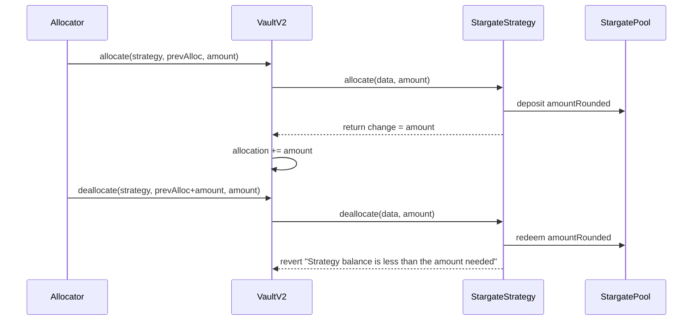

# 57526 sc medium stargateethpoolstrategy rounding mismatch freezes vaultv2 allocations

## #57526 \[SC-Medium] \`StargateEthPoolStrategy\` rounding mismatch freezes \`VaultV2\` allocations

**Submitted on Oct 26th 2025 at 23:57:13 UTC by @pxng0lin for** [**Audit Comp | Alchemix V3**](https://immunefi.com/audit-competition/alchemix-v3-audit-competition)

* **Report ID:** #57526
* **Report Type:** Smart Contract
* **Report severity:** Medium
* **Target:** <https://github.com/alchemix-finance/v3-poc/blob/immunefi\\_audit/src/strategies/optimism/StargateEthPoolStrategy.sol>
* **Impacts:**
  * Permanent freezing of funds

### Description

## Bug Description

`StargateEthPoolStrategy._allocate` floors deposits to `1e12` but returns the unfloored `amount`. `VaultV2` return value records more assets than the adapter actually deploys. On withdrawal, `StargateEthPoolStrategy._deallocate` cannot supply the overstated amount and reverts with `"Strategy balance is less than the amount needed"`, permanently freezing funds.

## Brief/Intro

As shown in the sequence flow, the allocator sends `amount` WETH through `VaultV2` into `StargateEthPoolStrategy`. The strategy unwraps, deposits only `amountRounded`, yet reports the full `amount` back to the vault. `VaultV2` records that figure as live capital, so when the allocator later requests the same `amount`, `_deallocate` can only pull `amountRounded` from Stargate and reverts, locking the position.

## Details

1. Allocator calls `VaultV2.allocate`. The vault transfers `amount` WETH to the adapter and invokes `IAdapter.allocate`.
2. `StargateEthPoolStrategy._allocate` unwraps WETH, computes `amountRounded = (amount / 1e12) * 1e12`, deposits only `amountRounded`, yet returns the original `amount`.
3. `VaultV2.allocate` adds `amount` to `caps[id].allocation`, so vault accounting now exceeds real assets.
4. Later the allocator calls `VaultV2.deallocate(..., amount)`. `StargateEthPoolStrategy._deallocate` redeems LP for `amountRounded`, wraps back to WETH, then checks that its balance covers `amount`; the check fails and the function reverts.
5. The vault never reduces the inflated allocation, the dust remains idle on the adapter, and no withdrawals can succeed.

## Sequence Diagram



## Impact

* Permanent freezing of user funds: recorded allocations can never be withdrawn once dust is present (critical impact).
* Ongoing insolvency risk: repeated allocations widen the gap between vault accounting and strategy assets.

## Risk Breakdown

* **Difficulty:** Low. Standard allocator operations trigger the bug.
* **Prerequisites:** Allocator privileges (normal vault role).
* **User action:** None; even honest deposits are vulnerable.

## Recommendation

Return `amountRounded` from `StargateEthPoolStrategy._allocate`.

## References

* `StargateEthPoolStrategy._allocate` @src/strategies/optimism/StargateEthPoolStrategy.sol#42-53
* `StargateEthPoolStrategy._deallocate` @src/strategies/optimism/StargateEthPoolStrategy.sol#55-81
* `VaultV2.allocate` and `VaultV2.deallocate` @lib/vault-v2/src/VaultV2.sol#564-608

### Proof of Concept

## Proof of Concept

* Add the test code to the existing `StargateEthPoolStrategy.t.sol` test file.
* run the test with `forge t --mt testStrategyAllocateDeallocate_VaultV2_reverts_permanent_freeze -vvvv` (higher verbosity to see the fails as `expectRevert()` has been used)
* The test allocates through the vault, leaves dust on the adapter, and shows `VaultV2.deallocate` reverting with `"Strategy balance is less than the amount needed"`.

### Test Code

```
 function testStrategyAllocateDeallocate_VaultV2_reverts_permanent_freeze(uint256 fuzzAmount) public {
        // Allocate via the real vault/allocator path with an amount that is not divisible by 1e12.
        uint256 amountToAllocate = bound(fuzzAmount, 1e12 + 1, testConfig.vaultInitialDeposit);
        uint256 dust = amountToAllocate - (amountToAllocate / 1e12) * 1e12;
        vm.assume(dust > 0);

        uint256 amountToDeposit = amountToAllocate - dust;
        bytes32 adapterId = IMYTStrategy(strategy).adapterId();
        uint256 previousAllocation = IVaultV2(vault).allocation(adapterId);

        vm.startPrank(allocator);
        console.log("allocator allocate", amountToAllocate);
        IVaultV2(vault).allocate(strategy, abi.encode(previousAllocation), amountToAllocate);
        vm.stopPrank();

        uint256 vaultRecordedAllocation = IVaultV2(vault).allocation(adapterId);
        assertEq(vaultRecordedAllocation, previousAllocation + amountToAllocate, "vault believes full amount allocated");

        uint256 initialRealAssets = IMYTStrategy(strategy).realAssets();
        assertEq(initialRealAssets, amountToDeposit, "realAssets should exclude dust");
        assertEq(address(strategy).balance, dust, "dust should remain as plain ETH");
        console.log("real assets tracked", initialRealAssets);
        console.log("dust remaining", dust);

        vm.startPrank(allocator);
        console.log("allocator deallocate", amountToAllocate);
        vm.expectRevert(bytes("Strategy balance is less than the amount needed"));
        IVaultV2(vault).deallocate(strategy, abi.encode(vaultRecordedAllocation), amountToAllocate);
        vm.stopPrank();
    }
```
