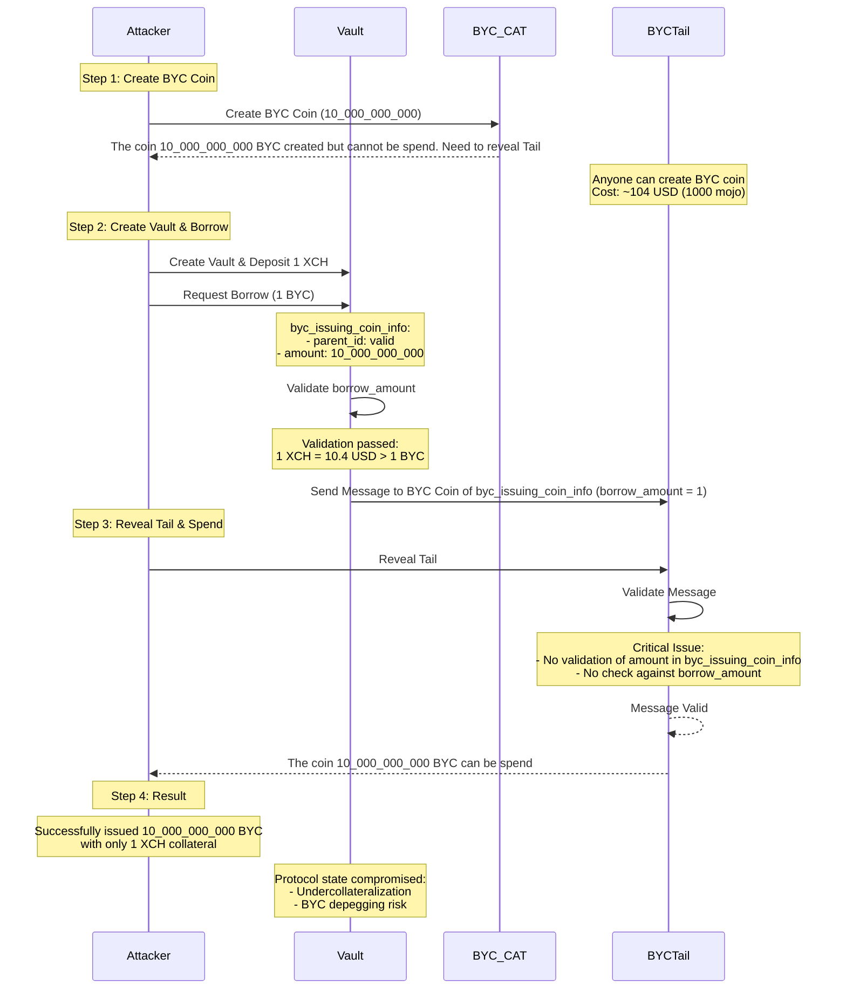

# #43705 \[SC-Critical] attackers can exploit lack of validation in byc coin issuance process to issue arbitrary amount of byc coin

## #43705 \[SC-Critical] Attackers can exploit Lack of Validation in BYC Coin Issuance Process to Issue arbitrary amount of BYC Coin

**Submitted on Apr 10th 2025 at 07:33:14 UTC by @perseverance for** [**IOP | CircuitDAO**](https://immunefi.com/audit-competition/iop-circuitdao)

* **Report ID:** #43705
* **Report Type:** Smart Contract
* **Report severity:** Critical
* **Target:** <https://github.com/immunefi-team/CircuitDAO-IoP/tree/main/circuit\\_puzzles>
* **Impacts:**
  * Protocol insolvency
  * Permanent significant depeg of stablecoin (BYC), e.g. by forcing undercollateralization

### Description

## Short summary

The BYC coin issuance process in the Circuit DAO protocol allows users to borrow BYC coins while providing collateral. However, there is a critical vulnerability in the validation process that could allow attackers to exploit Lack of Validation of `amount` in `byc_issuing_coin_info` BYC Coin Issuance Process to Issue arbitrary amount of BYC Coin. This attack can also depeg BYC because BYC will be under collaterized.

## Background Information

In the case of BYC Issuance, the `delta` is 0. (please note `delta` is `extra_delta` mentioned in docs: <https://chialisp.com/cats/> ).

This is correct according to the design and explanation of Circuit DAO team explanation.

```
anyone can create a new BYC coin on-chain by simply spending a standard XCH coin and giving it the puzzle hash of a BYC coin, but this coin is unspendable unless it's tail is revealed, which ensures that the spend is allowed. if it is, the child coin of the issuance coin is 'issued', i.e. it can now be spent via inner puzzle & solution only as its parent coin is now a CAT. The delta (called extra delta in the documentation) is 0 in case of an issuance because the issuance coin has the same amount as the issued coin.
```

The flow of code is as below:

1. So when a user want to borrow BYC, he create a Vault and deposit XCH into the Vault as Collateral. The puzzle will call the vault\_borrow with some input parameters.

Here we focus on 2 input parameters:

* borrow\_amount : The amount user want to borrow
* byc\_issuing\_coin\_info : as commented is the BYC issuing coin information : parent\_id amount inner\_puzzle\_hash . Please note that amount is the amount of BYC that was issued

<https://github.com/immunefi-team/CircuitDAO-IoP/blob/d2c3171f08864c29fdd436e25a39c95b371df860/circuit\\_puzzles/programs/vault\\_borrow.clsp#L1-L20>

```chialisp
;; Mint BYC to borrow and update the principal and other state variables accordingly
(mod
  (
    CAT_MOD_HASH BYC_TAIL_MOD_HASH RUN_TAIL_MOD_HASH
    (@ VAULT_STATE
      (
       COLLATERAL PRINCIPAL AUCTION_STATE INNER_PUZZLE_HASH
       STATUTES_STRUCT DISCOUNTED_PRINCIPAL statutes_puzzle_hash
      )
    )
    (@ args
      (
         borrow_amount ; amount of byc to be issued to borrower ; @audit borrow_amount 
         minimum_debt_amount liquidation_ratio price_info
         byc_issuing_coin_info  ; -> (parent_id amount inner_puzzle_hash) ; @audit amount is the amount of BYC that was issued
         statutes_cumulative_stability_fee_df
         current_stability_fee_df current_timestamp
      )
    )
  )
```

2. The Vault coin will verify the borrow\_amount that should be backed by enough collateral and the ratio is lower than the configured LTV (Loan to Value) ratio. After the verification done, the Vault will send the message to issue the BYC as below

<https://github.com/circuitdao/puzzles/blob/ad9df3df71048c96b7511fd1ec20b1b41c1b5b88/circuit\\_puzzles/programs/vault\\_borrow.clsp#L69-L75>

```chialisp
; signal to tail that it can issue BYC with certain amount
          (list SEND_MESSAGE 0x3f
            (concat PROTOCOL_PREFIX
              (sha256tree (c STATUTES_STRUCT (c "i" borrow_amount)))
            )
            byc_issuing_coin_id
          )
```

<https://github.com/circuitdao/puzzles/blob/ad9df3df71048c96b7511fd1ec20b1b41c1b5b88/circuit\\_puzzles/programs/vault\\_borrow.clsp#L48-L57>

```chialisp
    ; calculate the coin id for the new BYC coin by enforcing the tail hash
    byc_issuing_coin_id (calculate-byc-coin-id
      CAT_MOD_HASH
      byc_tail_hash
      (list
        (f byc_issuing_coin_info)
        (r byc_issuing_coin_info)
        RUN_TAIL_MOD_HASH
      )
    )
```

So the byc\_issuing\_coin\_id is important that only that BYC coin can receive the message. It is important to prevent unauthorized issuing of the BYC.

3. Now as commented above by the CircuitDAO team, the BYC can be issued by anyone. But to spend the BYC, he need to reveal the tail that means run the tail.

<https://github.com/immunefi-team/CircuitDAO-IoP/blob/d2c3171f08864c29fdd436e25a39c95b371df860/circuit\\_puzzles/byc\\_tail.clsp#L1-L20>

```chialisp
(mod (RUN_TAIL_MOD_HASH ; fixed
      STATUTES_STRUCT
      Truths
      parent_is_cat
      lineage_proof
      delta
      inner_conditions
      (@ solution
        (
          vault_parent_id
          vault_mod_hash
          vault_curried_args_hash
          vault_amount
          statutes_inner_puzzle_hash
          approval_mod_hashes
          current_coin_amount
          new_byc_coin_amount ; new amount of BYC coin being issued or melted from
        )
      )
     )
```

And in this tail coin, the message is received or consumed.

<https://github.com/immunefi-team/CircuitDAO-IoP/blob/d2c3171f08864c29fdd436e25a39c95b371df860/circuit\\_puzzles/byc\\_tail.clsp#L62-L73>

```chialisp
(list RECEIVE_MESSAGE 0x3f
            (concat
              PROTOCOL_PREFIX
              (sha256tree
                (c STATUTES_STRUCT ; need to tie it to statutes struct
                  (c (if (> 0 delta) "x" "i")
                    (if (> 0 delta) delta new_byc_coin_amount)
                  )
                )
              )
            )
            vault_coin_id
```

So if the Tail coin run succesfully, means spent, then the BYC can be sent to the user and he can own the BYC and use as a stable coin with value of 1 USD.

### The vulnerability

#### Vulnerability Details

I notice the vulnerability exists here is that the `amount` in `byc_issuing_coin_info` is not verified in the coin Vault\_borrow coin.

In the vault\_borrow, there is only verification against the `borrow_amount`.

In the `byc_tail.clsp`, the `amount` is also not verified against the `new_byc_coin_amount`.

So this bug enables the attacker to execute following attack in the POC section below.

## Severity assessment

Bug Severity: Critical

Impact category:

Protocol insolvency

Permanent significant depeg of stablecoin (BYC), e.g. by forcing undercollateralization

Because the attacker can issue arbitrary amount of BYC .

Likelihood: High

* No special privileges required
* it is profittable so the likelyhood is high

### Proof of Concept

## Proof of concept

As explained in the report above.

Step 1: For example, using XCH to issue 10\_000\_000\_000 BYC. This number 10\_000\_000\_000 can be any number.

According to the comment from Circuit DAO team, this can be done by anyone.

```
1 CAT is 1000 mojo so it is cheap to do this, because  1 BYC later can be exchanged for 1 USD. 
The value of 1000 mojo is `10 USD / 10^9` with the price of XCH is 10.4 USD (https://www.spacescan.io/). 
So to mint 10_000_000_000 cost about 104 USD.
```

Step 2: Attacker create a Vault and deposit 1 XCH and borrow 1 BYC. This is valid because 1 XCH is 10.4 USD and he borrow only 1 BYC.

The attacker input the `byc_issuing_coin_info` with valid parent\_id

```

borrow_amount = 1 
byc_issuing_coin_info ; @note amount =  10_000_000_000  

```

So the `vault_borrow` will send the message of with borrow\_amount of 1 to the BYC coin.

Step 3: The attacker reveal the tail and send the BYC to his address

In the `byc_tail` the check for message will pass.

So the whole process will run succesfully.

The below mermaid and attached sequence diagram (generated from mermaid) helps to illustrate this bug.


