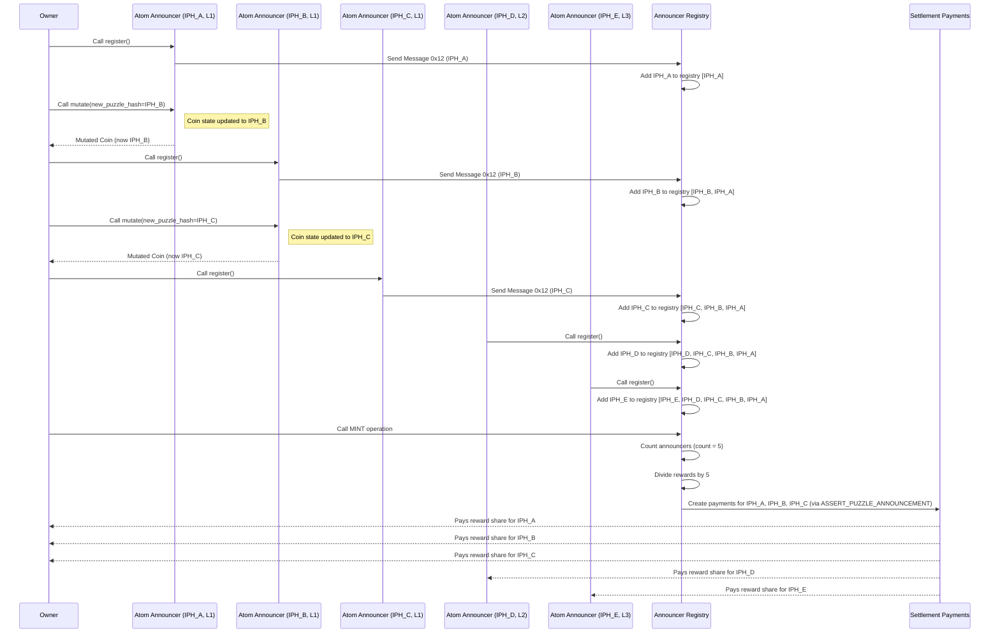

# #44355 \[SC-High] announcer owner can inflate announcers registry entries via mutate and register loop to claim most of rewards

## #44355 \[SC-High] Announcer Owner Can Inflate Announcers Registry Entries via Mutate and Register Loop to Claim Most of Rewards

**Submitted on Apr 22nd 2025 at 07:02:34 UTC by @perseverance for** [**IOP | CircuitDAO**](https://immunefi.com/audit-competition/iop-circuitdao)

* **Report ID:** #44355
* **Report Type:** Smart Contract
* **Report severity:** High
* **Target:** <https://github.com/immunefi-team/CircuitDAO-IoP/tree/main/circuit\\_puzzles>
* **Impacts:**
  * Theft of unclaimed yield

### Description

## Short Summary

The announcer owner can repeatedly use the `announcer_mutate` operation to change their `atom_announcer` coin's `INNER_PUZZLE_HASH` and then re-register the announcer using the `announcer_register` operation with the new hash in the `announcer_registry`. Because the registry uses the mutable `inner_puzzle_hash` as the unique identifier instead of the immutable `LAUNCHER_ID`, the owner can create multiple distinct entries in the registry, all ultimately controlled by them. This inflates the apparent number of unique announcers, causing the reward distribution mechanism (`MINT` operation in the registry) to allocate them a disproportionately large share of the CRT rewards, effectively draining rewards intended for other legitimate participants.

## Background Information

The `announcer_registry.clsp` puzzle serves as a central registry tracking active and approved Announcers within the Circuit DAO protocol. One of its key functions, triggered by the `MINT` operation, is to facilitate the distribution of CRT (Circuit DAO Token) rewards to registered announcers. The intended mechanism involves calculating the total rewards for an interval (`crt_credits_per_interval`) and dividing this amount proportionally among the currently registered announcers based on the count of entries in the `ANNOUNCER_REGISTRY` list. This aims to fairly compensate active participants.

Reference: <https://docs.circuitdao.com/technical-manual/announcer-registry#mint> and <https://github.com/immunefi-team/CircuitDAO-IoP/blob/d2c3171f08864c29fdd436e25a39c95b371df860/circuit\\_puzzles/announcer\\_registry.clsp#L102-L121>

## The Vulnerability and Vulnerability Details

The vulnerability stems from the interaction between three components: `announcer_mutate.clsp`, `announcer_register.clsp`, and `announcer_registry.clsp`.

1. **Mutable Identifier in Registry:** The `announcer_registry.clsp` uses the `announcer_inner_puzzle_hash` provided in the `RECEIVE_MESSAGE 0x12` from `announcer_register` as the unique key to identify and register an announcer. It checks if this specific hash already `contains` in the `ANNOUNCER_REGISTRY` list before adding it.

   <https://github.com/immunefi-team/CircuitDAO-IoP/blob/d2c3171f08864c29fdd436e25a39c95b371df860/circuit\\_puzzles/announcer\\_registry.clsp#L133-L134>

```chialisp
(assert
            (not (contains ANNOUNCER_REGISTRY announcer_inner_puzzle_hash))
```

2. **Owner Can Mutate "Inner Puzzle Hash":** The `announcer_mutate.clsp` puzzle explicitly allows the owner (who can provide the current `inner_puzzle_hash`) to change the `INNER_PUZZLE_HASH` of their `atom_announcer` coin to a `new_puzzle_hash`. This is a legitimate operation for transferring ownership or updating control logic.

<https://github.com/immunefi-team/CircuitDAO-IoP/blob/d2c3171f08864c29fdd436e25a39c95b371df860/circuit\\_puzzles/programs/announcer\\_mutate.clsp#L34-L40>

```chialisp
(list CREATE_COIN
            (curry_hashes MOD_HASH
              (sha256 ONE MOD_HASH)
              (sha256tree STATUTES_STRUCT)
              (sha256 ONE LAUNCHER_ID)
              (sha256 ONE (if new_puzzle_hash new_puzzle_hash INNER_PUZZLE_HASH))
              (sha256 ONE APPROVED)
```

3. **Mutation Doesn't Affect Registry:** The `announcer_mutate` operation only affects the state of the `atom_announcer` coin itself. It does *not* communicate with the `announcer_registry` to inform it about the change in the `inner_puzzle_hash` or to de-register the old hash.

## Exploitation

This allows a malicious owner to perform the following loop:

```
Step 1:   Register with `inner_puzzle_hash_A`. Registry contains `inner_puzzle_hash_A`.

Step 2:   Use `announcer_mutate` to change the announcer coin's hash to `inner_puzzle_hash_B`.

Step 3: Register again using the mutated coin (now controlled by hash `inner_puzzle_hash_B`). The registry checks for B (not found) and adds it. Registry contains `(B A)`.

Step 4:    Use `announcer_mutate` to change the announcer coin's hash to `inner_puzzle_hash_C`.

Step 5:   Register again using the mutated coin (now controlled by hash C). The registry checks for C (not found) and adds it. Registry contains `(inner_puzzle_hash_C inner_puzzle_hash_B inner_puzzle_hash_A)`.

...and so on.
```

**Reward Distribution Impact:**

When the `MINT` operation runs on the `announcer_registry`, it calculates `announcers_count` by counting the number of entries in `ANNOUNCER_REGISTRY`.

Supposed the total of announcers is 3. T

The total reward `crt_credits_per_interval` is divided by this count. The `generate-offer-assert` function then creates payment conditions for *each* entry (A, B, and C). Since the owner controls all these inner puzzle hashes, they effectively receive 3 shares of the reward pool instead of the intended 1 share.

Normal operation: Reward for the announcer should be : `crt_credits_per_interval /3`

After the hack: Reward for the announcer is: `crt_credits_per_interval * 3 / 5` that is `60/33.3` = `1.8` times bigger

<https://github.com/immunefi-team/CircuitDAO-IoP/blob/d2c3171f08864c29fdd436e25a39c95b371df860/circuit\\_puzzles/announcer\\_registry.clsp#L102-L121>

```chialisp
(sha256tree
                    (c
                      my_coin_id ; nonce
                      (generate-offer-assert
                        ANNOUNCER_REGISTRY
                        (/ crt_credits_per_interval announcers_count)
                        (if (> change_amount 0)
                          ; we reward the mint spender with remainder if any
                          (list
                            (list
                              change_receiver_hash
                              change_amount
                              (list change_receiver_hash)
                            )
                          )
                          ()
                        )
                      )
                    )
                  )
```

This fundamentally breaks the reward distribution fairness, allowing a single announcer owner to drain rewards intended for the broader set of unique participants.

## Severity assessment

* **Bug Severity:** **High**
* **Impact category:**
  * Theft of unclaimed yield
  * Unfair reward distribution.
  * Theft/Drain of rewards intended for other participants.
* **Likelihood:** **High**
  * The attack requires only standard owner operations (`announcer_mutate`, `announcer_register`).
  * There is a clear financial incentive for an owner to perform this attack.

### Proof of Concept

## Proof of concept (Conceptual Steps):

1. **Initial State:** Owner controls `AtomAnnouncer_A` (Launcher ID: `L1`, Inner Puzzle Hash: `IPH_A`). `ANNOUNCER_REGISTRY` state is empty.
2. **Register A:** Owner calls `register` on `AtomAnnouncer_A`. Registry receives message with `IPH_A`, checks `(not (contains reg IPH_A))` (true), adds `IPH_A`. ANNOUNCER\_REGISTRY state: `(IPH_A)`.
3. **Mutate A to B:** Owner calls `mutate` on `AtomAnnouncer_A`, providing `new_puzzle_hash = IPH_B`. A new coin `AtomAnnouncer_B` is created (Launcher ID: `L1`, Inner Puzzle Hash: `IPH_B`). ANNOUNCER\_REGISTRY state remains `(IPH_A)`.
4. **Register B:** Owner calls `register` on `AtomAnnouncer_B`. Registry receives message with `IPH_B`, checks `(not (contains reg IPH_B))` (true), adds `IPH_B`. Registry state: `(IPH_B IPH_A)`.
5. **Mutate B to C:** Owner calls `mutate` on `AtomAnnouncer_B`, providing `new_puzzle_hash = IPH_C`. A new coin `AtomAnnouncer_C` is created (Launcher ID: `L1`, Inner Puzzle Hash: `IPH_C`). ANNOUNCER\_REGISTRY state remains `(IPH_B IPH_A)`.
6. **Register C:** Owner calls `register` on `AtomAnnouncer_C`. Registry receives message with `IPH_C`, checks `(not (contains reg IPH_C))` (true), adds `IPH_C`. ANNOUNCER\_REGISTRY state: `(IPH_C IPH_B IPH_A)`.
7. Another announcer `register` with `IPH_D` . ANNOUNCER\_REGISTRY state: `(IPH_D IPH_C IPH_B IPH_A)`.
8. Another announcer `register` with `IPH_E` . ANNOUNCER\_REGISTRY state: `(IPH_E IPH_D IPH_C IPH_B IPH_A)`.
9. **Claim Rewards (MINT):** `MINT` operation triggers on `AnnouncerRegistry`.
   * `announcers_count` is calculated as 5.
   * Total rewards `R` are divided by 3 (`R/5`).
   * `generate-offer-assert` creates payments of `R/5` for `IPH_A`, `IPH_B`, and `IPH_C`.
   * Owner, controlling all three puzzle hashes, claims `3 * (R/5)` = `60% R` total rewards, instead of the intended `R / (number of *unique* announcers).`

**Mermaid Sequence Diagram:** or attached png below illustrates the attack sequence.


