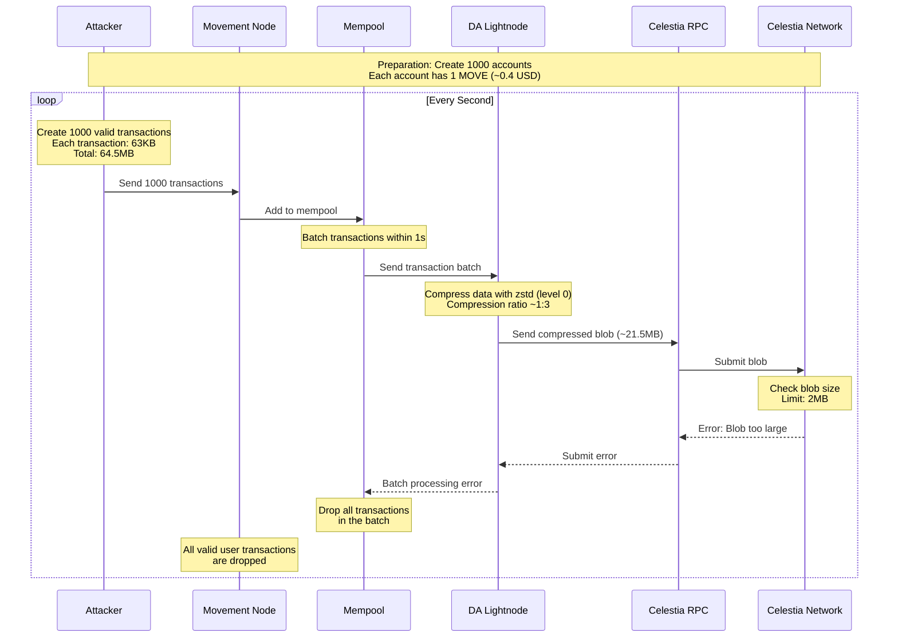

# #43114 \[BC-Critical] attackers can cause total shutdown network by exploiting missing of blob size check in da lightnode

## #43114 \[BC-Critical] Attackers can cause total shutdown network by exploiting missing of blob size check in DA Lightnode

**Submitted on Apr 2nd 2025 at 10:14:19 UTC by @perseverance for** [**Attackathon | Movement Labs**](https://immunefi.com/audit-competition/movement-labs-attackathon)

* **Report ID:** #43114
* **Report Type:** Blockchain/DLT
* **Report severity:** Critical
* **Target:** <https://github.com/immunefi-team/attackathon-movement/tree/main/protocol-units/da/movement/>
* **Impacts:**
  * Network not being able to confirm new transactions (total network shutdown)

### Description

## Short summary

Attackers can cause total shutdown network by exploiting missing of blob size check in DA Lightnode.\
The Blob Size Limit of Celestia is having a hard cap of 2 Mb. If submit blob size is greater than 2 Mb, then blobs are rejected.\
DA Lightnode does not check the size of Blob when submit to Celestia RPC Client. So when the Blob is rejected, then all the transactions of users are not executed, just causing total network shutdown.\
Since the attacker's transactions are not executed as well, so there is no cost for the attackers. Just the small cost of sending the spam transactions, thus make the attack threat is really high.

### Background Information

The transactions passed validation from the mempool ==> included in the mempool ==> submit (or batch\_write) to DA Lightnode

Step 1: Transactions from users are sent to Sender of a Multi Producer Single Consumer Channel.

Step 2: Transactions are read from Receiver of a Multi Producer Single Consumer Channel. This is FIFO Channel. (Ref: <https://doc.rust-lang.org/std/sync/mpsc/index.html>)

Step 3: Transactions is pushed to transactions vector

Step 4: Call da\_light\_node\_client.batch\_write to batch\_write the transactions to the DA Lightnode

**So notice that when transactions are read from Receiver, it is removed from the FIFO Channel.**

<https://github.com/immunefi-team/attackathon-movement/blob/a2790c6ac17b7cf02a69aea172c2b38d2be8ce00/networks/movement/movement-full-node/src/node/tasks/transaction\\_ingress.rs#L38-L129>

```rust
/// Constructs a batch of transactions then spawns the write request to the DA in the background.
	async fn spawn_write_next_transaction_batch(
		&mut self,
	) -> Result<ControlFlow<(), ()>, anyhow::Error> {
		use ControlFlow::{Break, Continue};

		// limit the total time batching transactions
		let start = Instant::now();
		let (_, half_building_time) = self.da_light_node_config.block_building_parameters();

		let mut transactions = Vec::new();

		let batch_id = LOGGING_UID.fetch_add(1, std::sync::atomic::Ordering::SeqCst);
		loop {
			let remaining = match half_building_time.checked_sub(start.elapsed().as_millis() as u64)
			{
				Some(remaining) => remaining,
				None => {
					// we have exceeded the half building time
					break;
				}
			};

			match tokio::time::timeout(
				Duration::from_millis(remaining),
				self.transaction_receiver.recv(), // @audit <--- step 2: transactions are read from Receiver of a Multi Producer Single Consumer Channel. This is FIFO Channel. 
			)
			.await
			{
				Ok(transaction) => match transaction {
					Some((application_priority, transaction)) => {
						info!(
							target : "movement_timing",
							batch_id = %batch_id,
							tx_hash = %transaction.committed_hash(),
							sender = %transaction.sender(),
							sequence_number = transaction.sequence_number(),
							"received transaction",
						);
						let serialized_aptos_transaction = bcs::to_bytes(&transaction)?;
						let movement_transaction = movement_types::transaction::Transaction::new(
							serialized_aptos_transaction,
							application_priority,
							transaction.sequence_number(),
						);
						let serialized_transaction = serde_json::to_vec(&movement_transaction)?;
						transactions.push(BlobWrite { data: serialized_transaction }); // @audit  <--- Step 2: Transactions is pushed to transactions vector 
					}
					None => {
						// The transaction stream is closed, terminate the task.
						return Ok(Break(()));
					}
				},
				Err(_) => {
					break;
				}
			}
		}

		if transactions.len() > 0 {
			info!(
				target: "movement_timing",
				batch_id = %batch_id,
				transaction_count = transactions.len(),
				"built_batch_write"
			);
			let batch_write = BatchWriteRequest { blobs: transactions };
			let mut buf = Vec::new();
			batch_write.encode_raw(&mut buf);
			info!("batch_write size: {}", buf.len());
			// spawn the actual batch write request in the background
			let mut da_light_node_client = self.da_light_node_client.clone();
			tokio::spawn(async move {
				match da_light_node_client.batch_write(batch_write.clone()).await { // @audit <-- Step 4: Call da_light_node_client.batch_write to batch_write the transactions to the DA Lightnode 
					Ok(_) => {
						info!(
							target: "movement_timing",
							batch_id = %batch_id,
							"batch_write_success"
						);
						return;
					}
					Err(e) => {
						warn!("failed to write batch to DA: {:?} {:?}", e, batch_id);
					}
				}
			});
		}

		Ok(Continue(()))
	}
}
```

Notice that the loop in `spawn_write_next_transaction_batch` is batching all transactions in time of `block_building_parameters`. This parameter is configurable and the default value is 1000 ms that is 1 second.

<https://github.com/immunefi-team/attackathon-movement/blob/a2790c6ac17b7cf02a69aea172c2b38d2be8ce00/protocol-units/sequencing/memseq/util/src/lib.rs#L22>

```rust
/// The configuration for the MemSeq sequencer
#[derive(Debug, Clone, Serialize, Deserialize, PartialEq, Eq)]
pub struct Config {
	/// The chain id of the sequencer
	#[serde(default = "Config::default_sequencer_chain_id")]
	pub sequencer_chain_id: Option<String>,

	/// The path to the sequencer database
	#[serde(default = "Config::default_sequencer_database_path")]
	pub sequencer_database_path: Option<String>,

	/// The memseq build time for the block
	#[serde(default = "default_memseq_build_time")]
	pub memseq_build_time: u64,

	/// The memseq max block size
	#[serde(default = "default_memseq_max_block_size")]
	pub memseq_max_block_size: u32,
}

env_default!(default_memseq_build_time, "MEMSEQ_BUILD_TIME", u64, 1000); // @audit default memseq build time  = 1000 ms = 1 second 

env_default!(default_memseq_max_block_size, "MEMSEQ_MAX_BLOCK_SIZE", u32, 2048); // @audit default max block size is 2048 

impl Default for Config {
	fn default() -> Self {
		Config {
			sequencer_chain_id: Config::default_sequencer_chain_id(),
			sequencer_database_path: Config::default_sequencer_database_path(),
			memseq_build_time: default_memseq_build_time(),
			memseq_max_block_size: default_memseq_max_block_size(),
		}
	}
}

```

So the DA Lightnode now can work in 2 modes: blocky or sequencer mode:

<https://github.com/immunefi-team/attackathon-movement/blob/a2790c6ac17b7cf02a69aea172c2b38d2be8ce00/protocol-units/da/movement/protocol/light-node/README.md#L1-L6>

#### Blocky Mode of DA Lightnode

If the DA Lightnode works in `Blocky` mode, then block of transactions received from mempool are signed to create Blob data and send to Celestia.

The code to send the blob to Celestia is here:

<https://github.com/immunefi-team/attackathon-movement/blob/a2790c6ac17b7cf02a69aea172c2b38d2be8ce00/protocol-units/da/movement/protocol/light-node/src/passthrough.rs#L229-L248>

```rust
/// Batch write blobs.
	async fn batch_write(
		&self,
		request: tonic::Request<BatchWriteRequest>,
	) -> std::result::Result<tonic::Response<BatchWriteResponse>, tonic::Status> {
		let blobs = request.into_inner().blobs;
		for data in blobs {
			let blob = InnerSignedBlobV1Data::now(data.data)
				.try_to_sign(&self.signer)
				.await
				.map_err(|e| tonic::Status::internal(format!("Failed to sign blob: {}", e)))?;
			self.da
				.submit_blob(blob.into()) // @audit call da.submit_blob to submit Blob to Celestia. 
				.await
				.map_err(|e| tonic::Status::internal(e.to_string()))?;
		}

		// * We are currently not returning any blobs in the response.
		Ok(tonic::Response::new(BatchWriteResponse { blobs: vec![] }))
	}
```

Since the DA Lightnode is sending to Celestia, it is using Celestia RPC Client

<https://github.com/immunefi-team/attackathon-movement/blob/a2790c6ac17b7cf02a69aea172c2b38d2be8ce00/protocol-units/da/movement/providers/celestia/src/da/mod.rs#L59-L80>

```rust
fn submit_blob(
		&self,
		data: DaBlob<C>,
	) -> Pin<Box<dyn Future<Output = Result<(), DaError>> + Send + '_>> {
		Box::pin(async move {
			debug!("submitting blob to celestia {:?}", data);

			// create the blob
			let celestia_blob = self
				.create_new_celestia_blob(data)
				.map_err(|e| DaError::Internal(format!("failed to create celestia blob :{e}")))?;

			debug!("created celestia blob {:?}", celestia_blob);

			// submit the blob to the celestia node
			self.submit_celestia_blob(celestia_blob)  // @audit call submit_celestia_blob 
				.await
				.map_err(|e| DaError::Internal(format!("failed to submit celestia blob :{e}")))?;

			Ok(())
		})
	}
```

<https://github.com/immunefi-team/attackathon-movement/blob/a2790c6ac17b7cf02a69aea172c2b38d2be8ce00/protocol-units/da/movement/providers/celestia/src/da/mod.rs#L42-L52>

```rust
/// Submits a CelestiaBlob to the Celestia node.
	pub async fn submit_celestia_blob(&self, blob: CelestiaBlob) -> Result<u64, anyhow::Error> {
		let config = TxConfig::default();
		// config.with_gas(2);
		let height = self.default_client.blob_submit(&[blob], config).await.map_err(|e| { // @audit call default_client.blob_submit to submit Blob 
			error!(error = %e, "failed to submit the blob");
			anyhow::anyhow!("Failed submitting the blob: {}", e)
		})?;

		Ok(height)
	}
```

Notice that there is no check or ways to control the size of blob before calling `blob_submit`.\
If the function `blob_submit` return error, then the error is returned back, but there is no mechanism to retry or rebuild the block.

#### Celestia Hard Cap Block Size to 2 MB

<https://docs.celestia.org/how-to-guides/mainnet#transaction-size-limit>

As specified in CIP-28, there is a 2 MiB (2,097,152 bytes) limit on individual transaction size. This limit was implemented to maintain network stability and provide clear expectations for users and developers, even as block sizes may be larger.

So if the Blob Data exceed the limit, the transaction will be rejected.

This is done in the code of Celestia

<https://github.com/celestiaorg/celestia-node/blob/e9026800ed67859deb0a4f31e832a4586bee1d45/blob/blob.go#L93-L95>

```go
func NewBlob(shareVersion uint8, namespace share.Namespace, data []byte) (*Blob, error) {
	if len(data) == 0 || len(data) > appconsts.DefaultMaxBytes {
		return nil, fmt.Errorf("blob data must be > 0 && <= %d, but it was %d bytes", appconsts.DefaultMaxBytes, len(data))
	}
```

The current default RPC that Movement using is Lumina RPC

<https://github.com/immunefi-team/attackathon-movement/blob/a2790c6ac17b7cf02a69aea172c2b38d2be8ce00/Cargo.toml#L231>

```toml
celestia-rpc = { git = "https://github.com/eigerco/lumina", rev = "c6e5b7f5e3a3040bce4262fe5fba5c21a2637b5" }   #{ version = "0.7.0" }
```

I checked the code and found that there is one test case also confirm this. So if the blob size is bigger than size limit, the function `default_client.blob_submit` will return error.

<https://github.com/eigerco/lumina/blob/main/rpc/tests/blob.rs#L162-L170>

```rust
#[tokio::test]
async fn blob_submit_too_large() {
    let client = new_test_client(AuthLevel::Write).await.unwrap();
    let namespace = random_ns();
    let data = random_bytes(5 * 1024 * 1024);
    let blob = Blob::new(namespace, data, AppVersion::V2).unwrap();

    blob_submit(&client, &[blob]).await.unwrap_err();
}

```

### Sequencer Mode of DA Lightnode

If the DA Lightnode works in "Sequencer" mode, then it is more complicated, but the same issue that blob size is not controlled.

Blob Data is received from Mempool and then write to RockDB Mempool.

Then the transactions are pop from RockDB Mempool to build block. This is happening during the `tick`.

In the Sequencer, the transactions in a block are limited to `block_size` that can be configured. The default value is default max block size is 2048 as noticed above.

<https://github.com/immunefi-team/attackathon-movement/blob/a2790c6ac17b7cf02a69aea172c2b38d2be8ce00/protocol-units/sequencing/memseq/sequencer/src/lib.rs#L101-L131>

```rust
/// Waits for the next block to be built, either when the block size is reached or the building time expires.
	async fn wait_for_next_block(&self) -> Result<Option<Block>, anyhow::Error> {
		let mut transactions = Vec::with_capacity(self.block_size as usize);

		let now = Instant::now();

		loop {
			let current_block_size = transactions.len() as u32;
			if current_block_size >= self.block_size {
				break;
			}

			let remaining = self.block_size - current_block_size;
			let mut transactions_to_add = self.mempool.pop_transactions(remaining as usize).await?; // @audit pop_transactions remove transactions from RockDB mempool 
			transactions.append(&mut transactions_to_add);

			// sleep to yield to other tasks and wait for more transactions
			tokio::task::yield_now().await;

			if now.elapsed().as_millis() as u64 > self.building_time_ms {
				break;
			}
		}

		if transactions.is_empty() {
			Ok(None)
		} else {
			let new_block =
				self.build_next_block(block::BlockMetadata::default(), transactions).await?;
			Ok(Some(new_block))
		}
	}

```

Then the block is sent to "Sender" of Multi Producer Single Receiver Channel.

<https://github.com/immunefi-team/attackathon-movement/blob/a2790c6ac17b7cf02a69aea172c2b38d2be8ce00/protocol-units/da/movement/protocol/light-node/src/sequencer.rs#L142-L162>

```rust
async fn tick_build_blocks(&self, sender: Sender<Block>) -> Result<(), anyhow::Error> {
		let memseq = self.memseq.clone();

		// this has an internal timeout based on its building time
		// so in the worst case scenario we will roughly double the internal timeout
		let uid = LOGGING_UID.fetch_add(1, std::sync::atomic::Ordering::SeqCst);
		debug!(target: "movement_timing", uid = %uid, "waiting_for_next_block",);
		let block = memseq.wait_for_next_block().await?;
		match block {
			Some(block) => {
				info!(target: "movement_timing", block_id = %block.id(), uid = %uid, transaction_count = block.transactions().len(), "received_block");
				sender.send(block).await?; // @audit send Block built to Sender 
				Ok(())
			}
			None => {
				// no transactions to include
				debug!(target: "movement_timing", uid = %uid, "no_transactions_to_include");
				Ok(())
			}
		}
	}
```

Then the block will be sent to Celestia through the same code as Passthrough.rs that I analyzed above.

<https://github.com/immunefi-team/attackathon-movement/blob/a2790c6ac17b7cf02a69aea172c2b38d2be8ce00/protocol-units/da/movement/protocol/light-node/src/sequencer.rs#L219-L241>

```rust
/// Ticks the block proposer to build blocks and submit them
	async fn tick_publish_blobs(
		&self,
		receiver: &mut Receiver<Block>,
	) -> Result<(), anyhow::Error> {
		// get some blocks in a batch
		let blocks = self.read_blocks(receiver).await?; // @audit Read from Receiver MPSC channel 
		if blocks.is_empty() {
			return Ok(());
		}

		// submit the blobs, resizing as needed
		let ids = blocks.iter().map(|b| b.id()).collect::<Vec<_>>();
		for block_id in &ids {
			info!(target: "movement_timing", %block_id, "submitting_block_batch");
		}
		self.submit_blocks(blocks).await?; // @audit call submit_blocks 
		for block_id in &ids {
			info!(target: "movement_timing", %block_id, "submitted_block_batch");
		}

		Ok(())
	}
```

<https://github.com/immunefi-team/attackathon-movement/blob/a2790c6ac17b7cf02a69aea172c2b38d2be8ce00/protocol-units/da/movement/protocol/light-node/src/sequencer.rs#L164-L173>

```rust
/// Submits blocks to the pass through.
	async fn submit_blocks(&self, blocks: Vec<Block>) -> Result<(), anyhow::Error> {
		for block in blocks {
			let data: InnerSignedBlobV1Data<C> = block.try_into()?;
			let blob = data.try_to_sign(&self.pass_through.signer).await?;
			self.pass_through.da.submit_blob(blob.into()).await?;
		}

		Ok(())
	}
```

To summarize, the users transactions are batched into a blob during `block_building_parameters` in Blocky mode of DA Lightnode.\
In `Sequencer` mode of DA Lightnode, the transactions in a block are also limited to `block_size` that can be configured. The building time of block is also limited to `block_building_parameters`. The default value is default max block size is 2048 as noticed above.

The bug is there is no mechanism to control the size of a blob. So if the blob size exceeds the size limit of Celestia Transaction size, then all user transactions in block are lost, not executed.

## Attack Scenario

The transaction size limit of Movement now is 64 Kb per transactions. This is hard coded in the code as below.

<https://github.com/immunefi-team/attackathon-movement-aptos-core/blob/627b4f9e0b63c33746fa5dae6cd672cbee3d8631/aptos-move/aptos-gas-schedule/src/gas\\_schedule/transaction.rs#L69-L73>

```rust
  [
            max_transaction_size_in_bytes: NumBytes,
            "max_transaction_size_in_bytes",
            64 * 1024
        ],
```

So an attacker can create 1000 valid transactions with the maximum size possible.

For example, an attacker can create 1000 accounts. Each account submit a transaction to deploy a big smart contract.\
Each transaction is 63 Kbytes.

So the total size of all transactions would be: `63 * 1024 * 1000 = 64_512_000`

Notice that now the movement allow one user to create maximum 32 transactions (= Sequence tolerance), so it would be easier for the attacker. He just need to create 32 accounts. But this is optional as this is not needed for this attack.

To bypass rate limit, the attacker can submit the transactions from different machines, IPs, ...

Since this is valid transactions, the movement node should accept these transactions.

All 1000 transactions in 1 seconds will be batched into the mempool and into a single blob.

#### The blob compress before sending and compress ratio

Actually before sending to Celestia, the blob data is compressed using zstd library.

<https://github.com/immunefi-team/attackathon-movement/blob/a2790c6ac17b7cf02a69aea172c2b38d2be8ce00/protocol-units/da/movement/providers/celestia/src/blob/ir.rs#L26-L49>

```rust
/// Tries to form a CelestiaBlob from a CelestiaDaBlob
impl<C> TryFrom<CelestiaDaBlob<C>> for CelestiaBlob
where
	C: Curve + Serialize,
{
	type Error = anyhow::Error;

	fn try_from(da_blob: CelestiaDaBlob<C>) -> Result<Self, Self::Error> {
		// Extract the inner blob and namespace
		let CelestiaDaBlob(da_blob, namespace) = da_blob;

		// Serialize the inner blob with bcs
		let serialized_blob = bcs::to_bytes(&da_blob).context("failed to serialize blob")?;

		// Compress the serialized data with zstd
		let compressed_blob =
			zstd::encode_all(serialized_blob.as_slice(), 0).context("failed to compress blob")?; // @audit using encode_all to compress the data with level 0 

		// Construct the final CelestiaBlob by assigning the compressed data
		// and associating it with the provided namespace
		Ok(CelestiaBlob::new(namespace, compressed_blob, AppVersion::V2)
			.map_err(|e| anyhow::anyhow!(e))?)
	}
}
```

The Library is zstd, in this case is: <https://github.com/gyscos/zstd-rs>

<https://github.com/immunefi-team/attackathon-movement/blob/a2790c6ac17b7cf02a69aea172c2b38d2be8ce00/Cargo.toml#L345>

```toml
zstd = "0.13"
```

The compress level is 0 that is default level of 3.

<https://github.com/gyscos/zstd-rs/blob/229054099aa73f7e861762f687d7e07cac1d9b3b/src/stream/functions.rs#L27-L36>

```rust
/// Compress all data from the given source as if using an `Encoder`.
///
/// Result will be in the zstd frame format.
///
/// A level of `0` uses zstd's default (currently `3`). // @audit level 0 means default level of 3 
pub fn encode_all<R: io::Read>(source: R, level: i32) -> io::Result<Vec<u8>> {
   
}

```

I researched about the compress level and found that with level 3 the output size is 2.5 to 3.5 smaller than input size.

For example: <https://github.com/klauspost/compress/blob/master/zstd/README.md>

Or I run the benchmark.rs (<https://github.com/gyscos/zstd-rs/blob/main/examples/benchmark.rs>) and give me result the compress ratio is that the output size about 3 times smaller than input

```
Compression level       Input size      Output size     Compression ratio       

3       				211.94 MB       66.48 MB        3.188   				
```

So with the compress ratio of about 3 times. The actual compress ratio depends on the data. Let's assume the compress ratio is 4 times

With the size of above input `64_512_000` would result in more than 16\_128\_000 that is still much bigger than 2 MB cap.

**So if the attacker send this transactions for every block, then all valid user transactions are not executed and dropped.**\
Since the attackers' transactions are dropped also, so no cost for him to execute the attack.\
There is only a small cost to send the requests and some money to prepare all 1000 accounts for the attack.

The capital needed: 1000 \* 1 MOVE = 1000 \* 0.4 = 400 USD (Price: <https://coinmarketcap.com/currencies/movement/>)

1 MOVE is more than enough to pay gas for a big smart contract deployment. The actual cost probably is lower.

### Severity Assessment

Bug Severity: Critical

Impact:

Network not being able to confirm new transactions (total network shutdown)

**Likelihood:**

* High as No special privileges required
* Can be executed by any attacker with very cheap cost of attack.
* The cost of an attack is 0
* The capital is < 400 USD

### Recommendation

Implement mechanism to control blob size that after compress should have size less then Celestia Blob Size limit of 2 MB.

### Proof of Concept

## Proof of concept

The following attack scenario demonstrate the bug.

Preparation: An attacker can create 1000 accounts. Each account has 1 MOVE.

Step 1: So an attacker can create 1000 valid transactions with the maximum size possible and send in every seconds.

Each account submit a transaction to deploy a big smart contract.\
Each transaction is 63 Kbytes.

So the total size of all transactions would be: `63 * 1024 * 1000 = 64_512_000`

To bypass rate limit, the attacker can submit the transactions from different machines, IPs, ...

Since this is valid transactions, the movement node should accept these transactions.

All 1000 transactions in 1 seconds will be batched into the mempool and into a single blob.

Expected output: All user transactions including attacker transactions are dropped.

The attached image or sequence diagram below illustrates the attack


