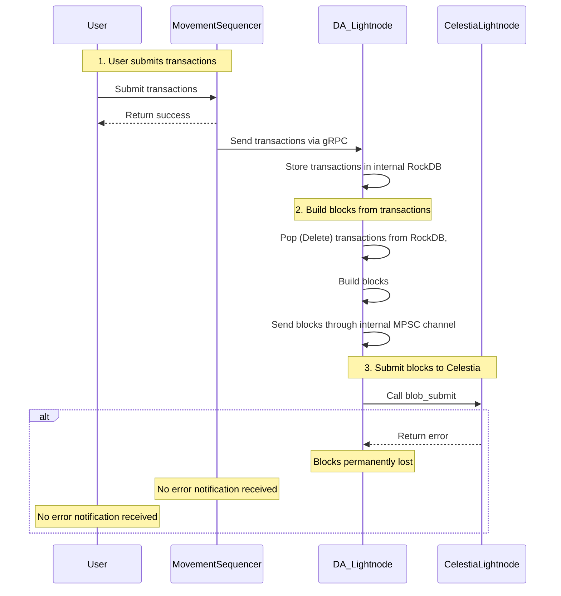

# #43255 \[BC-Medium] user transactions might be lost due to missing error handling in celestia rpc client requests blob submit failure&#x20;

## #43255 \[BC-Medium] User Transactions might be lost due to missing Error Handling in Celestia RPC Client Requests \`blob\_submit\` failure

**Submitted on Apr 4th 2025 at 04:03:41 UTC by @perseverance for** [**Attackathon | Movement Labs**](https://immunefi.com/audit-competition/movement-labs-attackathon)

* **Report ID:** #43255
* **Report Type:** Blockchain/DLT
* **Report severity:** Medium
* **Target:** <https://github.com/immunefi-team/attackathon-movement/tree/main/protocol-units/da/movement/>
* **Impacts:**
  * Causing network processing nodes to process transactions from the mempool beyond set parameters

### Description

## Summary

User Transactions received from users into Mempool are batched into a gRPC batch\_write requests to send to DA Lightnode. The Blob Data is sent from DA Lightnode to Celestia. Since this communication is via a network communication protocol, there can be errors of different reasons. There is no mechanism in place to retry on failures. If DA Lightnode works in `sequencer` mode, then the function `tick_publish_blobs` just return error. This might cause user transactions to be lost and not executed, although the user transactions submission RPC requests returned success.\
There would be no error to inform users.

## Technical Details

### Vulnerability Location

In the Scenario DA Ligtnode works in `sequencer` mode, the vulnerability exists in `tick_publish_blobs` function. In this function, the blocks are taken out of Receiver MPSC channel that is FIFO channel. And then call `submit_blocks` to send blob data to Celestia. In case `submit_blocks` return error, the function `tick_publish_blobs` just return error silently, there is no mechanism to retry or store the blocks back to the database to retry later. So in this case, the `block` that contains thousands of user transactions are lost.

Notice that although for DA Lightnode, the RockDB database is available, but the project has not implemented any retry mechanism or write back the blocks to database to retry later in case of failures.

<https://github.com/immunefi-team/attackathon-movement/blob/a2790c6ac17b7cf02a69aea172c2b38d2be8ce00/protocol-units/da/movement/protocol/light-node/src/sequencer.rs#L219-L241>

```rust
/// Ticks the block proposer to build blocks and submit them
	async fn tick_publish_blobs(
		&self,
		receiver: &mut Receiver<Block>,
	) -> Result<(), anyhow::Error> {
		// get some blocks in a batch
		let blocks = self.read_blocks(receiver).await?; // @audit blocks are taken out of Receiver MPSC channel that is FIFO channel. 
		if blocks.is_empty() {
			return Ok(());
		}

		// submit the blobs, resizing as needed
		let ids = blocks.iter().map(|b| b.id()).collect::<Vec<_>>();
		for block_id in &ids {
			info!(target: "movement_timing", %block_id, "submitting_block_batch");
		}
		self.submit_blocks(blocks).await?; // @audit call submit_blocks . If this return error then the function return error but blocks are lost 
		for block_id in &ids {
			info!(target: "movement_timing", %block_id, "submitted_block_batch");
		}

		Ok(())
	}
```

### Detailed Explanation

#### Life cycle of a user transaction submission

Code flow of handling of a user transaction submission request to the Sequencer are described in details in report [43188](https://bugs.immunefi.com/dashboard/submission/43188).

In Sequencer, the blob contain user transactions are sent in function `spawn_write_next_transaction_batch`, during `block_building_parameters` duration is 1 second as default configuration , the transactions are sent to DA Lightnode in a gRPC request.

<https://github.com/immunefi-team/attackathon-movement/blob/a2790c6ac17b7cf02a69aea172c2b38d2be8ce00/networks/movement/movement-full-node/src/node/tasks/transaction\\_ingress.rs#L97-L125>

```rust
async fn spawn_write_next_transaction_batch(
		&mut self,
	) -> Result<ControlFlow<(), ()>, anyhow::Error> {
      // SNIP 
   if transactions.len() > 0 {
			info!(
				target: "movement_timing",
				batch_id = %batch_id,
				transaction_count = transactions.len(),
				"built_batch_write"
			);
			let batch_write = BatchWriteRequest { blobs: transactions };
			let mut buf = Vec::new();
			batch_write.encode_raw(&mut buf);
			info!("batch_write size: {}", buf.len());
			// spawn the actual batch write request in the background
			let mut da_light_node_client = self.da_light_node_client.clone();
			tokio::spawn(async move {
				match da_light_node_client.batch_write(batch_write.clone()).await { 
					Ok(_) => {
						info!(
							target: "movement_timing",
							batch_id = %batch_id,
							"batch_write_success"
						);
						return;
					}
					Err(e) => { // @audit-issue if it return error, then the batch_write data is lost. There is no retry mechanism. The function spawn_write_next_transaction_batch still return Ok. 
						warn!("failed to write batch to DA: {:?} {:?}", e, batch_id); 
					}
				}
			});
		}
      Ok(Continue(()))
      // SNIP 
   }
```

So the DA Lightnode now can work in 2 modes: blocky or sequencer mode:

<https://github.com/immunefi-team/attackathon-movement/blob/a2790c6ac17b7cf02a69aea172c2b38d2be8ce00/protocol-units/da/movement/protocol/light-node/README.md#L1-L6>

**So in this report, I will focus on the `sequencer` mode.**

#### Sequencer mode of DA Lightnode

If the DA Lightnode works in "Sequencer" mode, then it is more complicated.

Blob Data is received from Mempool and then write to RockDB Mempool.

Then the transactions are pop from RockDB Mempool to build block. This is happening during the `tick`.

In the Sequencer, the transactions in a block are limited to `block_size` that can be configured. The default value is default max block size is 2048.

<https://github.com/immunefi-team/attackathon-movement/blob/a2790c6ac17b7cf02a69aea172c2b38d2be8ce00/protocol-units/sequencing/memseq/sequencer/src/lib.rs#L101-L131>

```rust
/// Waits for the next block to be built, either when the block size is reached or the building time expires.
	async fn wait_for_next_block(&self) -> Result<Option<Block>, anyhow::Error> {
		let mut transactions = Vec::with_capacity(self.block_size as usize);

		let now = Instant::now();

		loop {
			let current_block_size = transactions.len() as u32;
			if current_block_size >= self.block_size {
				break;
			}

			let remaining = self.block_size - current_block_size;
			let mut transactions_to_add = self.mempool.pop_transactions(remaining as usize).await?; // @audit pop_transactions remove transactions from RockDB mempool 
			transactions.append(&mut transactions_to_add);

			// sleep to yield to other tasks and wait for more transactions
			tokio::task::yield_now().await;

			if now.elapsed().as_millis() as u64 > self.building_time_ms {
				break;
			}
		}

		if transactions.is_empty() {
			Ok(None)
		} else {
			let new_block =
				self.build_next_block(block::BlockMetadata::default(), transactions).await?;
			Ok(Some(new_block))
		}
	}

```

**Then the block is sent to "Sender" of Multi Producer Single Receiver Channel.**

<https://github.com/immunefi-team/attackathon-movement/blob/a2790c6ac17b7cf02a69aea172c2b38d2be8ce00/protocol-units/da/movement/protocol/light-node/src/sequencer.rs#L142-L162>

```rust
async fn tick_build_blocks(&self, sender: Sender<Block>) -> Result<(), anyhow::Error> {
		let memseq = self.memseq.clone();

		// this has an internal timeout based on its building time
		// so in the worst case scenario we will roughly double the internal timeout
		let uid = LOGGING_UID.fetch_add(1, std::sync::atomic::Ordering::SeqCst);
		debug!(target: "movement_timing", uid = %uid, "waiting_for_next_block",);
		let block = memseq.wait_for_next_block().await?;
		match block {
			Some(block) => {
				info!(target: "movement_timing", block_id = %block.id(), uid = %uid, transaction_count = block.transactions().len(), "received_block");
				sender.send(block).await?; // @audit send Block built to Sender of a MPSC Channel. 
				Ok(())
			}
			None => {
				// no transactions to include
				debug!(target: "movement_timing", uid = %uid, "no_transactions_to_include");
				Ok(())
			}
		}
	}
```

In `tick_publish_blobs`, blocks are taken out of Receiver MPSC channel that is FIFO channel. then call `submit_blocks` to send to Celestia through `default_client.blob_submit` request.

<https://github.com/immunefi-team/attackathon-movement/blob/a2790c6ac17b7cf02a69aea172c2b38d2be8ce00/protocol-units/da/movement/protocol/light-node/src/sequencer.rs#L219-L241>

```rust
/// Ticks the block proposer to build blocks and submit them
	async fn tick_publish_blobs(
		&self,
		receiver: &mut Receiver<Block>,
	) -> Result<(), anyhow::Error> {
		// get some blocks in a batch
		let blocks = self.read_blocks(receiver).await?; // @audit blocks are taken out of Receiver MPSC channel that is FIFO channel.
		if blocks.is_empty() {
			return Ok(());
		}

		// submit the blobs, resizing as needed
		let ids = blocks.iter().map(|b| b.id()).collect::<Vec<_>>();
		for block_id in &ids {
			info!(target: "movement_timing", %block_id, "submitting_block_batch");
		}
		self.submit_blocks(blocks).await?; // @audit call submit_blocks . If this return error then the function return error but blocks are lost 
		for block_id in &ids {
			info!(target: "movement_timing", %block_id, "submitted_block_batch");
		}

		Ok(())
	}
```

<https://github.com/immunefi-team/attackathon-movement/blob/a2790c6ac17b7cf02a69aea172c2b38d2be8ce00/protocol-units/da/movement/providers/celestia/src/da/mod.rs#L42-L52>

```rust
/// Submits a CelestiaBlob to the Celestia node.
	pub async fn submit_celestia_blob(&self, blob: CelestiaBlob) -> Result<u64, anyhow::Error> {
		let config = TxConfig::default();
		// config.with_gas(2);
		let height = self.default_client.blob_submit(&[blob], config).await.map_err(|e| { // @audit call default_client.blob_submit to submit Blob 
			error!(error = %e, "failed to submit the blob");
			anyhow::anyhow!("Failed submitting the blob: {}", e)
		})?;

		Ok(height)
	}
```

So since the DA Lightnode communicates with Celestia via Celestia RPC Client so there might be different reasons sometimes the function `blob_submit` might return error. For example, something at Celestia Lightnode broken and interrupt the connection, internet issue, ...

\**The issue might be temparory. But there is no mechanism that the node is re-trying to send the `blob_submit`. In this code, it simple drops all the transactions. So the blocks are already built from the transactions already removed from RockDB Database, so the blocks are just simply lost*

In this case, I think the protocol can implement re-try mechanism can also avoid pontential lost of users transactions.\
Since the RockDB is available, so if there is error, there should be mechanism to store back the blocks to the RockDB database to retry later.

#### Blocky Mode of DA Lightnode

If the DA Lightnode works in `Blocky` mode, in short, the bug is similar to bug [43188](https://bugs.immunefi.com/dashboard/submission/43188).

The code to send the blob to Celestia is here:

<https://github.com/immunefi-team/attackathon-movement/blob/a2790c6ac17b7cf02a69aea172c2b38d2be8ce00/protocol-units/da/movement/protocol/light-node/src/passthrough.rs#L229-L248>

```rust
/// Batch write blobs.
	async fn batch_write(
		&self,
		request: tonic::Request<BatchWriteRequest>,
	) -> std::result::Result<tonic::Response<BatchWriteResponse>, tonic::Status> {
		let blobs = request.into_inner().blobs;
		for data in blobs {
			let blob = InnerSignedBlobV1Data::now(data.data)
				.try_to_sign(&self.signer)
				.await
				.map_err(|e| tonic::Status::internal(format!("Failed to sign blob: {}", e)))?;
			self.da
				.submit_blob(blob.into()) // @audit call da.submit_blob to submit Blob to Celestia. 
				.await
				.map_err(|e| tonic::Status::internal(e.to_string()))?;
		}

		// * We are currently not returning any blobs in the response.
		Ok(tonic::Response::new(BatchWriteResponse { blobs: vec![] }))
	}
```

It is using Celestia RPC Client as in `Sequencer` mode.

So if `blob_submit` return an error, then the error is propagated back to the gRPC Response error message to the Sequencer.\
The behavior would be similar to report [43188](https://bugs.immunefi.com/dashboard/submission/43188).

## Severity Assesment

Bug Severity : Medium

### Impact

High: Causing network processing nodes to process transactions from the mempool beyond set parameters

User transactions are dropped silently. There is no error message return. There is no recovery mechanism.

### Likelihood: Low to Medium

The issue can happened if there is some connection issue from DA Lightnode to Celestia that cause `blob_submit` requests failure. But the probability is low to Medium

Since the main purpose of DA Lightnode is for data availability and the RockDB is available, so I think missing this handling bug can have severity of Medium. But I am open to adjust the severity based on assessment of the Movement and Immunefi team.

## Recommendations

In this case, I think the protocol can implement re-try mechanism can also avoid pontential lost of users transactions.\
Since the RockDB is available, so if there is error, protocol can implement mechanism to write back the blocks to the RockDB database to retry later.

### Proof of Concept

## Proof of Concept

Step 1: Create the scenarios there are 10 transactions in RockDB database. The blocks are built with 10 transactions in the MPSC Receiver channel.

Step 2: Mock the DA Lightnode client to return error when call `default_client.blob_submit`.

Step 3: Call function `tick_publish_blobs`

Output: function `tick_publish_blobs` will simply drop all transactions and return error.

Below mermaid sequence diagram and attached png would illustrate the bug for easier understanding.


