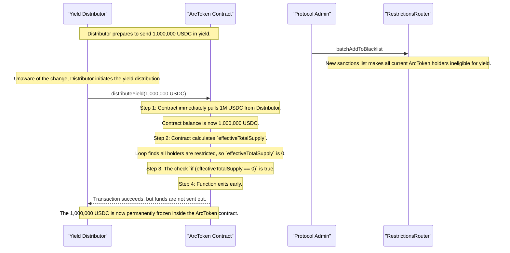

# 49941 sc low permanent freezing of yield tokens due to flawed check in distribution logic

**Submitted on Jul 20th 2025 at 16:52:50 UTC by @perseverance for** [**Attackathon | Plume Network**](https://immunefi.com/audit-competition/plume-network-attackathon)

* **Report ID:** #49941
* **Report Type:** Smart Contract
* **Report severity:** Low
* **Target:** <https://github.com/immunefi-team/attackathon-plume-network/blob/main/arc/src/ArcToken.sol>
* **Impacts:**
  * Permanent freezing of funds

## Description

### Short summary

The `distributeYield` functions in `ArcToken.sol` unconditionally pull yield tokens into the contract before checking for edge case conditions (such as no eligible holders or `effectiveTotalSupply` is 0). If these conditions are met, the functions exit prematurely, leaving the transferred yield tokens permanently locked within the contract, as there is no function to withdraw them. This leads to an irreversible loss of funds for the yield distributor.

### Background Information

The `ArcToken.sol` contract provides functionality to distribute yield tokens (e.g., USDC) to its holders. This is handled by two primary functions: `distributeYield` for a one-shot distribution and `distributeYieldWithLimit` for a paginated distribution to avoid gas limits. Both functions are intended to be called by an account with the `YIELD_DISTRIBUTOR_ROLE`. The core logic involves calculating each holder's share based on their token balance and transferring the yield token to them.

The critical part of the logic is as follows: <https://github.com/immunefi-team/attackathon-plume-network/blob/main/arc/src/ArcToken.sol#L411-L428>

```solidity
// File: arc/src/ArcToken.sol
function distributeYield(
    uint256 amount
) external onlyRole(YIELD_DISTRIBUTOR_ROLE) nonReentrant {
    // ...
    // The funds are transferred IN before any checks
    yToken.safeTransferFrom(msg.sender, address(this), amount);

    uint256 holderCount = $.holders.length();
    
    uint256 holderCount = $.holders.length();
         if (holderCount == 0) { // <-- @audit-issue VULNERABILITY HERE
            emit YieldDistributed(0, yieldTokenAddr);
            return;
        }

        uint256 effectiveTotalSupply = 0;
        for (uint256 i = 0; i < holderCount; i++) {
            address holder = $.holders.at(i);
            if (_isYieldAllowed(holder)) {
                effectiveTotalSupply += balanceOf(holder);
            }
        }

        if (effectiveTotalSupply == 0) { // <-- @audit-issue VULNERABILITY HERE
            emit YieldDistributed(0, yieldTokenAddr);
            return;
        }

    //...
}
```

## The vulnerability

### Vulnerability Details

The vulnerability lies in a critical logic flaw where funds are accepted before verifying that they can be distributed.




### Premature Fund Transfer

The `distributeYield` function immediately executes a `safeTransferFrom` call to pull the entire distribution amount from the caller (`msg.sender`) into the `ArcToken` contract.




### Delayed Sanity Checks

Only after the contract has taken custody of the funds does it perform critical sanity checks. Specifically, it checks if `holders.length()` is zero or if the `effectiveTotalSupply` (the total balance of all holders eligible to receive yield) is zero.




### Early Exit Trap

If either of these edge cases is true (e.g., there are no token holders, or all existing holders are restricted from receiving yield), the function emits an event and returns immediately.




### No Rescue Mechanism

The `ArcToken` contract lacks any administrative function to withdraw arbitrary ERC20 tokens. There is no `recoverERC20` or similar "rescue" function.




### Permanent Freeze

Consequently, the yield tokens that were prematurely transferred into the contract are now trapped. The execution path that would distribute them is never reached, and no other path exists to move them out of the contract. The funds are permanently frozen.



### Note

The function `distributeYieldWithLimit` correctly pulls yield token after the check `effectiveTotalSupply` is 0. The vulnerability exists in `distributeYield` specifically.

## Potential Failure Scenario




### Setup

A fund manager (the Yield Distributor) wants to distribute a large amount of USDC as yield to `ArcToken` holders. There are currently several holders.




### Trigger (Global Restriction Update)

Just before the distribution, an `YIELD_BLACKLIST_ADMIN_ROLE` of the protocol updates `batchAddToBlacklist`. This update inadvertently causes all current `ArcToken` holders to become ineligible to receive yield.




### Distribution Attempt

The Yield Distributor, unaware of the restriction update's full impact, calls `distributeYield(1_000_000 * 1e6)` to distribute $1M USDC.




### The Consequence

* The `distributeYield` function first pulls the 1,000,000 USDC from the distributor into the `ArcToken` contract.
* The function then loops through all holders to calculate `effectiveTotalSupply`. Because every holder is now restricted (`_isYieldAllowed` returns `false` for all), the calculated `effectiveTotalSupply` is `0`.
* The check `if (effectiveTotalSupply == 0)` becomes true.
* The function emits `YieldDistributed(0, yieldTokenAddr)` and `return`s.
  



### Result

The 1,000,000 USDC is now permanently locked inside the `ArcToken` contract. The distributor has lost the funds with no recourse for recovery.



## Severity assessment

**Bug Severity:** Medium

**Impact category:** Critical

* Permanent freezing of funds: although the likelihood is low, the consequence is catastrophic if it occurs. The reporter assesses overall severity as Medium.

## Suggested Fix / Remediation

Follow the logic in `distributeYieldWithLimit`: perform all sanity checks (holders count, effectiveTotalSupply) before pulling tokens from the distributor. Alternatively, add a safe rescue mechanism (e.g., `recoverERC20`) restricted to a governance/admin role to recover tokens accidentally sent to the contract—but only if this is acceptable given the protocol's security model and trust assumptions.

## Proof of Concept

The sequence below illustrates how the Yield Distributor loses their funds.




### Setup

A fund manager (the Yield Distributor) wants to distribute a large amount of USDC as yield to `ArcToken` holders. There are currently several holders.




### Trigger (Global Restriction Update)

Just before the distribution, an `YIELD_BLACKLIST_ADMIN_ROLE` of the protocol updates `batchAddToBlacklist`. This update inadvertently causes all current `ArcToken` holders to become ineligible to receive yield.




### Distribution Attempt

The Yield Distributor, unaware of the restriction update's full impact, calls `distributeYield(1_000_000 * 1e6)` to distribute $1M USDC.




### Consequence

* The `distributeYield` function first pulls the 1,000,000 USDC from the distributor into the `ArcToken` contract.
* The function then loops through all holders to calculate `effectiveTotalSupply`. Because every holder is now restricted (`_isYieldAllowed` returns `false` for all), the calculated `effectiveTotalSupply` is `0`.
* The check `if (effectiveTotalSupply == 0)` becomes true.
* The function emits `YieldDistributed(0, yieldTokenAddr)` and `return`s.
  



### Result

The 1,000,000 USDC is now permanently locked inside the ArcToken contract. The distributor has lost the funds with no recourse for recovery.



<details>

<summary>Mermaid sequence diagram (expand to view)</summary>



</details>
