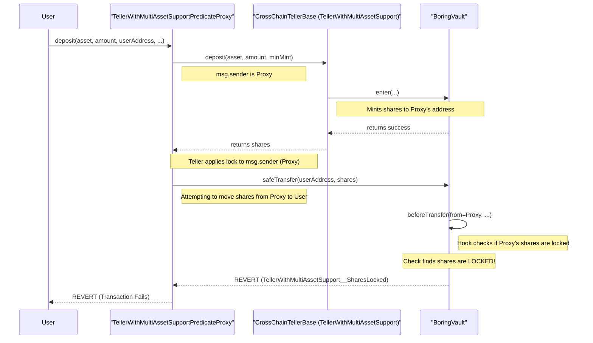

# 51043 sc medium core deposit and depositandbridge functionality in tellerwithmultiassetsupportpredicateproxy is non functional due to flawed sharelockperiod logic

* **Submitted on:** Jul 30th 2025 at 16:54:00 UTC by @perseverance for [Attackathon | Plume Network](https://immunefi.com/audit-competition/plume-network-attackathon)
* **Report ID:** #51043
* **Report Type:** Smart Contract
* **Report severity:** Medium
* **Target:** <https://github.com/immunefi-team/attackathon-plume-network-nucleus-boring-vault/blob/main/src/base/Roles/TellerWithMultiAssetSupportPredicateProxy.sol>

Impacts:

* Smart contract unable to operate due to lack of token funds

## Description

Short summary

The `deposit` function in `TellerWithMultiAssetSupportPredicateProxy.sol` is fundamentally broken and will always fail if a `shareLockPeriod` is active on the underlying `CrossChainTellerBase` contract. The proxy calls `teller.deposit()`, which results in the newly minted shares being time-locked for the proxy itself. The proxy then immediately attempts to transfer these locked shares to the end-user, causing the transaction to revert due to the lock. This makes the proxy-based `deposit` and `depositAndBridge` functionality unusable while a share lock period is active.

The vulnerability

The Plume Network architecture includes a `TellerWithMultiAssetSupportPredicateProxy.sol` contract that acts as an intermediary allowing users to deposit assets into the `BoringVault` indirectly.

The core deposit logic is handled by `TellerWithMultiAssetSupport.sol` (`Teller`), which interacts with `BoringVault.sol`. A key security feature of the `Teller` is the `shareLockPeriod`. When a deposit is made, the newly minted vault shares are locked for the depositor for a specified duration. This is enforced by a `beforeTransfer` hook in `BoringVault.sol` that checks the lock status before any share transfer.

The bug affects both `deposit` and `depositAndBridge`. The flawed interaction occurs within the `deposit` function of the proxy:

```solidity
// File: src/base/Roles/TellerWithMultiAssetSupportPredicateProxy.sol
function deposit(
        ERC20 depositAsset,
        uint256 depositAmount,
        uint256 minimumMint,
        address recipient,
        CrossChainTellerBase teller,
        PredicateMessage calldata predicateMessage
) external nonReentrant returns (uint256 shares) {
    //...
    // [Step 1] Proxy calls teller.deposit(). msg.sender is the proxy contract.
    shares = teller.deposit(depositAsset, depositAmount, minimumMint);

    // [Step 2] The Teller locks the shares for the msg.sender (the proxy).
    
    // [Step 3] Proxy tries to transfer the now-locked shares to the user.
    // THIS CALL WILL FAIL.
    vault.safeTransfer(recipient, shares); 
    //...
}
```

The lock is applied inside `teller.deposit` via an internal call to `_afterPublicDeposit`, which locks shares for its `msg.sender`.

```solidity
// src/base/Roles/TellerWithMultiAssetSupport.sol
 function deposit(
    ERC20 depositAsset,
    uint256 depositAmount,
    uint256 minimumMint
)
    external
    requiresAuth
    nonReentrant
    returns (uint256 shares)
{
    if (isPaused) revert TellerWithMultiAssetSupport__Paused();
    if (!isSupported[depositAsset]) revert TellerWithMultiAssetSupport__AssetNotSupported();

    shares = _erc20Deposit(depositAsset, depositAmount, minimumMint, msg.sender); // @audit msg.sender = TellerWithMultiAssetSupportPredicateProxy 

    _afterPublicDeposit(msg.sender, depositAsset, depositAmount, shares, shareLockPeriod); // @audit msg.sender = TellerWithMultiAssetSupportPredicateProxy 
}
```

```solidity
// src/base/Roles/TellerWithMultiAssetSupport.sol
function _erc20Deposit(
    ERC20 depositAsset,
    uint256 depositAmount,
    uint256 minimumMint,
    address to // @audit to = TellerWithMultiAssetSupportPredicateProxy 
)
    internal
    returns (uint256 shares)
{
    if (depositAmount == 0) revert TellerWithMultiAssetSupport__ZeroAssets();
    shares = depositAmount.mulDivDown(ONE_SHARE, accountant.getRateInQuoteSafe(depositAsset));
    if (shares < minimumMint) revert TellerWithMultiAssetSupport__MinimumMintNotMet();
    vault.enter(msg.sender, depositAsset, depositAmount, to, shares); // @audit to = TellerWithMultiAssetSupportPredicateProxy
}

function _afterPublicDeposit(
    address user,  // @audit user = TellerWithMultiAssetSupportPredicateProxy 
    ERC20 depositAsset,
    uint256 depositAmount,
    uint256 shares,
    uint256 currentShareLockPeriod
)
    internal
{
    shareUnlockTime[user] = block.timestamp + currentShareLockPeriod; // @audit shareUnlockTime[user] = shareUnlockTime[TellerWithMultiAssetSupportPredicateProxy] 

    uint256 nonce = depositNonce;
    publicDepositHistory[nonce] =
        keccak256(abi.encode(user, depositAsset, depositAmount, shares, block.timestamp, currentShareLockPeriod));
    depositNonce++;
    emit Deposit(nonce, user, address(depositAsset), depositAmount, shares, block.timestamp, currentShareLockPeriod);
}
```

After the proxy calls `teller.deposit`, `shareUnlockTime[TellerWithMultiAssetSupportPredicateProxy] = block.timestamp + currentShareLockPeriod`. When the proxy attempts to transfer shares, the vault invokes the `beforeTransfer` hook:

```solidity
// src/base/BoringVault.sol
function transfer(address to, uint256 amount) public override returns (bool) {
    _callBeforeTransfer(msg.sender); // @audit  msg.sender = TellerWithMultiAssetSupportPredicateProxy
    return super.transfer(to, amount);
}

function _callBeforeTransfer(address from) internal view {
    if (address(hook) != address(0)) hook.beforeTransfer(from); // @audit  from = TellerWithMultiAssetSupportPredicateProxy
}
```

And the `beforeTransfer` implementation in the `Teller` reverts when shares are still locked:

```solidity
// src/base/Roles/TellerWithMultiAssetSupport.sol
function beforeTransfer(address from) public view {
    if (shareUnlockTime[from] > block.timestamp) revert TellerWithMultiAssetSupport__SharesAreLocked(); // revert if locked
}
```

Thus, if `shareLockPeriod > 0`, `beforeTransfer` will revert and the proxy cannot forward shares to the user. The same pattern causes `depositAndBridge` to fail because `bridge` calls `beforeTransfer(msg.sender)` before burning shares.

`depositAndBridge` flow:

```solidity
function depositAndBridge(
    ERC20 depositAsset,
    uint256 depositAmount,
    uint256 minimumMint,
    BridgeData calldata data
)
    external
    payable
    requiresAuth
    nonReentrant
{
    if (!isSupported[depositAsset]) {
        revert TellerWithMultiAssetSupport__AssetNotSupported();
    }

    uint256 shareAmount = _erc20Deposit(depositAsset, depositAmount, minimumMint, msg.sender); // @audit msg.sender = TellerWithMultiAssetSupportPredicateProxy
    _afterPublicDeposit(msg.sender, depositAsset, depositAmount, shareAmount, shareLockPeriod); // @audit msg.sender = TellerWithMultiAssetSupportPredicateProxy
    bridge(shareAmount, data);
}
```

`bridge` calls `beforeTransfer(msg.sender)` and will revert because the proxy's shares are locked:

```solidity
// src/base/Roles/CrossChain/CrossChainTellerBase.sol
function bridge(
    uint256 shareAmount,
    BridgeData calldata data
)
    public
    payable
    requiresAuth
    returns (bytes32 messageId)
{
    if (isPaused) revert TellerWithMultiAssetSupport__Paused();

    _beforeBridge(data);

    // Since shares are directly burned, call `beforeTransfer` to enforce before transfer hooks.
    beforeTransfer(msg.sender); // @audit-issue -> reverts when shareUnlockTime[msg.sender] > block.timestamp

    // Burn shares from sender
    vault.exit(address(0), ERC20(address(0)), 0, msg.sender, shareAmount);

    messageId = _bridge(shareAmount, data);
    _afterBridge(shareAmount, data, messageId);
}
```

Severity assessment

* Bug Severity: Medium
* Impact category: Medium — Smart contract unable to operate due to lack of token funds. This renders a primary feature of the proxy unusable while share lock periods are active.

Suggested Fix / Remediation

The proxy deposit mechanism must ensure the lock is applied to the final recipient (user), not the intermediary proxy (msg.sender). Concretely, the `Teller` should be made aware of the intended recipient for locking (for example by exposing a deposit API that takes a recipient argument and applies the lock to that recipient), or the proxy should deposit on behalf of the recipient such that `msg.sender` in the `Teller` is the final recipient. The locking logic should lock the user who receives the shares rather than the proxy address.

Proof of Concept (conceptual)

This scenario demonstrates how standard protocol operation leads to a denial of service for a core feature.




### Setup

A protocol administrator sets `shareLockPeriod` to 1 hour on the `CrossChainTellerBase` contract.




### User action

A user calls the proxy:

deposit(WETH, 10e18, 0, userAddress, ...) on `TellerWithMultiAssetSupportPredicateProxy`.




### Sequence

* Proxy pulls 10 WETH from the user.
* Proxy calls `teller.deposit()`. The `BoringVault` mints shares and sends them to the proxy contract.
* The `Teller` marks the proxy's new shares as locked for 1 hour.
* The proxy immediately tries to `safeTransfer` the new shares to `userAddress`.
* The `beforeTransfer` hook checks the proxy's lock and reverts because the proxy's shares are locked.
  



### Result

The user's transaction fails and gas is lost. The proxy's deposit functionality cannot be used while `shareLockPeriod > 0`.



Sequence diagram (illustrative):



References (code locations)

* Proxy: <https://github.com/immunefi-team/attackathon-plume-network-nucleus-boring-vault/blob/main/src/base/Roles/TellerWithMultiAssetSupportPredicateProxy.sol>
* Teller deposit + lock: <https://github.com/immunefi-team/attackathon-plume-network-nucleus-boring-vault/blob/main/src/base/Roles/TellerWithMultiAssetSupport.sol>
* Vault hooks: <https://github.com/immunefi-team/attackathon-plume-network-nucleus-boring-vault/blob/main/src/base/BoringVault.sol>
* Bridge flow: <https://github.com/immunefi-team/attackathon-plume-network-nucleus-boring-vault/blob/main/src/base/Roles/CrossChain/CrossChainTellerBase.sol>

(End of report)
