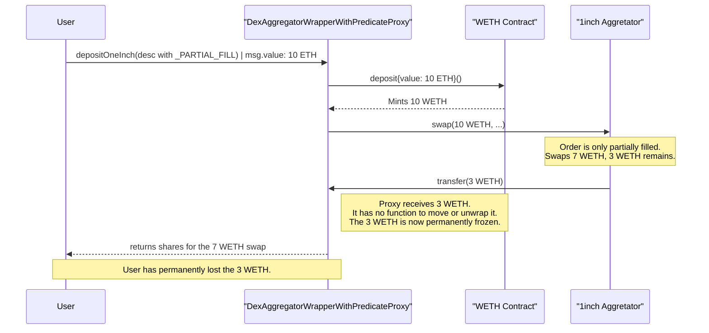

# 51283 sc critical permanent freeze of user token due to unhandled partial fill refunds for swap via 1inch in dexaggregatorwrapperwithpredicateproxy&#x20;

**Submitted on Aug 1st 2025 at 12:08:18 UTC by @perseverance for** [**Attackathon | Plume Network**](https://immunefi.com/audit-competition/plume-network-attackathon)

* **Report ID:** #51283
* **Report Type:** Smart Contract
* **Report severity:** Critical
* **Target:** <https://github.com/immunefi-team/attackathon-plume-network-nucleus-boring-vault/blob/main/src/helper/DexAggregatorWrapperWithPredicateProxy.sol>
* **Impacts:** Permanent freezing of funds

## Description

Short summary

The `DexAggregatorWrapperWithPredicateProxy.sol` contract is vulnerable to a permanent freeze of user funds when interacting with the 1inch DEX aggregator. If a user initiates a swap using the `depositOneInch` or `depositAndBridgeOneInch` function and includes the `_PARTIAL_FILL` flag in the swap parameters, any unspent token refunded by 1inch is sent back to the proxy contract. The proxy contract has no mechanism to withdraw, unwrap, or transfer this returned token, causing the user's funds to be permanently and irreversibly locked within the contract.

## The vulnerability

The core issue is that `depositOneInch` / `depositAndBridgeOneInch` do not account for 1inch's partial-fill refund behavior. When `_PARTIAL_FILL` is set in `AggregationRouterV6.SwapDescription`, the 1inch router refunds unused source tokens to `msg.sender`. In this integration, `msg.sender` is the proxy contract. The proxy:

* receives the refunded ERC20 (e.g., WETH),
* has no function to unwrap WETH to ETH,
* has no generic sweep/transfer for arbitrary ERC20 tokens,
* does not forward the refunded token back to the user.

Consequently, refunded tokens remain trapped in the proxy contract permanently.

Relevant contract locations:

* Proxy: <https://github.com/immunefi-team/attackathon-plume-network-nucleus-boring-vault/blob/main/src/helper/DexAggregatorWrapperWithPredicateProxy.sol>
* 1inch Aggregation router: <https://etherscan.io/address/0x111111125421ca6dc452d289314280a0f8842a65#code>

Vulnerable excerpt from `depositOneInch`:

```solidity
function depositOneInch(
        ERC20 supportedAsset,
        TellerWithMultiAssetSupport teller,
        uint256 minimumMint,
        address executor,
        AggregationRouterV6.SwapDescription calldata desc,
        bytes calldata data,
        uint256 nativeValueToWrap,
        PredicateMessage calldata predicateMessage
    )
        external
        payable  
        nonReentrant
        returns (uint256 shares)
    {
        _checkPredicateProxy(predicateMessage);
        uint256 supportedAssetAmount =
            _oneInchHelper(supportedAsset, address(teller), executor, desc, data, nativeValueToWrap); // @audit call _oneInchHelper
    
    } 
```

Vulnerable excerpt from `_oneInchHelper`:

```solidity
function _oneInchHelper(
        ERC20 supportedAsset,
        address teller,
        address executor,
        AggregationRouterV6.SwapDescription calldata desc,
        bytes calldata data,
        uint256 nativeValueToWrap
    )
{

    if (useNative) {
            // Ensure desc.srcToken matches canonicalWrapToken address
            if (address(desc.srcToken) != address(canonicalWrapToken) || desc.amount != nativeValueToWrap) {
                revert DexAggregatorWrapper__InvalidSwapDescription();
            }
            // Use standard approve (as requested) - potential risk if WETH impl changes non-standardly
            canonicalWrapToken.approve(address(aggregator), nativeValueToWrap); // @audit approve token to aggregator to transferFrom the proxy contract 
        } else {
            ERC20 depositAsset = desc.srcToken; // Assumes desc.srcToken is ERC20 type
            uint256 depositAmount = desc.amount;

            // Use safeTransferFrom
            depositAsset.safeTransferFrom(msg.sender, address(this), depositAmount);

            // Approve agregator to take tokens from this contract
            depositAsset.safeApprove(address(aggregator), depositAmount); // @audit approve token to aggregator to transferFrom the proxy contract 
        }

        // Perform swap
        (supportedAssetAmount,) = aggregator.swap(executor, desc, data); // @audit-issue Call OneInch Aggregator to swap. But not handle the refund token in case _PARTIAL_FILL is used 

}
```

1inch refund logic (relevant excerpt from AggregationRouterV6):

```solidity
function swap(
    IAggregationExecutor executor,
    SwapDescription calldata desc,
    bytes calldata data
)
    external
    payable
    whenNotPaused()
    returns (
        uint256 returnAmount,
        uint256 spentAmount
    )
{
    // ... 
    
    returnAmount = _execute(executor, msg.sender, desc.amount, data); // @audit perform swap 
    spentAmount = desc.amount;
    // When _PARTIAL_FILL is enabled, unused srcToken is sent back to msg.sender
    if (desc.flags & _PARTIAL_FILL != 0) {
        uint256 unspentAmount = srcToken.uniBalanceOf(address(this));
        if (desc.flags & _PARTIAL_FILL != 0) {
                uint256 unspentAmount = srcToken.uniBalanceOf(address(this));
                if (unspentAmount > 1) {
                    // we leave 1 wei on the router for gas optimisations reasons
                    unchecked { unspentAmount--; }
                    spentAmount -= unspentAmount;
                    srcToken.uniTransfer(payable(msg.sender), unspentAmount); // @audit-issue 'msg.sender' is the Proxy contract . So the token is refunded to the DexAggregatorWrapperWithPredicateProxy contract 
                }
                if (returnAmount * desc.amount < desc.minReturnAmount * spentAmount) revert RouterErrors.ReturnAmountIsNotEnough(returnAmount, desc.minReturnAmount * spentAmount / desc.amount);
            } 
        else {
                if (returnAmount < desc.minReturnAmount) revert RouterErrors.ReturnAmountIsNotEnough(returnAmount, desc.minReturnAmount);
            }
    }
    // ...
}
```

Because the router refunds the unused srcToken to `msg.sender` (the proxy contract), any unspent WETH / depositAsset is transferred to the proxy and becomes irrecoverable given the proxy's missing recovery/unwrapping logic.

Severity assessment


Bug Severity: Critical

Impact: Permanent freezing of funds. The refunded tokens (e.g., WETH) become permanently trapped in the proxy contract with no recovery mechanism.


Suggested remediation


The function should detect and forward any refunded source token (including WETH) back to the user (or otherwise provide a recovery path). Possible mitigations include:

* After the `aggregator.swap(...)` call, check the proxy contract's balance of the source token and transfer any excess back to the user.
* Provide a controlled admin or user-facing sweep/withdraw function for arbitrary ERC20s (with appropriate access controls and safety checks).
* If WETH is used, provide an unwrap flow to convert any returned WETH to ETH and refund to the user.
* Disallow `_PARTIAL_FILL` flag in `desc.flags` when calling 1inch from the proxy if proper handling is not implemented.
  

## Proof of Concept (Conceptual)

This scenario demonstrates the permanent loss of funds.




### Step

User's Action: A user ("Victim") wants to swap 10 ETH for USDC, but is willing to accept a partial fill. They call `depositOneInch` with `desc` including the `_PARTIAL_FILL` flag and send `msg.value = 10 ether`.




### Step

Proxy's Action: The `DexAggregatorWrapperWithPredicateProxy` receives 10 ETH, wraps it into 10 WETH (if using native flow), and calls the 1inch aggregator `swap`.




### Step

1inch Action: The 1inch aggregator partially fills 7 WETH -> USDC and, because `_PARTIAL_FILL` is set, refunds the remaining 3 WETH to `msg.sender` (the proxy contract).




### Step

Consequence: The proxy contract now holds 3 WETH. The proxy has no function to unwrap or transfer this WETH back to the user or elsewhere. The 3 WETH is permanently trapped.




### Step

Result: The user receives shares corresponding to the 7 WETH swap, but the 3 WETH is permanently lost.



Sequence diagram (mermaid):



References

* 1inch Aggregation router contract: <https://etherscan.io/address/0x111111125421ca6dc452d289314280a0f8842a65#code>
* Proxy contract: <https://github.com/immunefi-team/attackathon-plume-network-nucleus-boring-vault/blob/main/src/helper/DexAggregatorWrapperWithPredicateProxy.sol>

(End of report)
