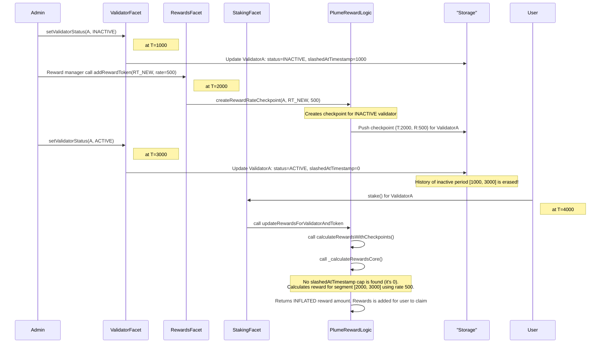

# 51999 sc high logical flaw in validator reactivation and addrewardtoken allows claiming rewards for validators in inactive periods

**Submitted on Aug 7th 2025 at 07:55:52 UTC by @perseverance for** [**Attackathon | Plume Network**](https://immunefi.com/audit-competition/plume-network-attackathon)

* **Report ID:** #51999
* **Report Type:** Smart Contract
* **Report severity:** High
* **Target:** <https://github.com/immunefi-team/attackathon-plume-network/blob/main/plume/src/facets/RewardsFacet.sol>
* **Impacts:**
  * Theft of unclaimed yield

## Description

### Short summary

A logical flaw in the validator status lifecycle allows a validator to earn rewards for periods when it was inactive. When an inactive validator is reactivated, the system erases the record of its downtime (`slashedAtTimestamp`). If a new reward token was introduced during this inactive period, the validator can subsequently claim rewards for that downtime, breaking the protocol's core invariant that only active validators are rewarded. This leads to an unfair dilution of rewards for honest participants.

### The vulnerability

The vulnerability arises from the interaction of two operations which together break reward accounting integrity.




### RewardsFacet.addRewardToken creates checkpoints for inactive validators

`RewardsFacet.addRewardToken` iterates through all `validatorIds` to create a new reward rate checkpoint but does not check the validator's current status. It creates reward checkpoints even for inactive validators.

Reference: <https://github.com/immunefi-team/attackathon-plume-network/blob/main/plume/src/facets/RewardsFacet.sol#L192-L196>

Code excerpt:

```solidity
uint16[] memory validatorIds = $.validatorIds;
for (uint256 i = 0; i < validatorIds.length; i++) {
    uint16 validatorId = validatorIds[i];
    // @audit-issue No check for validator status. Creates checkpoint even for inactive validators.
    PlumeRewardLogic.createRewardRateCheckpoint($, token, validatorId, initialRate);
}
```

This sets up a positive reward rate checkpoint for validators that should not be earning rewards.




### ValidatorFacet clears slashedAtTimestamp upon reactivation

When a validator transitions from `INACTIVE` to `ACTIVE`, its `slashedAtTimestamp` is reset to `0` (unless explicitly slashed). This erases the on-chain evidence of the validator's prior inactive period.

Reference: <https://github.com/immunefi-team/attackathon-plume-network/blob/main/plume/src/facets/ValidatorFacet.sol#L291-L304>

Code excerpt (inside `setValidatorStatus`):

```solidity
// If going ACTIVE: reset timestamps and clear the timestamp cap
if (newActiveStatus && !currentStatus) {
    // Create a new checkpoint to restore the reward rate, signaling activity resumes
    for (uint256 i = 0; i < rewardTokens.length; i++) {
        address token = rewardTokens[i];
        $.validatorLastUpdateTimes[validatorId][token] = block.timestamp;
        uint256 currentGlobalRate = $.rewardRates[token];
        PlumeRewardLogic.createRewardRateCheckpoint($, token, validatorId, currentGlobalRate);
    }
    // Clear the timestamp since validator is active again (unless actually slashed)
    if (!validator.slashed) {
        validator.slashedAtTimestamp = 0; // @audit-issue Erases the history of the inactive period.
    }
}
```

This removes the cap that would normally prevent rewards from being computed for the inactive interval.




### Reward calculation is memoryless with respect to erased downtime

`PlumeRewardLogic.calculateRewardsWithCheckpoints` (and `_calculateRewardsCore`) rely on `slashedAtTimestamp` to cap effective reward end time. Because reactivation cleared `slashedAtTimestamp`, there is no memory of the inactive period and reward calculation will include checkpoints created while the validator was inactive.

Relevant flow (calls that lead to reward calculation):

```
updateRewardsForValidator ==> updateRewardsForValidatorAndToken ==> calculateRewardsWithCheckpoints ==> _calculateRewardsCore
```

References and excerpts: <https://github.com/immunefi-team/attackathon-plume-network/blob/main/plume/src/lib/PlumeRewardLogic.sol#L112-L119>

```solidity
function updateRewardsForValidatorAndToken(
    PlumeStakingStorage.Layout storage $,
    address user,
    uint16 validatorId,
    address token
) internal {
    (uint256 userRewardDelta,,) =
        calculateRewardsWithCheckpoints($, user, validatorId, token, userStakedAmount); // @audit calculateRewardsWithCheckpoints will call _calculateRewardsCore to calculate rewards 

    if (userRewardDelta > 0) {
        $.userRewards[user][validatorId][token] += userRewardDelta; // @audit userRewardDelta is added for user to claim 
        $.totalClaimableByToken[token] += userRewardDelta;
        $.userHasPendingRewards[user][validatorId] = true;
    }
}
```

and

<https://github.com/immunefi-team/attackathon-plume-network/blob/main/plume/src/lib/PlumeRewardLogic.sol#L262-L279>

```solidity
function _calculateRewardsCore(
    PlumeStakingStorage.Layout storage $,
    address user,
    uint16 validatorId,
    address token,
    uint256 userStakedAmount,
    uint256 currentCumulativeRewardPerToken
)
{ 
    // Then check validator slash/inactive timestamp
    if (validator.slashedAtTimestamp > 0) {  // @audit In case reactivation, the slashedAtTimestamp = 0 so there is no memory about inactive period. 
        if (validator.slashedAtTimestamp < effectiveEndTime) {
            effectiveEndTime = validator.slashedAtTimestamp;
        }
    }

    // If no time has passed or user hasn't earned anything yet (e.g. paid index is already current)
    if (
        effectiveEndTime <= lastUserRewardUpdateTime
            || currentCumulativeRewardPerToken <= lastUserPaidCumulativeRewardPerToken
    ) {
        return (0, 0, 0);
    }

    effectiveTimeDelta = effectiveEndTime - lastUserRewardUpdateTime; // This is the total duration of interest

    uint256[] memory distinctTimestamps =
        getDistinctTimestamps($, validatorId, token, lastUserRewardUpdateTime, effectiveEndTime); // @audit the system will get all the checkpoints from lastUserRewardUpdateTime to effectiveEndTime including the inactive period . In this case the lastUserRewardUpdateTime is before the time the validator become inactive. 
}
```

Because the `slashedAtTimestamp` is zeroed, the reward calculation will process checkpoints (including those created while the validator was inactive) and therefore can grant rewards for that inactive period.



This bug impacts functions that call `updateRewardsForValidator`, such as:

* stake() ==> \_performStakeSetup ==> updateRewardsForValidator
* stakeOnBehalf() ==> \_performStakeSetup ==> updateRewardsForValidator
* restake() ==> \_performStakeSetup ==> updateRewardsForValidator
* restakeRewards() ==> \_performStakeSetup ==> updateRewardsForValidator

### Severity assessment

* Bug Severity: High
* Impact category:
  * Theft of unclaimed yield
  * Loss of yield for other stakers

Reason: Violates the protocol invariant that only active validators accrue rewards. Allows illegitimate claims for inactive periods, diluting rewards for honest participants. The issue does not revert and results in silent financial leakage. Given many validators and reward tokens, the scenario of adding a reward token while a validator is inactive is plausible.

## Suggested Fix / Remediation

The most direct and secure fix is to prevent reward checkpoints from being created for inactive validators in `RewardsFacet.addRewardToken`. Add a status check before creating a checkpoint so that only active validators receive the new checkpoint.

Proposed change:

```solidity
// In plume/src/facets/RewardsFacet.sol
function addRewardToken(address token, uint256 initialRate) external onlyRole(PlumeRoles.ADMIN_ROLE) {
    // ... (existing logic) ...
    uint16[] memory validatorIds = $.validatorIds;
    for (uint256 i = 0; i < validatorIds.length; i++) {
        uint16 validatorId = validatorIds[i];

        // ---- PROPOSED FIX START ----
        if ($.validators[validatorId].active) {
        // ---- PROPOSED FIX END ----

            PlumeRewardLogic.createRewardRateCheckpoint($, token, validatorId, initialRate);
        
        // ---- PROPOSED FIX START ----
        }
        // ---- PROPOSED FIX END ----
    }
    // ...
}
```

This ensures `addRewardToken` only affects currently active validators, preventing creation of checkpoints that would allow later reward claims for inactive periods.

## Proof of Concept

<details>

<summary>Proof of concept (Conceptual)</summary>

T\_stake: User stakes with ValidatorA. lastUserRewardUpdateTime is now T\_stake.

1. T=1000 (Admin Action): Admin sets `ValidatorA` to `INACTIVE` using `setValidatorStatus`.
   * State: `ValidatorA.active = false`, `ValidatorA.slashedAtTimestamp = 1000`.
2. T=2000 (REWARD\_MANAGER\_ROLE Action): REWARD\_MANAGER\_ROLE adds a new reward token `RT_NEW` via `addRewardToken` with `initialRate = 500`.
   * Vulnerable Action: A new checkpoint `{T:2000, R:500}` is created and pushed to `ValidatorA`'s checkpoint array, despite it being inactive.
3. T=3000 (Admin Action): Admin reactivates `ValidatorA`.
   * State Corruption: `ValidatorA.active` becomes `true`. `ValidatorA.slashedAtTimestamp` is reset to `0`.
   * A new checkpoint `{T:3000, R:800}` (currentGlobalRate at T=3000) is created.
   * The system has now lost the memory of the inactive period `[1000,3000]`.
4. T=4000 (User Action): A staker for `ValidatorA` triggers a stake or other action that calls reward update/claim.
   * `_calculateRewardsCore` runs:
     * Finds `slashedAtTimestamp == 0`, so no end-time cap for inactivity.
     * Processes checkpoints between lastUserRewardUpdateTime and effectiveEndTime, including `{T:2000, R:500}`.
     * Calculates rewards for segment `[2000,3000]` using rate `500`.

Consequence: The staker (and through commission the validator) claims rewards for the inactive period — funds that should not have been earned — diluting the pool for honest participants.

</details>

## Sequence Diagram



***

If you want, I can:

* Draft a minimal patch/PR diff for `RewardsFacet.addRewardToken` showing the proposed change in context, or
* Suggest additional defensive changes (e.g., preserve `slashedAtTimestamp` history or use an explicit validator-status-aware checkpointing approach) while keeping behavior auditable.
