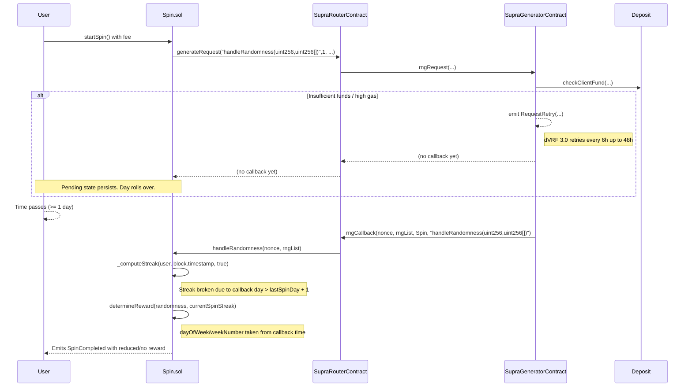

# 52339 sc low loss of daily streak and jackpot eligibility due to supra generator callback delay and on callback time usage in spin sol&#x20;

**Submitted on Aug 10th 2025 at 00:55:23 UTC by @perseverance for** [**Attackathon | Plume Network**](https://immunefi.com/audit-competition/plume-network-attackathon)

* **Report ID:** #52339
* **Report Type:** Smart Contract
* **Report severity:** Low
* **Target:** <https://github.com/immunefi-team/attackathon-plume-network/blob/main/plume/src/spin/Spin.sol>
* **Impacts:** Theft of unclaimed yield

## Description

Short summary

When a user initiates a spin, the contract does not pin the request time for the user’s streak state. Instead, both the streak computation and jackpot/day-of-week logic are evaluated at the time the oracle callback arrives. Supra Generator can delay the callback or the callback might fail due to lack of fees for the Spin/Raffle system. For Supra dVRF 3.0, callbacks can legitimately be delayed (automatic retries up to 48 hours when underfunded), which makes the final evaluation depend on a later `block.timestamp`. This can break a user’s accumulated streak and/or change jackpot thresholds, resulting in missed rewards. Additionally, while pending, users are blocked from spinning again.

The vulnerability

The `Spin` contract computes reward category and the user’s streak at callback time using `block.timestamp`, not the time when the user clicked spin. If the oracle callback is delayed or retried due to insufficient gas funds, the evaluation can occur on a different day or even a different week than the request, breaking the user’s streak or moving jackpot thresholds.

Key code locations

1. Streak and reward are determined on callback, using current `block.timestamp`:

```solidity
// plume_network/attackathon-plume-network/plume/src/spin/Spin.sol:304-321
function handleRandomness(uint256 nonce, uint256[] memory rngList) external onlyRole(SUPRA_ROLE) nonReentrant {
    // ...
    // Compute daily streak and determine reward
    uint256 currentSpinStreak = _computeStreak(user, block.timestamp, true); // @audit-issue compute streak based on the callback time 
    uint256 randomness = rngList[0]; // Use full VRF range
    (string memory rewardCategory, uint256 rewardAmount) = determineReward(randomness, currentSpinStreak);
    // ...
}
```

2. `determineReward` derives jackpot/day-of-week from `block.timestamp` at callback time, not request time:

```solidity
// plume_network/attackathon-plume-network/plume/src/spin/Spin.sol:383-413
function determineReward(uint256 randomness, uint256 streakForReward) internal view returns (string memory, uint256) {
    uint256 probability = randomness % 1_000_000; // Normalize VRF range to 1M

    uint256 daysSinceStart = (block.timestamp - campaignStartDate) / 1 days;
    uint8 weekNumber = uint8(getCurrentWeek());
    uint8 dayOfWeek = uint8(daysSinceStart % 7);

    uint256 jackpotThreshold = jackpotProbabilities[dayOfWeek];

    if (probability < jackpotThreshold) {
        return ("Jackpot", jackpotPrizes[weekNumber]);
    } else if (probability <= rewardProbabilities.plumeTokenThreshold) {
        // ...
    } else if (probability <= rewardProbabilities.raffleTicketThreshold) {
        // ...
    }
    return ("Nothing", 0);
}
```

3. The streak computation depends on the difference in days between `lastSpinTimestamp` and the callback time; if the callback lands after a gap > 1 day, the streak resets:

```solidity
// plume_network/attackathon-plume-network/plume/src/spin/Spin.sol:417-445
function _computeStreak(address user, uint256 nowTs, bool justSpun) internal view returns (uint256) {
    uint256 streakAdjustment = justSpun ? 1 : 0;
    uint256 lastSpinTs = userData[user].lastSpinTimestamp;
    if (lastSpinTs == 0) { return 0 + streakAdjustment; }

    uint256 lastDaySpun = lastSpinTs / SECONDS_PER_DAY;
    uint256 today = nowTs / SECONDS_PER_DAY;

    if (today == lastDaySpun) { return userData[user].streakCount; }
    if (today == lastDaySpun + 1) { return userData[user].streakCount + streakAdjustment; }
    return 0 + streakAdjustment; // broken streak
}
```

4. While a request is pending, users cannot spin again, and canceling requires admin intervention and does not refund nor preserve the streak state tied to the request time:

```solidity
// plume_network/attackathon-plume-network/plume/src/spin/Spin.sol:722-737
function cancelPendingSpin(address user) external onlyRole(ADMIN_ROLE) {
    require(isSpinPending[user], "No spin pending for this user");
    uint256 nonce = pendingNonce[user];
    if (nonce != 0) { delete userNonce[nonce]; }
    delete pendingNonce[user];
    isSpinPending[user] = false;
    // Note: The spin fee is NOT refunded.
}
```

5. On the oracle side, insufficient funds trigger a retry mechanism rather than immediate callback. This is expected in dVRF 3.0 and can introduce hours/days of delay:

<https://vscode.blockscan.com/ethereum/0x343027e1b7fa744679cd2596b2f7b4c823d939b1>

```solidity
// plume_network/eth_0x343027e1b7fa744679cd2596b2f7b4c823d939b1_code/src/SupraGeneratorContract.sol:227-248
if(IDepositContract(depositContract).checkClientFund(_clientWalletAddress) < tx.gasprice * (callbackGasLimit + IDepositContract(depositContract).verificationGasValue())) {
    emit RequestRetry(
        _nonce,
        instanceId,
        _callerContract,
        _func,
        _rngCount,
        _clientSeed,
        _clientWalletAddress,
        block.chainid,
        _requestBlockNumber
    );

    (bool fundsCollected, ) = depositContract.call(abi.encodeCall(IDepositContract.collectFund, (_clientWalletAddress, tx.gasprice * supraMinimumGasPerTx)));
    if(!fundsCollected) {
        revert FailedToCollectFunds();
    }

    return(false, fundsCollected, "");
}
```

Documentation explicitly states dVRF 3.0 retries failed callbacks due to insufficient gas every 6 hours for up to 48 hours, which increases the chance of date/week drifting between request and fulfillment: see “Request Retry Mechanism” in Migration to dVRF 3.0 ([docs.supra.com/dvrf/migration-to-dvrf-3.0](https://docs.supra.com/dvrf/migration-to-dvrf-3.0)).

Severity assessment

* Bug Severity: High
* Impact category: Loss of Yield — Loss/withholding of user rewards, unfair outcome manipulation, DoS of user participation (pending state), missed jackpot eligibility.

Reasoning:

* Impact: Users can lose accumulated streaks and jackpots because evaluation is anchored to callback time. This directly affects user rewards and expected game fairness. If the streak required for a given jackpot is higher (e.g., week 3 requires 5 streaks), losing the streak is more severe and forces the user to start over.
* Likelihood: Underfunded deposits or volatile gas are common; dVRF 3.0 intentionally retries for up to 48h, making delayed callbacks realistic.

Suggested Fix / Remediation

Pin request-time state and decouple reward evaluation from callback time. Concretely:

* Store request timestamp (or precomputed day/week indices and streak snapshot) when the user starts a spin.
* Use the pinned request-time values (request timestamp / request day / week / streak snapshot) in `handleRandomness`, `_computeStreak`, and `determineReward` instead of `block.timestamp`.
* Allow users to re-spin or refund when requests are pending for too long (optional), or ensure pending state preserves request-time streak if a cancel/refund path is used.

Proof of Concept (Conceptual)




### Preconditions

* `campaignStartDate` is set.
* User’s `userData.streakCount = S` and `lastSpinTimestamp` corresponds to day D-1.
  



### T = D, User calls startSpin()

* Contract sets `isSpinPending[user] = true` and sends request to Supra Router.
* No request-time pin of streak/day/week is stored.
  



### Deposit underfunded / gas volatile

* Generator detects insufficient funds and emits `RequestRetry(...)` (see code above); callback is not delivered immediately.
* Per dVRF 3.0 docs, retries may occur every 6h up to 48h.
  



### T = D+1 (callback finally arrives)

* `handleRandomness` computes `currentSpinStreak = _computeStreak(user, block.timestamp, true)`. Since `today > lastDaySpun + 1`, the function returns `1` (broken streak), not `S+1`.
* `determineReward` computes `dayOfWeek` and `weekNumber` from the new `block.timestamp`, which may have different `jackpotThreshold`/prize.
* The user loses their streak and likely loses jackpot eligibility.
  



### Pending state

* While pending, the user cannot start another spin unless an admin calls `cancelPendingSpin`, which does not preserve request-time streak nor refund the fee.
  
  

Sequence diagram



Notes / References

* Target file: <https://github.com/immunefi-team/attackathon-plume-network/blob/main/plume/src/spin/Spin.sol>
* Supra Generator retry logic reference (on-chain): <https://vscode.blockscan.com/ethereum/0x343027e1b7fa744679cd2596b2f7b4c823d939b1>
* dVRF 3.0 docs “Request Retry Mechanism”: <https://docs.supra.com/dvrf/migration-to-dvrf-3.0>

(End of report)
